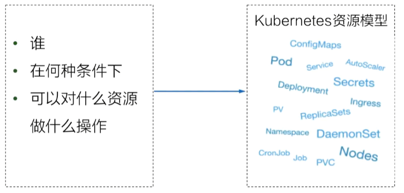
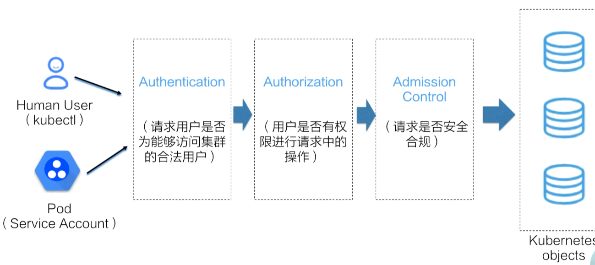
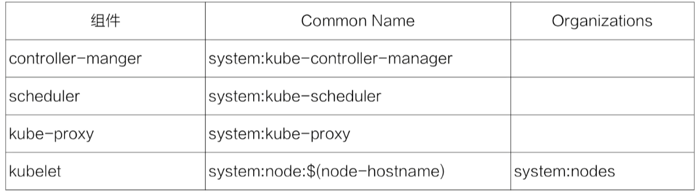

k8s的API请求：

# kubernetes的用户模型

- k8s没有自身的用户管理能力
- k8s中的用户通常是通过请求凭证设置
- 认证方式：

- Basic
- X509证书认证（k8s组件的默认方式）
- Bearer Tokens（JWT，JSON Web Tokens）

## x509证书认证

认证机构：

- 公钥：/etc/kubernetes/pki/ca.crt
- 私钥：/etc/kubernetes/pki/ca.key

集群组件间通信用证书都是由根CA签发

在证书中有两个身份凭证相关的重要字段：

- CommonName（CN）：apiserver在认证过程中将其作为用户user
- Organization（O）：apiserver在认证过程中将其作为组

每一个k8s系统组件在集群创建时都签发了自身对应的客户端证书：

## ServiceAccount认证

- ServiceAccount是k8s中唯一能够通过API方式管理的APIServer访问凭证
- 通常用于Pod中的业务进程与APIServer的交互
- 当一个namespace创建完成后，会同时在该namespace下生成一个名为default的ServiceAccount和对应的Secret实例
- 用户也可以通过API创建其他名称的ServiceAccount，并在该namespace下挂载到运行时的pod中

## 生成kubeconfig

- 下载集群CA
- 使用kubectl添加集群连接信息

`kubectl config set-cluster sandbox --certificate-authority=ca.pem --embed-certs=true --server=https://<目标集群公网地址>:6443`

- 将新的密钥信息加入kubectl配置中

`kubectl config set-credentials dahu --client-certificate=dahu.crt --client-key=dahu.key --embed-certs=true`

- 添加新的context入口到kubectl配置中

`kubectl config set-context sandbox-dahu --cluster=sandbox --user=dahu`

# k8s鉴权-RBAC

- Subject

- Action
- Resource
- namespace

默认拒绝所有访问：deny all

Role：在指定命名空间上配置角色权限，定义在指定的k8s namespace下可以进行哪些操作

RoleBinding：将Role和subject绑定

ClusterRole：定义对集群中所有namespace下资源的操作权限
