# 二叉查找树

二叉查找树（Binary Search Tree，简称BST）是一棵二叉树，它的左子节点的值比父节点的值要小，右节点的值要比父节点的值大。
它的高度决定了它的查找效率。

在理想的情况下，二叉查找树增删查改的时间复杂度为O(log N)（其中N为节点数），最坏的情况下为O(N)。
当它的高度为log N+1时，我们就说二叉查找树是平衡的。

BST存在的主要问题是，插入时会导致树倾斜，不同的插入顺序会导致树的高度不一样，而树的高度直接的影响了树的查找效率。
理想的高度是log N，最坏的情况是所有的节点都在一条斜线上，这样的树的高度为N。

在由N个随机的键构造的BST中，插入和查找命中所需的平均查找次数为2ln N，约为1.39log N。跟有序数组相比，二叉查找树在插入数据时具有更好的灵活性。

## AVL

AVL，指左右子树高度差绝对值不大于1的二叉搜索树。查找、插入和删除在平均和最坏情况下的时间复杂度都是O(log n)。

AVL的缺点是动态插入一个节点后，可能需要多次左旋或右旋来保持AVL的平衡性，代价很大。

## 红黑树与2-3查找树

### 2-3查找树

定义2-3树中每一个节点都具有两个孩子(我们称它为2节点)或三个孩子(我们称它为3节点)。

- 一个2节点包含一个元素和两个孩子(只能包含两个孩子或没有孩子，不能出现有一个孩子的情况)，且与二叉排序树类似，左子树包含的元素小于该元素，
  右子树包含的元素大于该元素。
- 一个3节点包含一小一大两个元素和三个孩子(只能包含三个孩子或没有孩子，不能出现有一个孩子或有两个孩子的情况)。
  如果某个3节点有孩子，左子树包含小于较小元素的元素，右子树包含大于较大元素的元素，中间子树包含介于两元素之间的元素。

示意图：

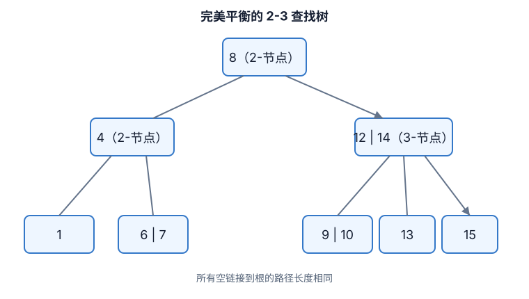

一颗完美平衡的2-3查找树中的所有空链接到根结点的距离都是相同的。

**查找**：类似二叉查找树的查找，只是三节点需要比较的 key 数量为2。

**插入**：

1. 向只有3节点的树插入数据：

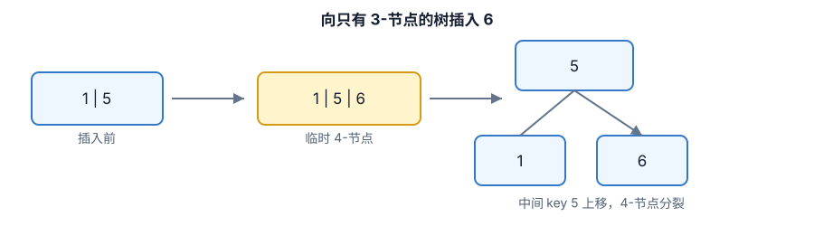

1. 向一个父节点为2节点的3节点中插入数据

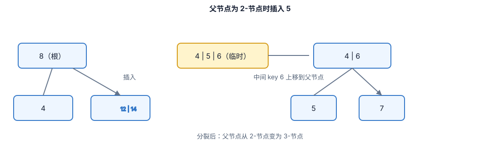

1. 向一个父节点为3节点的3节点中插入数据

不停向上分解临时的4节点，直到达到根节点，如果根节点也是3节点，则执行根节点的分解，提高树高。

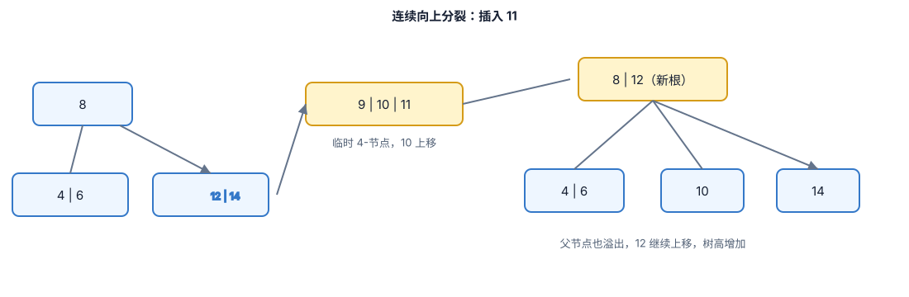

2-3树所做的变换不会影响树的全局有序性和平衡性：任意空链接到根节点的路径长度都是相等的。

2-3树的高度为$\lfloor log_{2}N \rfloor$到$\lfloor log_{3}N \rfloor$之间，
可以保证每次查找的次数小于log~2~N。

### 红黑树

红黑树（Red-Black Tree，RBT）是一种**近似平衡的二叉查找树**。每个节点除了保存 key、value、左右孩子指针外，还保存一个颜色位：`RED` 或 `BLACK`。它把 2-3 树中的“一个 3-节点”编码成二叉树中的“一条红链接”，再用黑链接表示普通的 2-节点连接。

红黑树的核心取舍是：它不追求 AVL 那样严格的高度平衡，而是用更宽松的约束减少更新时的旋转和整体调整。这样既保留了二叉查找树接口，又能把查找、插入、删除的最坏时间复杂度控制在 `O(log n)`。

#### 1. 红黑树与 2-3 树的对应关系

在左倾红黑树（LLRB）的表示中，红链接约定为指向左孩子的链接。把红链接“横向放平”，每个红色孩子与其黑色父节点就合并为一个 3-节点；只沿黑链接向下看，就能得到一棵完美平衡的 2-3 树。

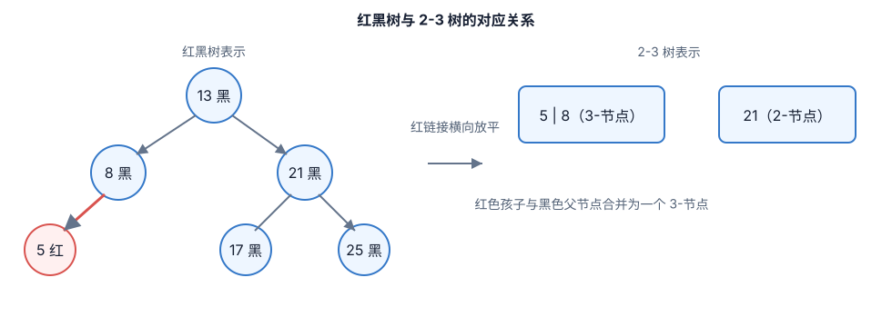

这种对应关系解释了红黑树为什么能够保持平衡：2-3 树的所有空链接到根距离相同，映射回红黑树后，任意根到叶子的路径包含的黑节点数相同。

#### 2. 五条不变量

不同实现对空叶子（`NIL`）的描述略有差异，但经典红黑树通常满足以下规则：

1. 每个节点只能是红色或黑色。
2. 根节点必须是黑色。
3. 所有空叶子（`NIL` 哨兵）视为黑色。
4. 红色节点不能有红色孩子，也就是不能出现连续的红链接。
5. 从任意节点到其所有后代 `NIL` 叶子的路径上，黑色节点数量相同，这个数量称为该节点的**黑高**（black-height）。

规则 4 和规则 5 是平衡的关键。因为红色节点不能连续出现，每条路径上的红节点数量不会超过黑节点数量，所以最长路径不会超过最短路径的两倍。严格地说，若树中有 `n` 个内部节点，则红黑树高度满足：

```text
h <= 2 * log2(n + 1)
```

因此，查找、插入和删除都为 `O(log n)`；空间复杂度为 `O(n)`，每个节点通常只需要额外 1 个颜色位。

#### 3. 查找：和普通 BST 一样

红黑树的查找不需要理解颜色：

1. 将目标 key 与当前节点比较。
2. 目标较小则进入左子树，较大则进入右子树。
3. 相等时返回节点；遇到 `NIL` 时表示不存在。

颜色只参与更新后的平衡修复，因此红黑树可以直接复用普通二叉查找树的 `get`、`contains`、最小值、最大值和中序遍历等操作。中序遍历仍然按 key 的升序输出。

#### 4. 旋转：只改变局部结构，不破坏有序性

旋转是红黑树修复平衡的基本操作。它只调整局部父子关系，不改变中序遍历顺序。例如右旋以 `y` 为轴，把 `y` 的左孩子 `x` 提升，`x` 的右子树 `T2` 成为 `y` 的左子树：

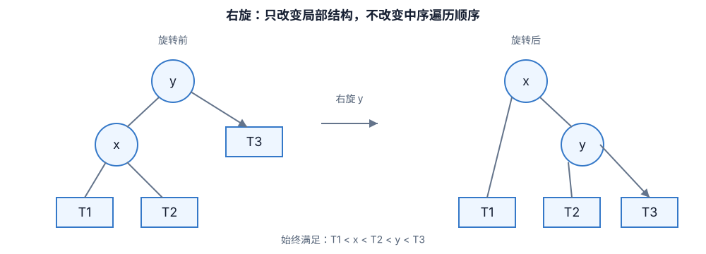

旋转前后都满足：`T1 < x < T2 < y < T3`。左旋完全对称，常用于把“右倾红链接”转为左倾，或把连续的红链接调整到合适位置。

#### 5. 插入：先按 BST 插入，再修复颜色

常见实现把新节点先标为红色。这样不会立刻改变从根到 `NIL` 的黑高，只有在父节点也是红色时才违反规则 4。修复通常围绕三个局部动作展开：**左旋、右旋、变色**。

以左倾红黑树为例，插入后从下向上修复：

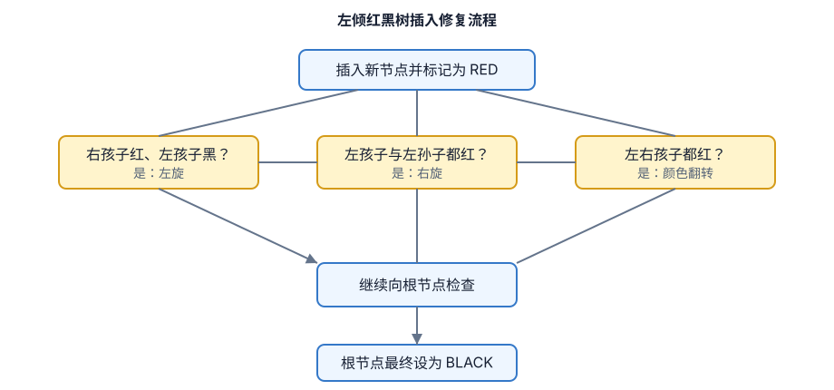

用经典 CLRS 风格的父指针实现时，插入修复通常归纳为三类：

- **叔节点为红色**：父节点和叔节点一起变黑，祖父节点变红，把问题上移。
- **叔节点为黑色，形成折线**：先对父节点旋转，把结构变成直线。
- **叔节点为黑色，形成直线**：对祖父节点旋转，并交换父节点与祖父节点的颜色。

插入修复最多需要常数次旋转，颜色向上调整的次数最多为 `O(log n)`。

#### 6. 删除：先解决“双重黑”

删除比插入复杂，因为直接删除黑节点可能使某条路径的黑高减少 1。工程实现通常先按 BST 删除：若待删节点有两个孩子，用其中序后继（或前驱）覆盖它，再转化为删除至多一个孩子的节点。随后根据被删除节点和替代节点的颜色进行修复。

可以把删除修复理解为处理一个临时的“额外黑色”（double black）：

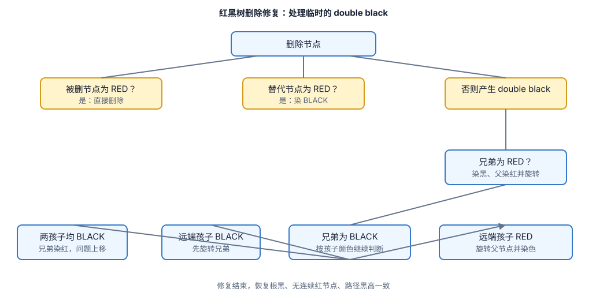

删除修复仍是 `O(log n)`，但分支多、实现更容易出错。因此生产代码通常使用经过充分测试的标准库实现，而不是临时手写删除逻辑。

#### 7. 一个插入过程示例

依次插入 `10、20、30`：

1. 插入 `10`：新节点先为红色，最后将根染黑。
2. 插入 `20`：`20` 为红色，父节点 `10` 为黑色，没有违反规则。
3. 插入 `30`：出现连续红链接 `10 -> 20 -> 30`，属于直线结构。对 `10` 左旋，并交换 `10` 与 `20` 的颜色。

最终得到：

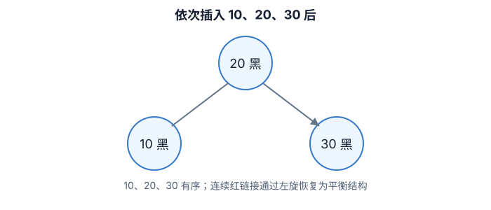

树高从倾斜的 3 层恢复为 2 层，同时中序遍历仍然是 `10、20、30`。

#### 8. 与 AVL 树、普通 BST 的对比

| 结构 | 平衡强度 | 查找最坏复杂度 | 插入/删除调整 | 典型使用场景 |
| --- | --- | --- | --- | --- |
| 普通 BST | 不保证平衡 | `O(n)` | 无额外修复 | 数据近似有序、实现简单 |
| AVL 树 | 严格平衡 | `O(log n)` | 旋转较频繁 | 查找远多于更新 |
| 红黑树 | 近似平衡 | `O(log n)` | 更新成本较均衡 | 通用有序映射/集合 |

红黑树的优势不是“任何情况下都比 AVL 快”，而是在查找性能足够稳定的同时，通常比 AVL 更适合更新较频繁的场景。选择时应结合读写比例、节点大小、缓存局部性和语言标准库实现进行基准测试。

#### 9. 工程实践中的注意事项

- **颜色不是业务属性**：颜色只用于维护结构不变量，不参与 key 的比较。
- **明确重复 key 策略**：可以禁止重复、覆盖 value，或把重复值挂在同一 key 的容器中；不要让重复 key 随意落在左右两侧，否则会破坏实现假设。
- **使用 `NIL` 哨兵或统一空指针约定**：删除修复经常需要读取兄弟、叔节点和孩子的颜色，统一约定可显著减少空指针分支。
- **验证不变量**：测试时可检查根为黑、无连续红节点、所有路径黑高相同，以及中序遍历有序。
- **不要把红黑树和 B+ 树混用**：红黑树适合内存中的有序集合；B/B+ 树通过大节点和低高度减少磁盘或页式存储的随机 I/O。


## B树

在B树中，内部（非叶子）节点可以拥有可变数量的子节点（数量范围预先定义好）。当数据被插入或从一个节点中移除，它的子节点数量发生变化。
为了维持在预先设定的数量范围内，内部节点可能会被合并或者分离。因为子节点数量有一定的允许范围，所以B树不需要像其他自平衡查找树那样频繁地重新保持平衡，
但是由于节点没有被完全填充，可能浪费了一些空间。子节点数量的上界和下界依特定的实现而设置。
例如，在一个2-3 B树（通常简称[2-3树](https://zh.wikipedia.org/wiki/2-3树)），每一个内部节点只能有2或3个子节点。

B树中每一个内部节点会包含一定数量的键，键将节点的子树分开。例如，如果一个内部节点有3个子节点（子树），那么它就必须有两个键： *a*1 和 *a*2 。
左边子树的所有值都必须小于 *a*1 ，中间子树的所有值都必须在 *a*1 和*a*2 之间，右边子树的所有值都必须大于 *a*2 。

一个Ｂ树通过约束所有叶子节点在相同深度来保持平衡。深度在元素添加至树的过程中缓慢增长，而整体深度极少地增长，并导致所有叶子节点与根节点距离加1。

描述一颗B树时需要指定它的阶数，阶数表示了一个节点最多有多少个孩子节点，一般用字母m表示阶数。

m阶B树的定义：

- 每一个节点最多有 *m* 个子节点
- 每一个非叶子节点（除根节点）最少有 ⌈*m*/2⌉ 个子节点
- 如果根节点不是叶子节点，那么它至少有两个子节点
- 有 *k* 个子节点的非叶子节点拥有 *k* − 1 个键
- 所有的叶子节点都在同一层

举个例子来说明一下上面的概念，比如这里有一个5阶的B树，根节点的索引数量范围：1 <= k <= 4，非根节点的索引数量范围：2 <= k <= 4。

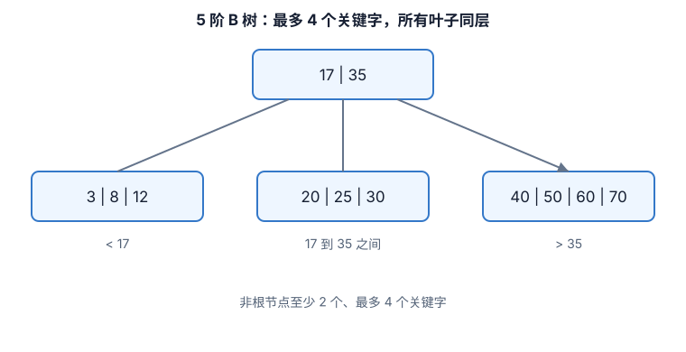

上图是一棵合法的5阶B树：每个节点最多有4个关键字；除根节点外，非根节点至少有2个关键字；节点中的关键字有序，关键字之间的空隙划分出不同子树的取值范围；
所有叶子节点处在同一层。

下面，我们通过一个插入的例子，讲解一下B树的插入过程，接着，再讲解一下删除关键字的过程。

### B树插入

插入的时候，我们需要记住一个规则：**判断当前结点key的个数是否小于等于m-1，如果满足，直接插入即可，如果不满足，
将节点的中间的key将这个节点分为左右两部分，中间的节点放到父节点中即可。**

例子：在5阶B树中，结点最多有4个key,最少有2个key（注意：下面的节点统一用一个节点表示key和value）。

- 插入18，70，50，40


- 插入22


插入22时，发现这个节点的关键字已经大于4了，所以需要进行分裂，分裂的规则在上面已经讲了，分裂之后，如下。


- 接着插入23，25，39

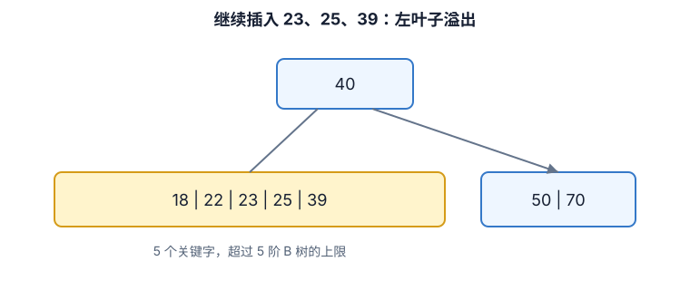

分裂，得到下面的。

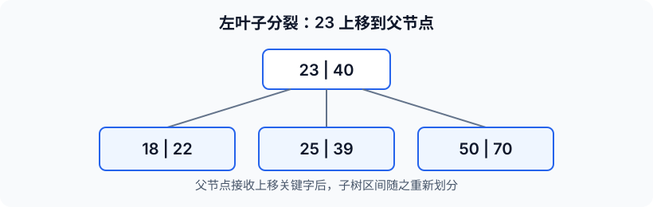

插入过程的核心是“先插入到叶子节点，再自底向上处理溢出”。当节点关键字数超过m - 1时，选择中间关键字上移到父节点，左右两侧关键字分别成为两个子节点。
如果父节点也因此溢出，则继续向上分裂；如果根节点分裂，B树高度增加一层。

### B树的删除操作

- B树初始状态如下：

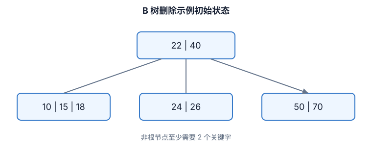

- 删除15，这种情况是删除叶子节点的元素，如果删除之后，节点数仍不低于最小值2个key，这种情况只要直接删除即可。

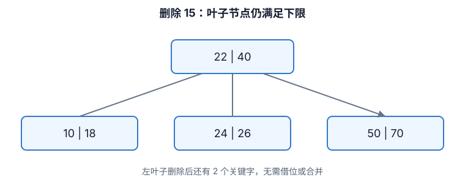

- 接着，我们把22删除，这种情况的规则：22是非叶子节点，**对于非叶子节点的删除，我们需要用后继key（元素）覆盖要删除的key，
  然后在后继key所在的子支中删除该后继key**。对于删除22，需要将后继元素24移到被删除的22所在的节点。

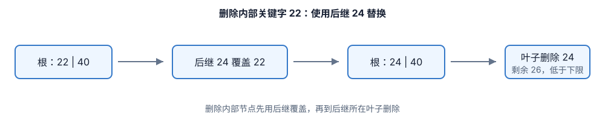

此时发现26所在的节点只有一个元素，小于最少2个key，这个节点不符合要求，这时候的规则（向兄弟节点借元素）：**如果删除叶子节点，
如果删除元素后元素个数少于最小值，并且它的兄弟节点的元素多于最小值，将先将父节点的元素移到该节点，然后将兄弟节点的元素再移动到父节点**。这样就满足要求了。

我们看看操作过程就更加明白了。

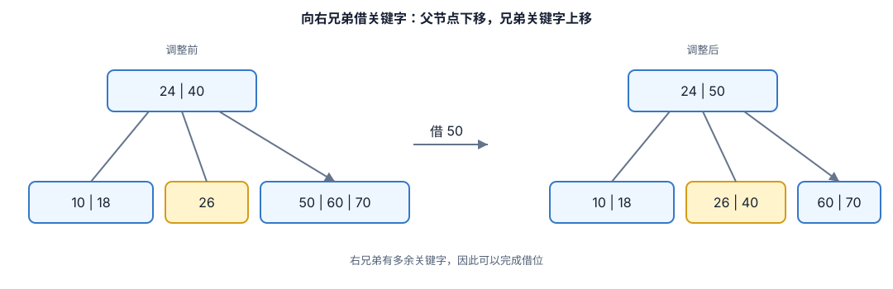

- 接着删除26，**删除叶子节点**，删除后不满足要求，所以，我们需要考虑向兄弟节点借元素，但是，兄弟节点也没有多的节点（2个），借不了，
  怎么办呢？如果遇到这种情况，**首先，还是将先将父节点的元素移到该节点，然后，将当前节点及它的兄弟节点中的key合并，形成一个新的节点**。

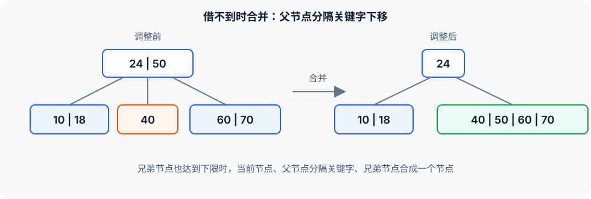

移动之后，跟兄弟节点合并。

删除过程的核心是“先保证将要下降的子节点有足够关键字，再执行删除”。删除叶子节点后仍满足下限时可以直接删除；删除内部节点时通常用前驱或后继关键字替换；
如果删除后节点低于下限，就优先向兄弟节点借关键字，借不到时再与兄弟节点和父节点分隔关键字合并。合并可能让父节点继续低于下限，因此删除也可能向上递归调整。

### 总结

B-树是一种多路搜索树（并不是二叉的），设计的主要思想是减少磁盘访问次数。大多数树操作(增、删、查、最大值、最小值等)都需要都需要O(h)磁盘访问，h为树的高度。
**B-树通过在节点中放置最大可能的键来保持B树的高度较低。** 通常，B-树节点的大小保持与磁盘块大小相等或者是其N倍。
由于B-树的高度较低，因此与B树和平衡的二叉搜索树（如AVL树、红黑树等）相比，大多数操作的磁盘访问次数显著减少。

B树的特性：

1. 关键字集合分布在整颗树中；

2. 任何一个关键字出现且只出现在一个结点中；

3. 搜索有可能在非叶子结点结束；

4. 其搜索性能等价于在关键字全集内做一次二分查找；

5. 自动层次控制；

## B+树

B+树是B-树的变体，也是一种多路搜索树。

1. 其定义基本与B树相同
1. 非叶子结点的子树指针与关键字个数相同
1. 非叶子结点的子树指针`P[i]`，指向关键字值属于
   `[K[i], K[i+1])`的子树（B树是开区间）
1. 为所有叶子结点增加一个链指针
1. 所有关键字都在叶子结点出现

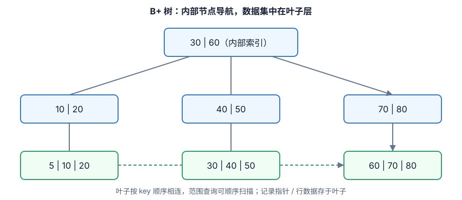

实现动态多级索引时，通常会采用B树和B+树的数据结构。**但是，B树有一个缺点是它将与特定键值对应的数据指针（指向包含键值的磁盘文件块的指针）
以及该键值存储在B树的节点中。该设计大大减少了可压缩到B树节点中的条目数，从而增加了B树中级别数与记录的搜索时间。**

B+树通过仅在树的叶节点处存储数据指针来消除上述B树的缺点，因而B+树的叶节点结构与B树的内部节点结构完全不同。
数据指针在B+树中仅存在于叶节点，因此叶节点必须将所有键值及其对应的数据指针存储到磁盘文件块以便访问。此外，叶节点也用于链接以提供对记录的有序访问。
因此，叶节点才是第一级索引，而内部节点只是索引到其它级别索引的多层索引。叶节点的一些键值也出现在内部节点中，主要是作为简化搜索记录的一种媒介。

**B+树与具有同级的B树相比，同级的B+树可以在其内部节点中存储更多键**，改善对任何给定关键字的搜索时间，
同样的键数B+树级别较低且含指向下一个节点的指针P的存在使B+树在从磁盘访问记录时非常快速有效。
如设B树与B+树某一级别内部节点都有100K的容量，由于B树的节点除了存键和数据指针，所以实际存的键容量连一半50K可能都没有，
但B+树的100K容量都用于存键了，所以索引更高效。

### B树与B+树的区别

1. B树非叶子结点和叶子结点都存储数据,因此查询数据时，时间复杂度最好为O(1),最坏为O(log n)。
B+树只在叶子结点存储数据，非叶子结点存储关键字，且不同非叶子结点的关键字可能重复，因此查询数据时，时间复杂度固定为O(log n)。

2. B+树叶子结点之间用链表相互连接，因而只需扫描叶子结点的链表就可以完成一次遍历操作，B树只能通过中序遍历。

B+树在B-树的基础上加了以下优化：

1. 叶子结点增加了指针进行连接，即叶子结点间形成了链表；

2. 非叶子结点只存关键字key，不再存储数据，只在叶子结点存储数据；

说明：叶子之间用双向链表连接比单向链表连接多出的好处是通过链表中任一结点都可以通过往前或者往后遍历找到链表中指定的其他结点。

这样做的好处是：

1. 范围查询时可以通过访问叶子节点的链表进行有序遍历，而不再需要中序回溯访问结点。

2. 非叶子结点只存储关键字key，一方面这种结构相当于划分出了更多的范围，加快了查询速度，另一方面相当于单个索引值大小变小，同一个页可以存储更多的关键字，
读取单个页就可以得到更多的关键字，可检索的范围变大了，相对IO读写次数就降低了。

### 为什么 B+ 树比 B树更适合应用于数据库索引？

B+树更加适应磁盘的特性，相比B树减少了I/O读写的次数。由于索引文件很大因此索引文件存储在磁盘上，B+树的非叶子结点只存关键字不存数据，
因而单个页可以存储更多的关键字，即一次性读入内存的需要查找的关键字也就越多，磁盘的随机I/O读取次数相对就减少了。

B+树叶子结点之间用链表有序连接，所以扫描全部数据只需扫描一遍叶子结点，利于扫库和范围查询；B树由于非叶子结点也存数据，所以只能通过中序遍历按序来扫。
也就是说，对于范围查询和有序遍历而言，B+树的效率更高。
