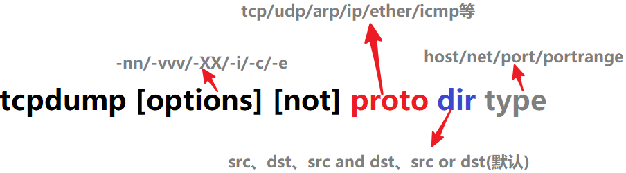
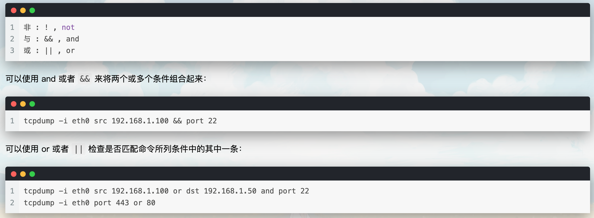
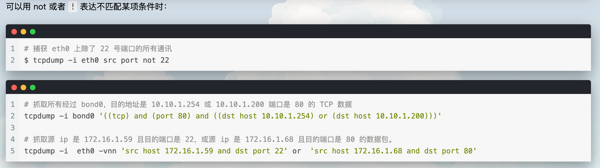

tcpdump是Linux系统中基于libpcap库实现的抓包工具，根据使用者的定义对网络上的数据包进行截获，tcpdump可以将网络中传送的数据包中的”头”完全截获下来提供分析，支持针对网络层、协议、主机、网络或端口的过滤，并提供and、or、not等逻辑语句来帮助去掉无用的信息。通过 tcpdump 可以分析很多网络行为，比如丢包重传、详细报文、tcp分组等。

# 命令格式

```
$ tcpdump [ 选项 ] [ -c 数量 ] [ -i 网络接口 ] [ -w 文件名 ] [ 表达式 ]

# 常见选项如下
-i：指定监听的网络接口
-c：抓包次数
-D: 列出所有可用的网络接口
-n: 禁用域名解析，让 tcpdump 直接输出 IP 地址
-nn：直接以 IP 及 Port Number 显示，而非主机名与服务名称
-v: 会输出稍微详细一点的信息包括校验和 ttl 之类的
-vv: 更详细的信息，比如包括 NFS 的回包信息等
-vvv: 会尝试解析应用层协议，输出详细信息。二者组合就能完整的详细信息
-X: 以 16 进制格式输出数据包的内容, 不加该参数, 会只输出 iptcp/udp 头部信息
-A: 以 ASCII 值显示抓到的包, 比如和 MySQL 的交互时，可以通过 - A 查看包的文本内容
-r：从指定的文件中读取包
-w：输出信息保存到指定文件
-s: 设置每个数据包的大小；抓取数据包时默认抓取长度为 68 字节。加上 - s 0 后可以抓到完整的数据包
-t：在输出的每一行不打印时间戳
-tt: 打印时间戳，以秒为单位，使用格式 2019-02-02 10:37:37, 便于分析
-ttt: 打印时间戳，以微秒为单位，使用格式 2019-02-02 10:37:37.120297, 便于分析
-d：将匹配信息包的代码以人们能够理解的汇编格式给出；
-a：将网络地址显示为名称
```



## type

```
host(缺省类型):	指明一台主机，如：host 10.215.20.13
net: 指定网络地址, net 10.215.20.0
port: 指明端口号, port 3306
portrange: 指明端口范围 ，portrange 22-125
```

## direction

```
dst or src(缺省值)：指定源或者目标地址是 10.215.20.13 的流量包
src: src 10.9.51.13, 指定源地址是 10.9.51.13
dst: dst 172.0.0.0, 指定目标网络地址是 172.0.0.0
dst and src 比如: src 10.9.51.13 and dst 10.215.20.13
```

## protocol

```
协议的关键字：缺省值是监听所有协议的信息包
ip
arp
tcp
udp
icmp
```

## 逻辑运算





```
$ sudo tcpdump -i any -c5 -nn "port 80 and (src 192.168.122.98 or src 54.204.39.132)"
tcpdump: verbose output suppressed, use -v or -vv for full protocol decode
listening on any, link-type LINUX_SLL (Linux cooked), capture size 262144 bytes
10:10:37.602214 IP 192.168.122.98.39346 > 54.204.39.132.80: Flags [S], seq 871108679, win 29200, options [mss 1460,sackOK,TS val 123327951 ecr 0,nop,wscale 7], length 0
10:10:37.650651 IP 54.204.39.132.80 > 192.168.122.98.39346: Flags [S.], seq 854753193, ack 871108680, win 28960, options [mss 1460,sackOK,TS val 522957932 ecr 123327951,nop,wscale 9], length 0
10:10:37.650708 IP 192.168.122.98.39346 > 54.204.39.132.80: Flags [.], ack 1, win 229, options [nop,nop,TS val 123328000 ecr 522957932], length 0
10:10:37.651097 IP 192.168.122.98.39346 > 54.204.39.132.80: Flags [P.], seq 1:113, ack 1, win 229, options [nop,nop,TS val 123328000 ecr 522957932], length 112: HTTP: GET / HTTP/1.1
10:10:37.692900 IP 54.204.39.132.80 > 192.168.122.98.39346: Flags [.], ack 113, win 57, options [nop,nop,TS val 522957942 ecr 123328000], length 0
5 packets captured
5 packets received by filter
0 packets dropped by kernel
```

demo：

```
tcpdump -i bond0 -tttt -s 0 -c 100  tcp and dst port ! 22 
  and src net 10.10.1.0/24 -w 20190131.pcap
```

- tcp: 协议类型，用来过滤数据报的协议类型。
- -i bond0 : 只抓取经过接口 bond0 的包
- -tttt : 使用格式 2019-02-02 10:37:37.120297, 便于分析。
- -s 0: 抓取数据包时默认抓取长度为 68 字节。加上 - s 0 后可以抓到完整的数据包
- -c 100: 只抓取 100 个数据包
- dst port ! 22: 不抓取目标端口是 22 的数据包
- src net 10.10.1.0/24: 数据包的源网络地址为 10.10.1.0/24
- -w 20190131.pcap: 保存成 pcap 文件中, 方便使用 wireshark 分析抓包结果

# 数据抓包

## 列出可以抓包的网络接口

```
$ sudo tcpdump -D
1.eth0
2.virbr0
3.eth1
4.any (Pseudo-device that captures on all interfaces)
5.lo [Loopback]
```

## 对任意接口抓包

```
$ sudo tcpdump -i any
tcpdump: verbose output suppressed, use -v or -vv for full protocol decode
listening on any, link-type LINUX_SLL (Linux cooked), capture size 262144 bytes
09:56:18.293641 IP rhel75.localdomain.ssh > 192.168.64.1.56322: Flags [P.], seq 3770820720:3770820916, ack 3503648727, win 309, options [nop,nop,TS val 76577898 ecr 510770929], length 196
09:56:18.293794 IP 192.168.64.1.56322 > rhel75.localdomain.ssh: Flags [.], ack 196, win 391, options [nop,nop,TS val 510771017 ecr 76577898], length 0
09:56:18.295058 IP rhel75.59883 > gateway.domain: 2486+ PTR? 1.64.168.192.in-addr.arpa. (43)
09:56:18.310225 IP gateway.domain > rhel75.59883: 2486 NXDomain* 0/1/0 (102)
09:56:18.312482 IP rhel75.49685 > gateway.domain: 34242+ PTR? 28.64.168.192.in-addr.arpa. (44)
09:56:18.322425 IP gateway.domain > rhel75.49685: 34242 NXDomain* 0/1/0 (103)
09:56:18.323164 IP rhel75.56631 > gateway.domain: 29904+ PTR? 1.122.168.192.in-addr.arpa. (44)
09:56:18.323342 IP rhel75.localdomain.ssh > 192.168.64.1.56322: Flags [P.], seq 196:584, ack 1, win 309, options [nop,nop,TS val 76577928 ecr 510771017], length 388
09:56:18.323563 IP 192.168.64.1.56322 > rhel75.localdomain.ssh: Flags [.], ack 584, win 411, options [nop,nop,TS val 510771047 ecr 76577928], length 0
09:56:18.335569 IP gateway.domain > rhel75.56631: 29904 NXDomain* 0/1/0 (103)
09:56:18.336429 IP rhel75.44007 > gateway.domain: 61677+ PTR? 98.122.168.192.in-addr.arpa. (45)
09:56:18.336655 IP gateway.domain > rhel75.44007: 61677* 1/0/0 PTR rhel75. (65)
09:56:18.337177 IP rhel75.localdomain.ssh > 192.168.64.1.56322: Flags [P.], seq 584:1644, ack 1, win 309, options [nop,nop,TS val 76577942 ecr 510771047], length 1060
---- SKIPPING LONG OUTPUT -----
09:56:19.342939 IP 192.168.64.1.56322 > rhel75.localdomain.ssh: Flags [.], ack 1752016, win 1444, options [nop,nop,TS val 510772067 ecr 76578948], length 0
^C
9003 packets captured
9010 packets received by filter
7 packets dropped by kernel
```

可以使用-c限制数量：

```
$ sudo tcpdump -i any -c 5
tcpdump: verbose output suppressed, use -v or -vv for full protocol decode
listening on any, link-type LINUX_SLL (Linux cooked), capture size 262144 bytes
11:21:30.242740 IP rhel75.localdomain.ssh > 192.168.64.1.56322: Flags [P.], seq 3772575680:3772575876, ack 3503651743, win 309, options [nop,nop,TS val 81689848 ecr 515883153], length 196
11:21:30.242906 IP 192.168.64.1.56322 > rhel75.localdomain.ssh: Flags [.], ack 196, win 1443, options [nop,nop,TS val 515883235 ecr 81689848], length 0
11:21:30.244442 IP rhel75.43634 > gateway.domain: 57680+ PTR? 1.64.168.192.in-addr.arpa. (43)
11:21:30.244829 IP gateway.domain > rhel75.43634: 57680 NXDomain 0/0/0 (43)
11:21:30.247048 IP rhel75.33696 > gateway.domain: 37429+ PTR? 28.64.168.192.in-addr.arpa. (44)
5 packets captured
12 packets received by filter
0 packets dropped by kernel
```

## 显示IP+port

```
$ sudo tcpdump -i any -c5 -nn
tcpdump: verbose output suppressed, use -v or -vv for full protocol decode
listening on any, link-type LINUX_SLL (Linux cooked), capture size 262144 bytes
23:56:24.292206 IP 192.168.64.28.22 > 192.168.64.1.35110: Flags [P.], seq 166198580:166198776, ack 2414541257, win 309, options [nop,nop,TS val 615664 ecr 540031155], length 196
23:56:24.292357 IP 192.168.64.1.35110 > 192.168.64.28.22: Flags [.], ack 196, win 1377, options [nop,nop,TS val 540031229 ecr 615664], length 0
23:56:24.292570 IP 192.168.64.28.22 > 192.168.64.1.35110: Flags [P.], seq 196:568, ack 1, win 309, options [nop,nop,TS val 615664 ecr 540031229], length 372
23:56:24.292655 IP 192.168.64.1.35110 > 192.168.64.28.22: Flags [.], ack 568, win 1400, options [nop,nop,TS val 540031229 ecr 615664], length 0
23:56:24.292752 IP 192.168.64.28.22 > 192.168.64.1.35110: Flags [P.], seq 568:908, ack 1, win 309, options [nop,nop,TS val 615664 ecr 540031229], length 340
5 packets captured
6 packets received by filter
0 packets dropped by kernel
```

-n显示ip，-nn显示ip+端口

# 抓取内容

```
08:41:13.729687 IP 192.168.64.28.22 > 192.168.64.1.41916: Flags [P.], 
seq 196:568, ack 1, win 309, options [nop,nop,TS val 117964079 ecr 816509256], 
length 372
```

- 第一个字段 08:41:13.729687 是该数据报文被抓取的系统本地时间戳。
- IP 是网络层协议类型，这里是 IPv4，如果是 IPv6 协议，该字段值是 IP6。
- 192.168.64.28.22 是源 ip 地址和端口号，紧跟其后的是目的 ip 地址和其端口号，这里是 192.168.64.1.41916。
- 在源 IP 和目的 IP 之后，可以看到是 TCP 报文标记段 Flags [P.]。该字段通常取值如下：

|   |   |   |
|---|---|---|
|**值**|**标志类型**|**描述**|
|S|SYN|Connection Start 发起连接标志|
|F|FIN|Connection Finish 关闭连接标志|
|P|PUSH|Data push 传送数据标志|
|R|RST|Connection reset 异常关闭连接|
|.|ACK|Acknowledgment 表示确认包|

- 接下来是该数据包中数据的序列号。对于抓取的第一个数据包，该字段值是一个绝对数字，后续包使用相对数值，以便更容易查询跟踪。例如此处 seq 196:568 代表该数据包包含该数据流的第 196 到 568 字节。
- 接下来是 ack 值：ack 1。该数据包是数据发送方，ack 值为 1。在数据接收方，该字段代表数据流上的下一个预期字节数据，例如，该数据流中下一个数据包的 ack 值应该是 568。
- 接下来字段是接收窗口大小 win 309，它表示接收缓冲区中可用的字节数，后跟 TCP 选项如 MSS（最大段大小）或者窗口比例值。更详尽的 TCP 协议内容请参考 Transmission Control Protocol(TCP) Parameters。
- 最后，length 372 代表数据包有效载荷字节长度。这个长度和 seq 序列号中字节数值长度是不一样的。

# 查看数据包内容

tcpdump 提供了两个选项可以查看数据包内容，-X 以十六进制打印出数据报文内容，-A 打印数据报文的 ASCII 值。

```
$ sudo tcpdump -i any -c10 -nn -A port 80
tcpdump: verbose output suppressed, use -v or -vv for full protocol decode
listening on any, link-type LINUX_SLL (Linux cooked), capture size 262144 bytes
13:02:14.871803 IP 192.168.122.98.39366 > 54.204.39.132.80: Flags [S], seq 2546602048, win 29200, options [mss 1460,sackOK,TS val 133625221 ecr 0,nop,wscale 7], length 0
E..<..@.@.....zb6.'....P...@......r............
............................
13:02:14.910734 IP 54.204.39.132.80 > 192.168.122.98.39366: Flags [S.], seq 1877348646, ack 2546602049, win 28960, options [mss 1460,sackOK,TS val 525532247 ecr 133625221,nop,wscale 9], length 0
E..<..@./..a6.'...zb.P..o..&...A..q a..........
.R.W.......     ................
13:02:14.910832 IP 192.168.122.98.39366 > 54.204.39.132.80: Flags [.], ack 1, win 229, options [nop,nop,TS val 133625260 ecr 525532247], length 0
E..4..@.@.....zb6.'....P...Ao..'...........
.....R.W................
13:02:14.911808 IP 192.168.122.98.39366 > 54.204.39.132.80: Flags [P.], seq 1:113, ack 1, win 229, options [nop,nop,TS val 133625261 ecr 525532247], length 112: HTTP: GET / HTTP/1.1
E.....@.@..1..zb6.'....P...Ao..'...........
.....R.WGET / HTTP/1.1
User-Agent: Wget/1.14 (linux-gnu)
Accept: */*
Host: opensource.com
Connection: Keep-Alive
................
13:02:14.951199 IP 54.204.39.132.80 > 192.168.122.98.39366: Flags [.], ack 113, win 57, options [nop,nop,TS val 525532257 ecr 133625261], length 0
E..4.F@./.."6.'...zb.P..o..'.......9.2.....
.R.a....................
13:02:14.955030 IP 54.204.39.132.80 > 192.168.122.98.39366: Flags [P.], seq 1:643, ack 113, win 57, options [nop,nop,TS val 525532258 ecr 133625261], length 642: HTTP: HTTP/1.1 302 Found
E....G@./...6.'...zb.P..o..'.......9.......
.R.b....HTTP/1.1 302 Found
Server: nginx
Date: Sun, 23 Sep 2018 17:02:14 GMT
Content-Type: text/html; charset=iso-8859-1
Content-Length: 207
X-Content-Type-Options: nosniff
Location: https://opensource.com/
Cache-Control: max-age=1209600
Expires: Sun, 07 Oct 2018 17:02:14 GMT
X-Request-ID: v-6baa3acc-bf52-11e8-9195-22000ab8cf2d
X-Varnish: 632951979
Age: 0
Via: 1.1 varnish (Varnish/5.2)
X-Cache: MISS
Connection: keep-alive
<!DOCTYPE HTML PUBLIC "-//IETF//DTD HTML 2.0//EN">
<html><head>
<title>302 Found</title>
</head><body>
<h1>Found</h1>
<p>The document has moved <a href="https://opensource.com/">here</a>.</p>
</body></html>
................
13:02:14.955083 IP 192.168.122.98.39366 > 54.204.39.132.80: Flags [.], ack 643, win 239, options [nop,nop,TS val 133625304 ecr 525532258], length 0
E..4..@.@.....zb6.'....P....o..............
.....R.b................
13:02:15.195524 IP 192.168.122.98.39366 > 54.204.39.132.80: Flags [F.], seq 113, ack 643, win 239, options [nop,nop,TS val 133625545 ecr 525532258], length 0
E..4..@.@.....zb6.'....P....o..............
.....R.b................
13:02:15.236592 IP 54.204.39.132.80 > 192.168.122.98.39366: Flags [F.], seq 643, ack 114, win 57, options [nop,nop,TS val 525532329 ecr 133625545], length 0
E..4.H@./.. 6.'...zb.P..o..........9.I.....
.R......................
13:02:15.236656 IP 192.168.122.98.39366 > 54.204.39.132.80: Flags [.], ack 644, win 239, options [nop,nop,TS val 133625586 ecr 525532329], length 0
E..4..@.@.....zb6.'....P....o..............
.....R..................
10 packets captured
10 packets received by filter
0 packets dropped by kernel
```
