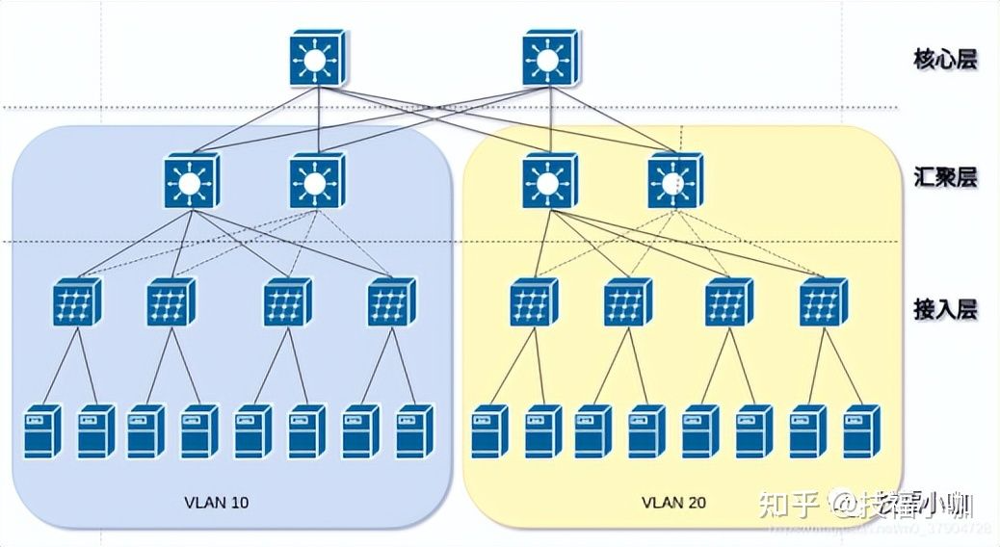
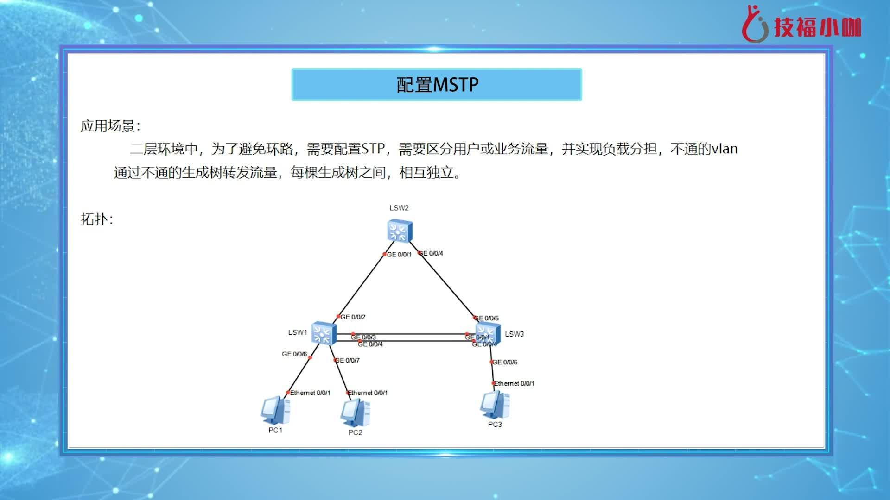
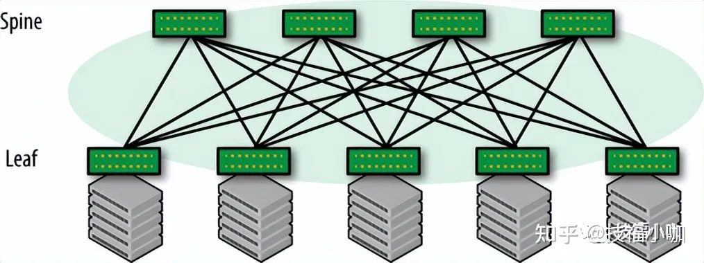
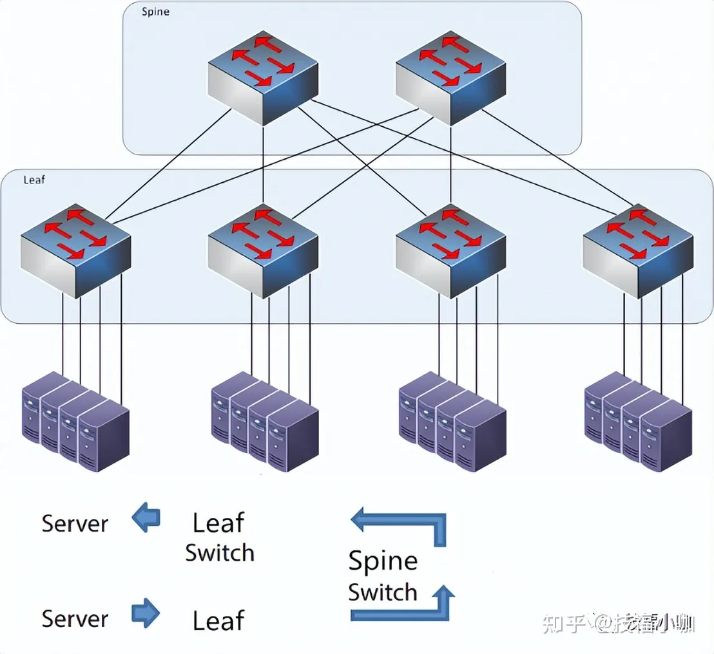
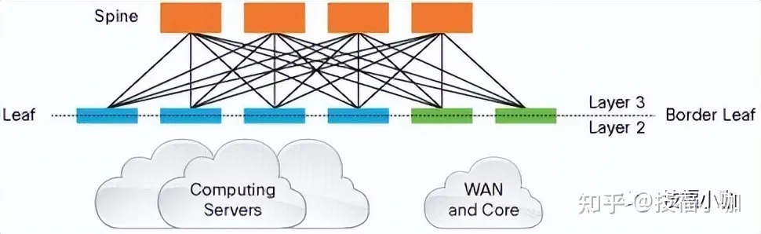
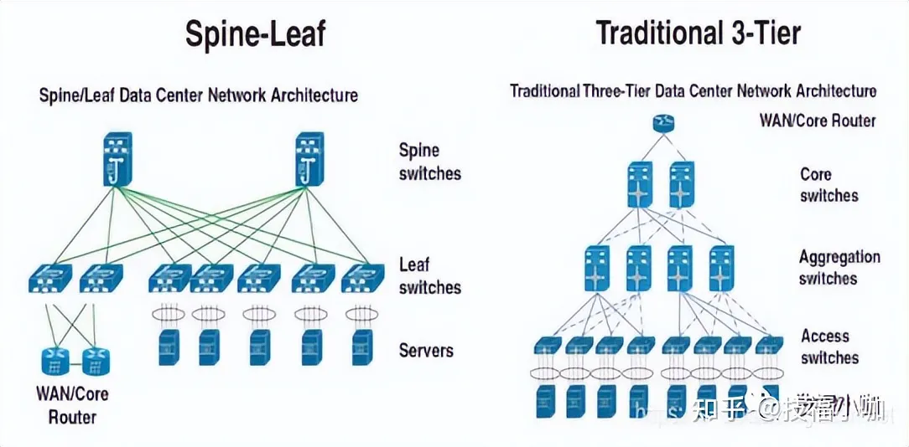
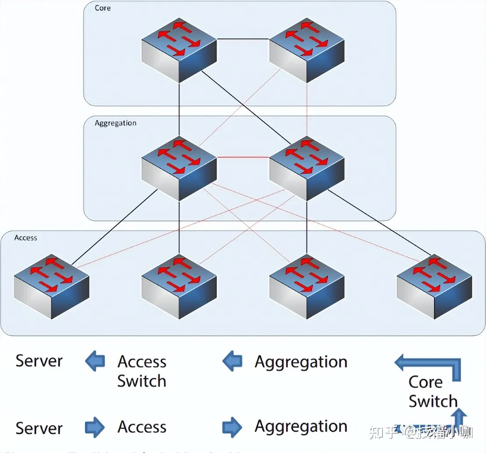
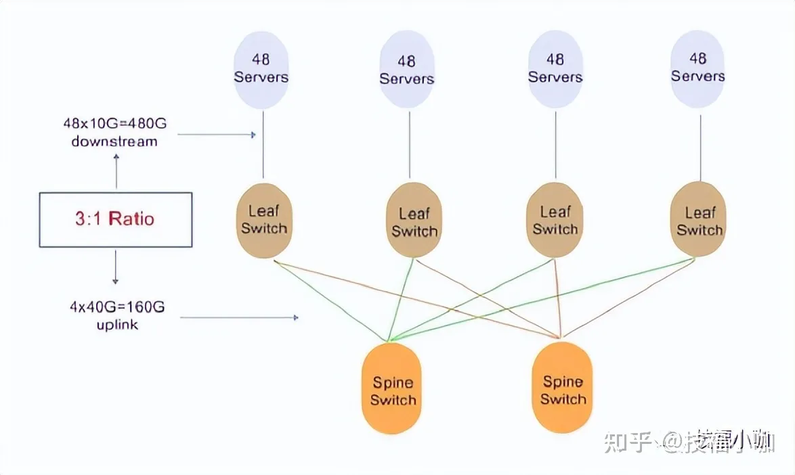
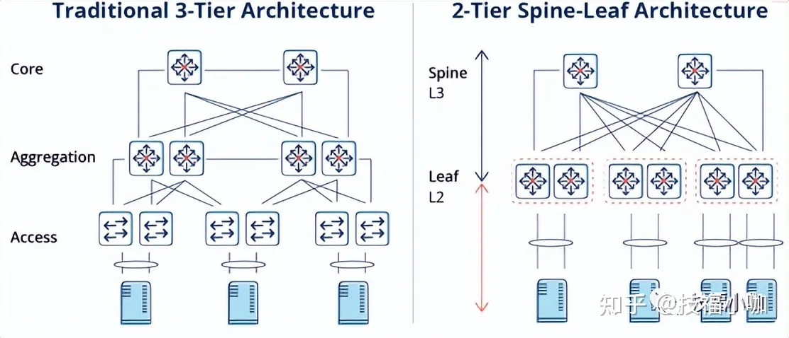

随着业务形态的变化，数据中心网络的交换架构也在不断的发展。传统的三层网络结构应用广泛而且技术成熟，但随着技术的发展趋势，它的瓶颈也不断涌现，导致越来越多的网络工程师放弃这种结构的网络，而**spine leaf——叶脊拓扑网络结构**，则越来越成为受关注的选择。

# 一、 传统三层网络

如上图是**传统三成网络架构的典型拓扑结构**：

**接入层**：接入交换机通常位于机架顶部，所以它们也被称为ToR（Top of Rack）交换机，它们物理连接服务器。

**汇聚层**：汇聚交换机连接同一个二层网络（VLAN）下的接入交换机，同时提供其他的服务，例如防火墙，SSL offload，入侵检测，网络分析等， 它可以是二层交换机也可以是三层交换机。

**核心层**： 核心交换机为进出数据中心的包提供高速的转发，为多个二层局域网（VLAN）提供连接性，核心交换机为通常为整个网络提供一个弹性的三层网络。

在这种网络架构下，存在如下的一些弊端：

**带宽的浪费**：为了防止环路，汇聚层和接入层之间通常会运行STP协议，使得接入交换机的上联链路中实际承载流量的只有一条，而其他上行链路将被阻塞（如图中虚线所示），造成了带宽的浪费；

**故障域较大**：STP协议由于其本身的算法，在网络拓扑发生变更时需要重新收敛，容易发生故障，从而影响整个VLAN的网络；

**难以适应超大规模网络**：在云计算领域，网络规模扩大，数据中心也分布在不同的地理位置，虚拟机要求能在任意地点创建，迁移，而保持其网络属性（IP, 网关等）保持不变，需要支持大二层网络，在上图的拓扑中，无法在VLAN10和VLAN20之间作上述迁移；

传统架构下，当存在大量东西向流量时，汇聚交换机和核心交换机的压力会大大增加，网络规模和性能也就限制在了汇聚层和核心层。要支持大规模的网络，就必须有性能最好，端口密度最大的汇聚层核心层设备，这样的设备成本高，不是所有企业都买得起，且必须在建设网络时就预先规划好网络规模，在网络规模小时，会造成资源的浪费，在网络规模继续扩大时，扩容也比较困难，因而让企事业单位陷入了成本和可扩展性的两难选择之中。

**数据中心的流量总的来说可以分为以下几种**：

· **南北向流量**：数据中心之外的客户端到数据中心服务器之间的流量，或者数据中心服务器访问互联网的流量。

· **东西向流量**：数据中心内的服务器之间的流量。

· **跨数据中心流量**：不同数据中心的流量，例如数据中心之间的灾备，私有云和公有云之间的通讯。

在传统数据中心中，业务通常采用专线方式部署。通常，服务部署在一个或多个物理服务器上，并与其他系统物理隔离。因此，传统数据中心东西向流量较低，南北向流量约占数据中心总流量的80%。

在云数据中心，服务架构逐渐从**单体架构转变为Web-APP-DB**，分布式技术成为企业应用的主流。服务的组件通常分布在多个虚拟机或容器中。该服务不再由一台或多台物理服务器运行，而是由多台服务器协同工作，导致东西向流量快速增长。

此外，大数据服务的出现使分布式计算成为云数据中心的标准配置。大数据服务可以分布在一个数据中心的数百台服务器上进行并行计算，这也大大增加了东西向流量。

传统的三层网络架构是为南北向流量占主导地位的传统数据中心设计的，不适合东西向流量较大的云数据中心。

一些东西向流量(如跨POD的二层和三层流量)必须经过汇聚层和核心层的设备转发，不必要地经过许多节点。传统网络通常设置1:10到1:3的带宽超额比，以提高设备利用率。随着超额订阅率，每次流量通过节点时性能都会显着下降。此外，第 3 层网络上的 xSTP 技术加剧了这种恶化。

因此，如果通过传统三层网络架构运行大量的东西向流量，连接到同一交换机端口的设备可能会争夺带宽，导致最终用户获得的响应时间很差。

**二、 叶脊网络架构是什么？**

Clos 网络以其发明者Charles Clos命名，Charles Clos是一名电话网络工程师，他在 1950 年代需要解决如何应对电话网络的爆炸式增长这一问题. 提出了现在称之为 Clos 的网络架构。

Spine-Leaf体系架构是由Spine和Leaf这两个交换层组成的数据中心网络拓扑结构。Leaf层由访问交换机组成，汇聚来自服务器的流量，并直接连接到Spine或网络核心。Spine交换机在全网格拓扑中互连所有Leaf交换机。上图中，绿色节点代表交换机，灰色节点代表服务器。在绿色节点中，最上面的是Spine节点，下面是Leaf节点。

Spine-Leaf架构更适合满足现代应用程序的需求，例如高吞吐量和低延迟。

Spine交换机具有高吞吐量、低延迟且端口密集，它们与每个Leaf交换机都有直接的高速 (40-400Gbps) 连接。

Leaf交换机与传统TOR交换机非常相似，它们通常是 24 或 48 端口 1、10 或 40Gbps的接入层连接。但是，它们增加了到每个Spine交换机的 40、100 或 400Gbps 上行链路的能力。

**叶脊网络架构因其可扩展性、高可靠性和高性能备受大型数据中心、云计算数据中心青睐**。如下图所示，叶脊网络架构是叶子层（即叶层）和脊椎层（脊层）组成。其中，叶子层包含了用于连接服务器、存储设备的二层交换机（即叶交换机）；脊椎层包含了用于路由转发的三层交换机（即脊交换机），属于网络的骨干。在叶脊网络架构中，每台叶交换机都需要与架构中的脊交换机连接，通过这种设计，网络中的每台服务器与其他服务器进行数据传输时都只需要通过叶交换机和脊交换机即可，大大提高了数据传输的效率，该网络架构在高性能计算集群应用中尤为重要。

Spine-Leaf 网络架构，也称为**分布式核心网络**，由于这种网络架构来源于交换机内部的 Switch Fabric，因此也被称为 Fabric 网络架构，同属于 CLOS 网络模型。事实已经证明，Spine-Leaf 网络架构可以提供高带宽、低延迟、非阻塞的服务器到服务器连接。

前面说过 CLOS 网络是三级交换架构，而 Leaf Spine 却只有两层，这是因为：网络架构中的设备基本都是双向流量，输入设备同时也是输出设备，因此三级 CLOS 沿着中间层对折，就得到了两层的网络架构。可以看出传统的三层网络架构是垂直的结构，而 Spine-Leaf 网络架构是扁平的结构，从结构上看，Spine-Leaf 架构更易于水平扩展。

从拓扑结构上看，Spine-Leaf 二层架构视乎要比传统三层网络架构简单得多，但为什么 Spine-Leaf 直到近些年才能得到普及呢？技术成熟度固然是因素之一，再一个就是数据中心网络发展过程中无法回避的成本问题。传统三层网络架构只有核心交换机是昂贵的 L3 交换机，但 Spine-Leaf 却要求所有节点都应该是 L3 交换机。因此，Spine-Leaf 也只能在设备价格下降了的这些年才得以被推广。

**三、 Spine-Leaf 的工作原理**

**Leaf Switch**：**相当于传统三层架构中的接入交换机**，作为 TOR（Top Of Rack）直接连接物理服务器。与接入交换机的区别在于 L2/L3 网络的分界点现在在 Leaf 交换机上了。Leaf 交换机之上是三层网络，Leaf 交换机之下都是个独立的 L2 广播域，这就解决了大二层网络的 BUM 问题。如果说两个 Leaf 交换机下的服务器需要通讯，需要通过 L3 路由，经由 Spine 交换机进行转发。

**Spine Switch**：**相当于核心交换机**。Spine 和 Leaf 交换机之间通过 ECMP（Equal Cost Multi Path）动态选择多条路径。区别在于，Spine 交换机现在只是为 Leaf 交换机提供一个弹性的 L3 路由网络，数据中心的南北流量可以不用直接从 Spine 交换机发出，一般来说，南北流量可以从与 Leaf 交换机并行的交换机（edge switch）再接到 WAN router 出去。

Fabric 中的 Leaf 层由接入交换机组成，用于接入服务器，Spine 层是网络的骨干（Backbone），负责将所有的 Leaf 连接起来。每个低层级的 Leaf 交换机都会连接到每个高层级的 Spine 交换机上，即每个 Leaf 交换机的上行链路数等于 Spine 交换机数量，同样，每个 Spine 交换机的下行链路数等于 Leaf 交换机的数量，形成一个 Full-Mesh 拓扑。当 Leaf 层的接入端口和上行链路都没有瓶颈时，这个架构就实现了无阻塞（Nonblocking）。并且，因为任意跨 Leaf 的两台服务器的连接，都会经过相同数量的设备，所以保证了延迟是可预测的，因为一个包只需要经过一个 Spine 和另一个 Leaf 就可以到达目的端。

因为 Fabric 中的每个 Leaf 都会连接到每个 Spine，所以，如果一个 Spine 挂了，数据中心的吞吐性能只会有轻微的下降（Slightly Degrade）。如果某个链路的流量被打满了，Spline-Leaf 的扩容过程也很简单：添加一个 Spine 交换机就可以扩展每个 Leaf 的上行链路，增大了 Leaf 和 Spine 之间的带宽，缓解了链路被打爆的问题。如果接入层的端口数量成为了瓶颈，那就直接添加一个新的 Leaf，然后将其连接到每个 Spine 并做相应的配置即可。这种易于扩展（Ease of Expansion）的特性优化了 IT 部门扩展网络的过程。

传统的三层网络架构由核心层、汇聚层和接入层组成，由于该结构中存在多设备多路径冗余，会导致环路的形成。与此同时，传统的三层网络架构主要是为了南北向流量而设计，虽然也支持东西向流量，但其不足非常明显，如浪费核心交换机资源、多层转发增加了延时、最终用户响应时间过长等。因此，传统的三层网络架构并不适用计算机和存储服务器四处分布的大型虚拟化数据中心。

**注：**南北向流量指数据中心之外的客户端到数据中心服务器之间的流量，或数据中心服务器访问互联网的流量；东西向流量值数据中心内的服务器之间的流量。

**四、 Spine-Leaf 的优势**
**扁平化**：扁平化设计缩短服务器之间的通信路径，从而降低延迟，可以显著提高应用程序和服务性能。
**易扩展**：如果 Spine 交换机的带宽不足，我们只需要增加 Spine 节点数，也可以提供路径上的负载均衡；如果接入连接不足，则只需增加 Leaf 节点数。
低收敛比：容易实现 1:X 甚至是无阻塞的 1:1 的收敛比，而且通过增加 Spine 和 Leaf 设备间的链路带宽也可以降低链路收敛比。
**简化管理**：叶脊结构可以在无环路环境中使用全网格中的每个链路并进行负载平衡，这种等价多路径设计，在使用 SDN 等集中式网络管理平台时处于最佳状态。SDN 允许在发生堵塞或链路故障时简化流量的配置，管理和重新分配路由，使得智能负载均衡的全网状拓扑成为一个相对简单的配置和管理方式。
**边缘流量处理**：随着物联网（IoT）等业务的兴起，接入层压力剧增，可能有数千个传感器和设备在网络边缘连接并产生大量流量。Leaf 可以在接入层处理连接，Spine 保证节点内的任意两个端口之间提供延迟非常低的无阻塞性能，从而实现从接入到云平台的敏捷服务。

**多云管理**：数据中心或云之间通过 Leaf Spine 架构仍可以实现高性能、高容错等优势，而多云管理策略也逐渐成为企业的必选项。

**五、 Spine-Leaf 的缺陷**

但是，Fabric 架构并非完美。叶子节点网络设备无论是性能要求还是功能要求，均高于传统架构下的接入设备，其作为各种类型的网关（二三层间、VLAN/VxLAN 间、VxLAN/NVGRE 间、FC/IP 间等等），芯片处理能力要求较高，目前尚无满足所有协议间互通的商用芯片；由于不存在相关的标准，为了实现各种类型网络的接入，其骨干节点与叶子节点间的转发各个厂商均采用了私有封装，这也为将来的互通设置了难题。除此之外，还有：

独立的 L2 Domain 限制了依赖 L2 Domain 应用程序的部署。要求部署在一个二层网络的应用程序，现在只能部署下一个机架下了。  
独立的 L2 Domain 限制了服务器的迁移。迁移到不同机架之后，网关和 IP 地址都要变。

子网数量大大增加了。每个子网对应数据中心一条路由，现在相当于每个机架都有一个子网，对应于整个数据中心的路由条数大大增加，并且这些路由信息要怎么传递到每个 Leaf 上，也是一个复杂的问题。

**六、 叶脊网络架构如何设计？**
在设计叶脊网络架构之前，您必须先确定一些重要的因素。如，收敛比（即超额预订比率）、叶交换机与脊交换机的比例、从叶层到脊层的上行链路、构建在第2层还是第3层等。

收敛比（即超额预订比率）——指所有设备在相同时间内发送流量的比值，也就是指南北向流量（下行链路带宽）和东西向流量（上行链路带宽）的比值。当前的网络设计应遵循3:1的超额预订比率，也就是说下行端口（叶交换机到服务器或存储设备）和上行端口（叶交换机到脊交换机）的比值应达到3:1。下图说明了如何测量叶子层和脊椎层的超额预订比率。

**叶交换机和脊交换机的比例**——由于叶脊网络架构中的网络端点仅与叶交换机连接，因此网络中叶交换机部署数量取决于网络端点所需连接的接口数。而又因为每台叶交换机都需要连接到脊交换机，因此脊交换机的端口密度取决于拓扑结构中叶交换机的最大数量，同时，网络中的脊交换机的数量取决于叶交换机之间的吞吐量、叶子层的冗余/等价多路径（ECMP）数以及脊交换机中的端口密度。

**从叶层到脊层的上行链路**——对于叶脊网络，从叶子层到脊椎层的上行链路通常为10G/40G，且可从10G迁移到40G。为了避免网络不会因主机的增加造成阻塞，最好是确保上行链路的传输速率比下行链路的传输速率快。

**叶脊架构可构建在第二层或第三层**——叶脊网络架构可构建在第2层（任何VLAN）或第3层（子网）中。在第2层中构建叶脊网络架构时，能提供较高的灵活性，允许VLAN跨越任何地方，以及MAC地址可迁移到任何地方。在第3层中构建叶脊网络架构时，可提供最快的收敛时间和较优越的扩展性（可扩展至最大规模），同时，其具备扇出（也就是扇形发散）等价多路径（ECMP）路由功能，可支持32个或更多脊交换机。
Spine-Leaf 架构减少了核心层，实现了层次的扁平化，如下图所示。

此外，关于**Spine-Leaf 架构的其他常见差异如下**：

⚫ **放弃了生成树协议 (STP)**

⚫ **越来越多地使用固定端口交换机而不是网络骨干的模块化模型**

⚫ **横向与纵向基础架构的扩展**

Spine-Leaf架构的主要好处之一就是它允许数据流从数据的源到数据的目标路径较短。无论源和目的地如何，Spine-Leaf结构中的数据流在网络上的跳数都相同，任意两个服务器之间都是Leaf—>Spine—>Leaf三跳可达的。

由于Spine-Leaf 架构不再需要 STP，容量也得到了提高。其依赖诸如 ECMP(等价多路径)路由等协议来平衡所有可用路径上的流量，同时仍然避免网络环路。
