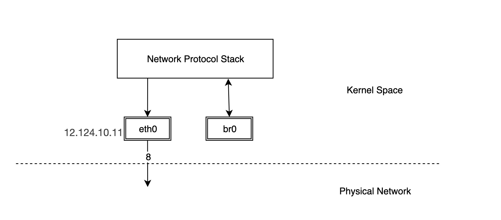
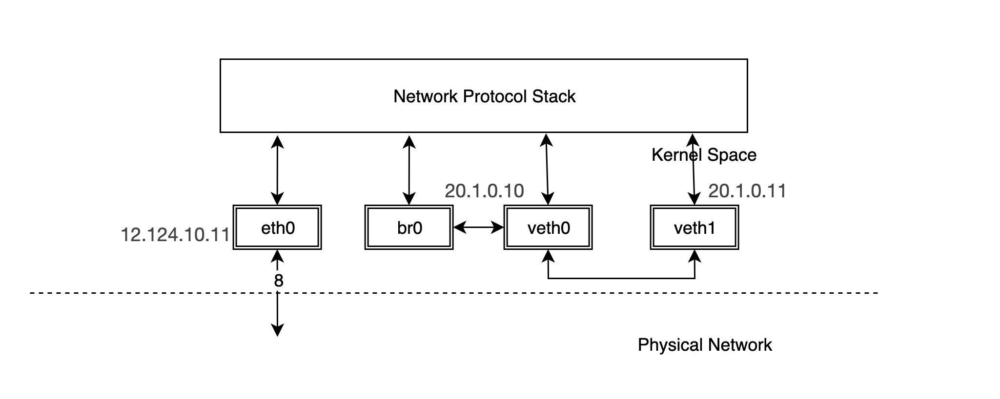
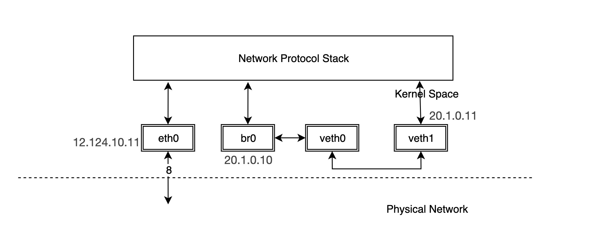
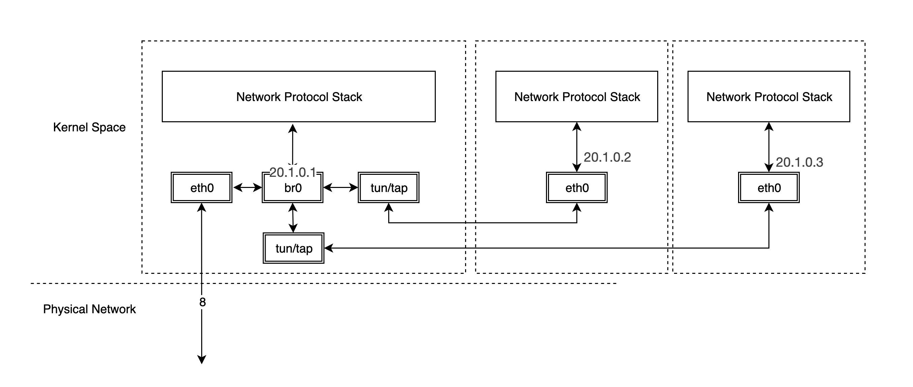
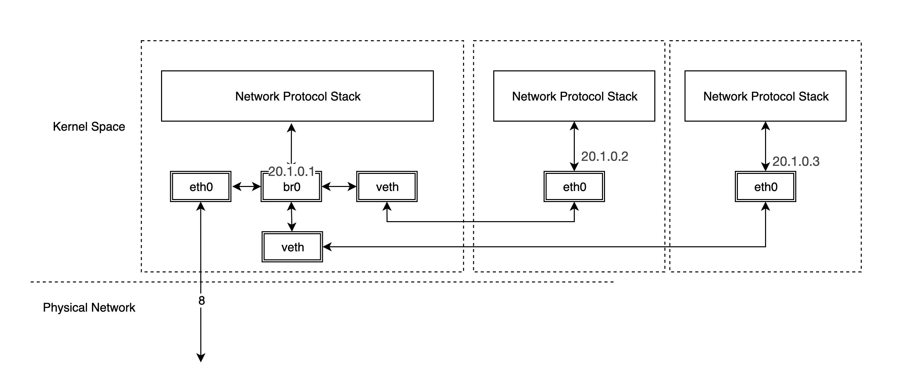
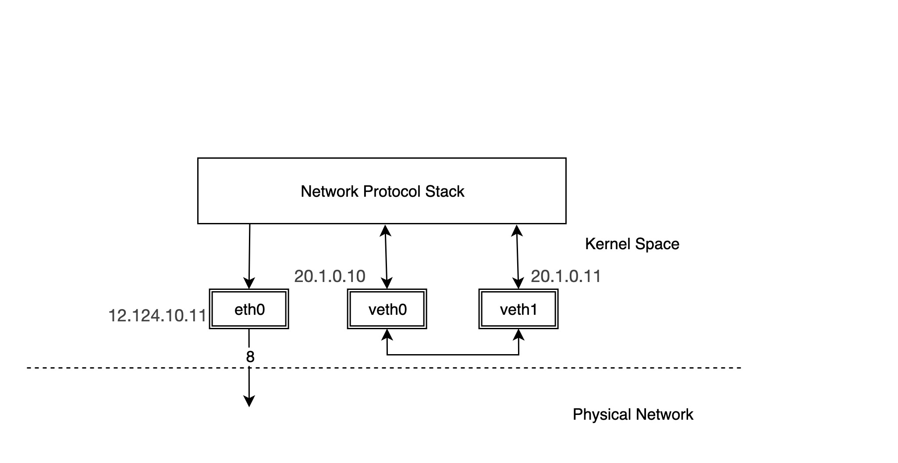
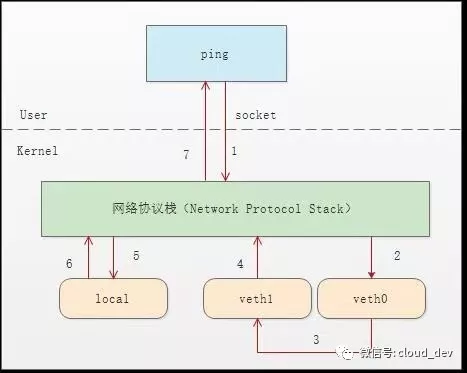

# Bridge

bridge 一般叫网桥，它也是一种虚拟网络设备，所以具有虚拟网络设备的特征，可以配置IP、MAC地址等。与其他虚拟网络设备不同的是，bridge是一个虚拟交换机，和物理交换机有类似的功能。bridge一端连接着协议栈，另外一端有多个端口，数据在各个端口间转发是基于MAC地址。

bridge可以工作在二层(链路层)，也可以工作在三层（IP网路层）。默认工作在二层。默认情况下，其工作在二层，可以在同一子网内的的不同主机间转发以太网报文；当给bridge分配了IP地址，也就开启了该bridge的三层工作模式。在Linux下，你可以用[iproute2](https://wiki.linuxfoundation.org/networking/iproute2)或brctl命令对bridge进行管理。

创建bridge与创建其他虚拟网络设备类似，只需要制定type为bridge:

```
ip link add br0 type bridge
ip link set br0 up
```



但是这样创建出来的bridge一端连接着协议栈，其他端口什么也没有连接，因此我们需要将其他设备连接到该bridge才能有实际的功能。

```
ip link add veth0 type veth peer name veth1
ip addr add 20.1.0.10/24 dev veth0
ip addr add 20.1.0.11/24 dev veth1
ip link set veth0 up
ip link set veth1 up
# 将veth0连接到br0
ip link set dev veth0 master br0
# 通过 bridge link 命令可以看到bridge上连接了哪些设备
bridge link

6: veth0 state UP : <BROADCAST,MULTICAST,UP,LOWER_UP> mtu 1500 mas
                      ter br0 state forwarding priority 32 cost 2
```



事实上，一旦br0和veth0连接后，它们之间将变成双向通道，但是内核协议栈和veth0之间变成了单通道，协议栈能发数据给veth0，但veth0从外面收到的数据不会转发给协议栈 ，同时br0的MAC地址变成了veth0的MAC地址。我们可以验证一下：

```
# ping -c 1 -I veth0 20.1.0.11
PING 20.1.0.11 (20.1.0.11) from 20.1.0.10 veth0: 56(84) bytes of data.
From 20.1.0.10 icmp_seq=1 Destination Host Unreachable

--- 20.1.0.11 ping statistics ---
1 packets transmitted, 0 received, +1 errors, 100% packet loss, time 0ms
```

如果我们使用tcpdump在br0上抓包就会发现：

```
# tcpdump -n -i br0
tcpdump: verbose output suppressed, use -v or -vv for full protocol decode
listening on br0, link-type EN10MB (Ethernet), capture size 262144 bytes
21:45:48.225459 ARP, Reply 20.1.0.10 is-at a2:85:26:b3:72:6c, length 28
```

可以看到veth0收到应答包后没有给协议栈，而是直接转发给br0，这样协议栈得不到veth1的mac地址，从而ping不通。br0在veth0和协议栈之间数据包给拦截了。但是如果我们给br配置IP，会怎么样呢？

```
ip addr del 20.1.0.10/24 dev veth0
ip addr add 20.1.0.10/24 dev br0
```

这样，网络结构就变成了下面这样：

  
这时候再通过br0来ping一下veth1，会发现结果可以通：

```
# ping -c 1 -I br0 20.1.0.11
PING 20.1.0.11 (20.1.0.11) from 20.1.0.10 br0: 56(84) bytes of data.
64 bytes from 20.1.0.11: icmp_seq=1 ttl=64 time=0.121 ms

--- 20.1.0.11 ping statistics ---
1 packets transmitted, 1 received, 0% packet loss, time 0ms
rtt min/avg/max/mdev = 0.121/0.121/0.121/0.000 ms
```

其实当去掉veth0的IP地址，而给br0配置了IP之后，协议栈在路由的时候不会将数据包发给veth0，为了表达更直观，我们协议栈和veth0之间的连接线去掉，这时候的veth0相当于一根网线。

在现实中，bridge常用的使用场景：

**虚拟机**

典型的虚拟机网络实现就是通过TUN/TAP将虚拟机内的网卡同宿主机的br0连接起来，这时br0和物理交换机的效果类似，虚拟机发出去的数据包先到达br0，然后由br0交给eth0发送出去，这样做数据包都不需要经过host机器的协议栈，运行效率非常高。



**容器**

而对于容器网络来说，每个容器的网络设备单独的网络命名空间中  


# veth

veth 虚拟网络设备一端连着协议栈，另外一端不是物理网络，而是另一个veth 设备，成对的veth设备中一个数据包发送出去后会直接到另一个veth设备上去。每个veth设备都可以被配置IP地址，并参与三层 IP 网络路由过程。

下面就是一个典型的veth设备对的例子：



我们配置物理网卡eth0的IP为12.124.10.11， 而成对出现的veth设备分别为veth0和veth1，它们的IP分别是20.1.0.10和20.1.0.11。

```
ip link add veth0 type veth peer name veth1
ip addr add 20.1.0.10/24 dev veth0
ip addr add 20.1.0.11/24 dev veth1
ip link set veth0 up
ip link set veth1 up
```

然后尝试从veth0设备ping另一个设备veth1:

```
# ping -c 2 20.1.0.11 -I veth0
PING 20.1.0.11 (20.1.0.11) from 20.1.0.11 veth0: 28(42) bytes of data.
64 bytes from 20.1.0.11: icmp_seq=1 ttl=64 time=0.034 ms
64 bytes from 20.1.0.11: icmp_seq=2 ttl=64 time=0.052 ms

--- 20.1.0.11 ping statistics ---
2 packets transmitted, 2 received, 0% packet loss, time 1500ms
```

Note: 在有些Ubuntu中有可能ping不通，原因是默认情况下内核网络配置导致veth设备对无法返回ARP返回包。解决办法是：

```
echo 1 > /proc/sys/net/ipv4/conf/veth1/accept_local
echo 1 > /proc/sys/net/ipv4/conf/veth0/accept_local
echo 0 > /proc/sys/net/ipv4/conf/veth0/rp_filter
echo 0 > /proc/sys/net/ipv4/conf/veth1/rp_filter
echo 0 > /proc/sys/net/ipv4/conf/all/rp_filter
```

可以尝试使用tcpdump看看在veth设备对上的请求包：

```
# tcpdump -n -i veth1
tcpdump: verbose output suppressed, use -v or -vv for full protocol decode
listening on veth1, link-type EN10MB (Ethernet), capture size 458122 bytes
20:24:12.220002 ARP, Request who-has 20.1.0.11 tell 20.1.0.10, length 28
20:24:12.220198 ARP, Request who-has 20.1.0.11 tell 20.1.0.10, length 28
20:24:12.221372 IP 20.1.0.10 > 20.1.0.11: ICMP echo request, id 18174, seq 1, length 64
20:24:13.222089 IP 20.1.0.10 > 20.1.0.11: ICMP echo request, id 18174, seq 2, length 64
```

可以看到在veth1上面只有ICMP echo的请求包，但是没有应答包。

1. 首先 ping 程序构造 ICMP echo request，通过 socket 发给协议栈。
2. 由于 ping 指定了走 veth0 口，如果是第一次，则需要发 ARP 请求，否则协议栈直接将数据包交给 veth0。
3. 由于 veth0 连着 veth1，所以 ICMP request 直接发给 veth1。
4. veth1 收到请求后，交给另一端的协议栈。
5. 协议栈看本地有 10.1.1.3 这个 IP，于是构造 ICMP reply 包，查看路由表，发现回给 10.1.1.0 网段的数据包应该走 localback 口，于是将 reply 包交给 lo 口（会优先查看路由表的 0 号表，ip route show table 0 查看）。
6. lo 收到协议栈的 reply 包后，啥都没干，转手又回给协议栈。
7. 协议栈收到 reply 包之后，发现有 socket 在等待包，于是将包给 socket。
8. 等待在用户态的 ping 程序发现 socket 返回，于是就收到 ICMP 的 reply 包。



我们可以尝试使用tcpdump抓取lo设备上的数据：

```
# tcpdump -n -i lo
tcpdump: verbose output suppressed, use -v or -vv for full protocol decode
listening on lo, link-type EN10MB (Ethernet), capture size 458122 bytes
20:25:49.486019 IP IP 20.1.0.11 > 20.1.0.10: ICMP echo reply, id 24177, seq 1, length 64
20:25:50.4861228 IP IP 20.1.0.11 > 20.1.0.10: ICMP echo reply, id 24177, seq 2, length 64
```

由此可见，对于成对出现的veth设备对，从一个设备出去的数据包会直接发给另外一个设备。在实际的应用场景中，比如容器网络中，成对的veth设备对处于不同的[网络命名空间](https://blog.scottlowe.org/2013/09/04/introducing-linux-network-namespaces/)中，数据包的转发在不同网络命名空间之间进行。

将veth1放入一个namespace：

```
ip link set veth1 netns newns
```

# demo1 跨namespace到veth互通

创建namespace

```
ip netns add ns1
ip netns add ns2
```

创建veth pair

```
ip link add vetha type veth peer name vethb
ip link add vethc type veth peer name vethd
```

默认veth均位于主机的network namespace

添加veth到ns：

```
ip link set vethb netns ns1
ip link set vethd netns ns2
```

设置veth的ip地址：

```
ip netns exec ns1 ip addr add 192.168.1.1/24 dev vethb
ip netns exec ns2 ip addr add 192.168.1.2/24 dev vethd
```

设置veth为up：

```
ip netns exec ns1 ip link set dev vethb up
ip netns exec ns2 ip link set dev vethd up
```

将宿主机ns上的veth添加到ovs的port，并up

```
ip link set dev vetha up
ip link set dev vethc up

ovs-vsctl add-br testbr
ovs-vsctl add-port testbr vetha
ovs-vsctl add-port testbr vethc
```

测试连通性：

```
root@n248-187-151:~# ip netns exec ns1 ping -c1 192.168.1.2
PING 192.168.1.2 (192.168.1.2) 56(84) bytes of data.
64 bytes from 192.168.1.2: icmp_seq=1 ttl=64 time=1.00 ms

--- 192.168.1.2 ping statistics ---
1 packets transmitted, 1 received, 0% packet loss, time 0ms
rtt min/avg/max/mdev = 1.008/1.008/1.008/0.000 ms
```

设置tag实现VLAN隔离：

```
root@n248-187-151:~# ovs-vsctl set Port vethc tag=100
root@n248-187-151:~# ovs-vsctl set Port vetha tag=200
root@n248-187-151:~# ip netns exec ns1 ping -c1 192.168.1.2
PING 192.168.1.2 (192.168.1.2) 56(84) bytes of data.

--- 192.168.1.2 ping statistics ---
1 packets transmitted, 0 received, 100% packet loss, time 0ms
```
