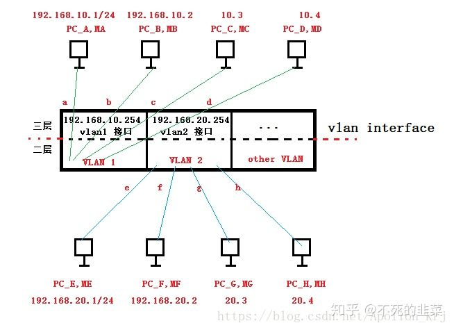
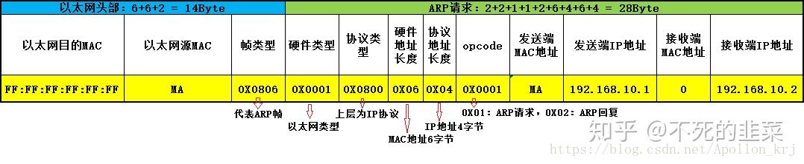
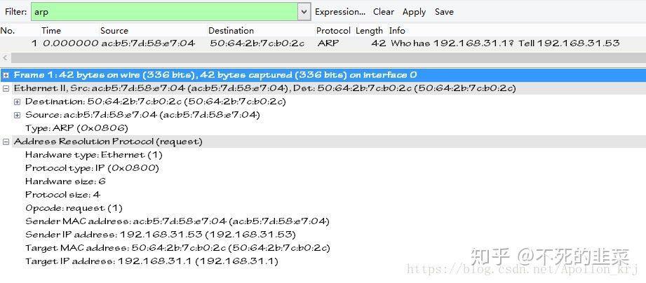

[https://www.bilibili.com/read/cv12782091](https://www.bilibili.com/read/cv12782091)

首先二层转发是基于MAC地址转发，三层转发基于IP地址转发，但是这并不意味着仅仅依靠IP地址就能转发，二层转发是建立在三层的基础上的，而仅仅依靠MAC地址是不能转发的。另外，二三层转发基于MAC地址、IP地址、FDB表（MAC地址学习、更新、老化、删除等）、ARP表、路由表、三层转发表、VLAN端口类型（Access、Trunk、Hybrid）、VLAN帧格式、ARP报文格式等。以下图为例，总结一下交换机中，基于VLAN的二三层转发原理。  

# 0 基本概念术语

①MAC地址：48bit的硬件地址，单播地址格式为首字节最低位为1，多播地址格式为首字节最低位为0，广播地址为全1（即FF：FF：FF：FF：FF：FF）。  
②FDB表（FordWarding DataBase）：即MAC地址映射表，有MAC地址、端口、VLAN ID等信息。  
③ARP表：用于记录IP和MAC映射关系的表。  
④三层转发表：即基于硬件三层转发的包含目的IP地址、VLAN ID、端口和下一跳MAC地址等的关系表。  
⑤路由表：包含默认路由、RIP等动态路由的路由路径信息的记录表。  
⑥VLAN端口：主要是Access一般是用于连接主机，其发出的数据帧不带tag标签；还有就是Trunk用于可连接不同交换机的主干链路，其上发出的数据帧可能会带tag标签，用以识别不同VLAN，如果没带则采用默认的VLAN （PVID）

**假设最开始所有PC和交换机没有任何表项存在（ARP缓存、FDB缓存、三层转发表缓存等），且端口均为Access模式。**

# 1 二层转发（同一VLAN中主机通信）

以上图中PC_A ping PC_B为例来详细分析整个过程。  
①PC_A（192.168.10.1/24） 要 ping PC_B(192.168.10.2/24)，首先要去检查目标IP地址和自己的IP地址是否在同一个网段中，经过IP和子网掩码进行与运算，得知PC_A和PC_B属于语同一网段192.168.10.0网段。因此进行下一步：ARP表项查询。  
②根据目标IP：192.168.10.2作为索引，在ARP表中查找对应的MAC地址，由于ARP表最开始是空的，所以没有找到对应MAC，因此PC_A需要发送一个ARP广播报文在VLAN 1中请求PC_B（192.168.10.2）的MAC地址，PC封装的ARP报文主要内容为（opcode操作码字段为0X01代表这是一个ARP请求报文，目标MAC由于不知道因此填充为0，其余包含以太帧头部具体如下图所示）  

关于ARP报文各个字段的含义，用wireshark抓一个ARP包来查看，如下所示：  

③当交换机从a端口收到PC_A发出的报文，解析以太头部后发现目标MAC是FF：FF：FF：FF：FF：FF，则知其是一个广播帧，解析源MAC：MA，由于FDB表当前空空如也，因此先将**port a<->MA<->VLAN 1**等信息缓存到FDB表中。之后根据端口为Access模式，加上一个VLAN tag（主要包含优先级和VLAN ID=1），使其成为一个802.1Q的带有VLAN tag的以太帧，在交换机内部开始进行交换。  
④端口检测后发现b、c、d三个端口（其实还有一个VLAN接口，暂不提及）归属于VLAN 1，因此将tag剥离并从这三个端口转发出去。  
⑤当PC_C、PC_D收到该广播帧解析内容发现目标IP不是自己则丢弃该数据帧，而PC_B发现目标IP就是自己，则先将PC_A的**192.168.10.1<->MA**的映射信息更新到本地ARP表中。然后封装一个ARP回应的单播报文，内容主要为：源IP：192.168.10.2，目标IP：192.168.10.1，源MAC：MB，目标MAC：MA。发送出去，经端口b到达交换机。  
⑥交换机收到来自端口b的报文，解析头部获得源MAC，则先将**port b<->MB<->VLAN 1**缓存到FDB表中去，由于FDB表中已经有了PC_A的MAC地址缓存，因此根据ARP回复报文数据帧头部的目标MAC将报文从端口a转发出去（该步中当然也存在入口数据帧tag的添加与出口数据帧tag剥离的操作）。  
⑦PC_A接收到从端口a发出的ARP报文后，解析以太头部进行目标MAC匹配判断，匹配后解析报文内容，发现源IP<->源MAC的对应关系，因此先缓存**192.168.10.2<->MB**，到ARP表中，之后有了PC_B的MAC地址接可以封装icmp报文进行ping的后续操作了。  
⑧交换机收到来自PC_A和PC_B的icmp request与icmp reply报文，由于之前有缓存FDB表项，因此之后只会更新对应表项的老化标志，长时间没有这俩源MAC的报文到交换机则会删除对应表项。

# 2 三层转发（跨越不同VLAN的主机通信）

以上，以一台交换机上的同一个VLAN内的不同主机通信为例，描述了的是二层转发的基本过程，包括ARP表查询、ARP请求、交换机MAC地址查询、FDB表缓存、端口类型检查、VLAN tag添加与剥离、目标主机ARP回复等步骤。而三层交换基本步骤差不多。以VLAN 1的PC_A（192.168.10.1，MA）和VLAN 2的PC_E（192.168.20.1，ME）相互ping为例分析（假设VLAN 1的网关为VLAN 1 interface的IP：192.168.10.254，VLAN 2的网关为VLAN 2 interface 的IP为192.168.20.254），以下过程也有加VLAN tag和剥离VLAN tag的过程，但与二层基本一致，因此不再赘述：

①当PC_A（192.168.10.1/24）要ping PC_E（192.168.20.1/24）时，依然是检查目标IP是不是和自己在同一个网段，发现不在同一网段（一个在10.0网段一个在20.0网段），则需要经过网关（这里是交换机三层接口）来转发，因此PC_A在自己的ARP表中寻找网关对应的MAC地址，如果有则直接将报文封装为：目标MAC为网关MAC，源MAC为MA，发送端IP为192.168.10.1，接收端IP为192.168.20.1。  
②由于第一次PC_A的ARP缓存中不存在网关的MAC地址。则先向VLAN 1内广播发送一个ARP请求，请求网关192.168.10.254的MAC地址，封装为源MAC为MA，目标MAC不可知则为全0，源IP为192.168.10.1，目标IP为192.168.10.254，到链路层封装的头部为，源MAC为MA，目标MAC为全F即广播包，“帧类型”字段则填上ARP的协议号0x0806。  
③交换机SW1收到PC_A发送的报文，二层解析头部检查为广播包，则从VLAN 1的除源端口外的各个端口转发出去，另外也转发一份到VLAN 1的三层接口，由于PC_A之前给PC_B发送过报文，SW 1有PC_A的FDB缓存，则检查匹配后更新老化标志位。此外将PC_A的IP、MAC、对应port、VLAN ID等信息记录到交换机的三层转发表中。  
④VLAN 1其他主机收到请求对象不是自己的ARP请求，丢弃该广播报文，而SW 1的三层接口解析到目标IP是自己，则封装一个源MAC是交换机VLAN 1 interface的MAC，源IP是192.168.10.254，目标IP是192.168.10.1，目标MAC是MA的ARP应答报文，再经过以太头部封装，添加ARP单播报文头部，目标MAC为MA。交换机二层收到自三层的报文，解析数据帧头部，根据目标MAC地址MA在FDB表中查找到其出端口是port a，为ACCESS端口，则剥掉tag（之前请求报文进入port a之后会被加上tag，以致能够区分识别出VLAN 1的其他端口与VLAN 1 interface）转发给PC_A。  
⑤PC_A收到网关的MAC地址，则将发给PC_E的报文修改目标MAC为VLAN 1 interface即网关的MAC地址，而目标IP依旧是PC_E的IP：192.168.20.1，然后封装以太头部以单播形式发送出去。  
⑥SW 1在收到这个数据包后，因为“目的MAC地址”为交换机自己VLAN接口的MAC地址，而且“目的IP地址”和“源IP地址”不在同一网段，所以直接提交到三层，根据包中的“目的IP地址”(PC_E的IP地址)在三层硬件转发表中查看有无对应表项，因为是第一次通信，所以结果是查找失败，于是将数据包再转送到CPU去进行软件路由处理。  
⑦ CPU同样会根据包中的“目的IP地址”去查找其软件路由表，发现匹配了一个直连网段(PC_E对应的网段)，于是继续查在ARP表中查找对应的MAC地址项。同样是由于是第一次查找，所以仍然查找失败。如果在ARP表中找到了对应的MAC地址，则数据可以直接由软件路由表转发了。  
⑧如果没查找到则以PC_E的目标IP为请求对象，在其所在VLAN 2的目标网段内发送ARP请求广播（目标MAC为全0，目标IP为192.168.20.1，源MAC为VLAN 2 interface对应MAC，源IP为VLAN 2 interface对应IP，192.168.20.254），PC_E则先缓存网关的ARP表项，然后以ARP单播形式回复自己的MAC地址ME给网关192.168.20.254，SW 1的CPU则根据回复的报文更新记三层转发表项，记录到PC_E的IP、MAC、出端口、VLAN ID等信息，此时三层转发表中有了PC_A和PC_E的转发表项。另外缓存PC_E的ARP表项与FDB表项目。  
⑨三层交换机的CPU根据获取到的目标主机MAC和现有的直连路由信息将PC_A发来的数据包转发给PC_E，这就是一次单方向的三层转发过程，其中也大量涉及到了二层转发（PC_A在VLAN 1内广播请求网关MAC，交换机CPU控制在VLAN2内广播请求PC_E的MAC等）。  
⑩当PC_E回复PC_A报文时，与PC_A步骤相同，只是在PC_E上已经存在了网关ARP表项、交换机上已经存在了到PC_A的三层转发表项、FDB表项等，所以会更简单些。另外由于三层转发表项的存在，因此PC_E回复PC_A的报文会直接根据三层转发表进行硬件转发，而不是CPU路由软件转发，效率会更快。
