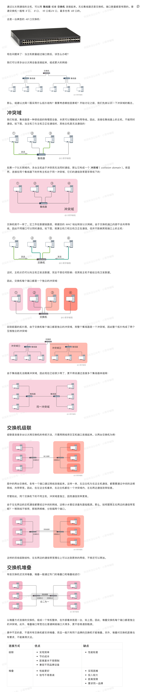

# 以太网组建、冲突域与广播域

## 先用一句话区分

- **冲突域（collision domain）**：共享同一介质、可能发生以太网帧碰撞的一组接口。它主要是半双工共享以太网时代的概念。
- **广播域（broadcast domain）**：二层广播帧能够被转发到的范围。VLAN 决定广播域边界；三层接口/路由器不会转发二层广播。

在今天常见的全双工交换以太网中，链路不再使用 CSMA/CD，因此“冲突”通常不再发生；但理解冲突域仍有助于区分 Hub 与 Switch 的行为。

## 设备如何划分边界

| 设备/机制 | 对冲突域的影响 | 对广播域的影响 | 说明 |
|---|---|---|---|
| Hub（集线器） | 所有端口共享一个冲突域 | 不隔离广播域 | 收到的电信号会重复到其他端口，通常工作在半双工。 |
| 二层 Switch（交换机） | 每个交换端口是独立冲突域 | 默认仍在同一广播域 | 按 MAC/FDB 单播转发，未知单播和广播会在同 VLAN 内泛洪。 |
| VLAN | 不改变每端口独立冲突域 | 一个 VLAN 对应一个二层广播域 | 同一交换机可承载多个相互隔离的广播域。 |
| Router / 三层交换的 SVI | 接口各自独立 | 隔离广播域 | 在三层转发 IP 包，不透明转发二层广播。 |

## 组建小型以太网的判断步骤

1. 先确定终端接入在哪些 Switch 端口，接入链路一般采用全双工。
2. 按业务/隔离需求规划 VLAN：同 VLAN 才能直接使用二层广播完成 ARP 等发现。
3. 跨 VLAN 通信必须经过默认网关；网关可以是路由器接口或三层交换机的 SVI。
4. Switch 间链路若承载多个 VLAN，应使用 trunk，并允许所需 VLAN 通过。
5. 对仍然存在的共享介质或半双工设备，才需要重点评估冲突域与双工不匹配。

## 常见误区

- **“交换机消除了广播。”** 不对。二层交换机仅缩小冲突域；广播仍会在同一 VLAN 内转发。
- **“一个子网一定等于一个 VLAN。”** 常见设计如此，但它们是不同层面的概念；一个 VLAN 可配置一个或多个 IP 子网，具体取决于网关与地址设计。
- **“全双工还需要 CSMA/CD。”** 不需要。全双工链路的收发方向独立，不发生传统以太网碰撞。

## 延伸阅读

- [VLAN](VLAN.md)：理解广播域如何按 VLAN 切分。
- [数据链路层](数据链路层.md)：理解以太帧、MAC 学习和交换行为。
- [二三层转发](二三层转发.md)：理解 ARP、FDB、路由表如何协同工作。
- [原始参考链接](https://www.yuque.com/coding-fan/network/collision-domain)
