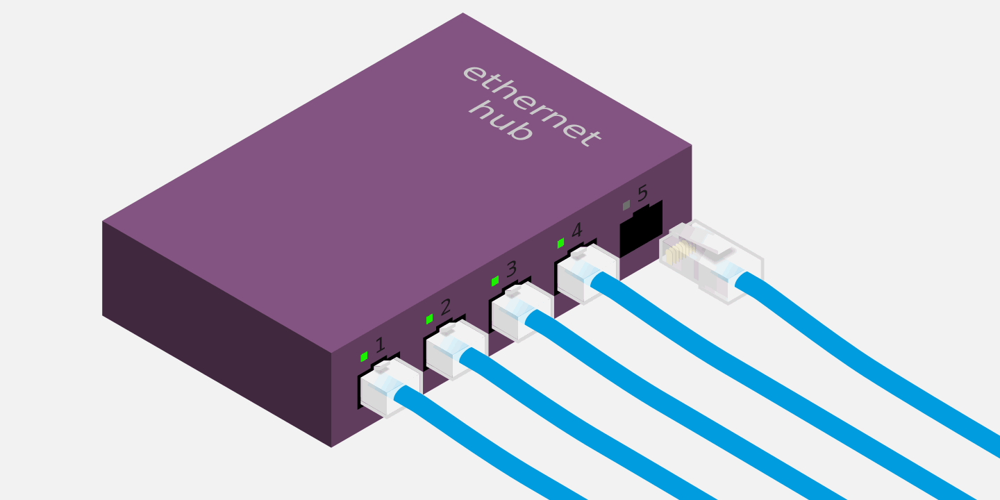
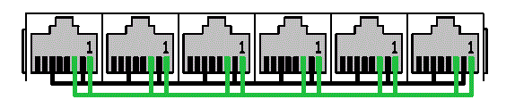
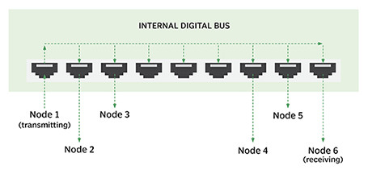
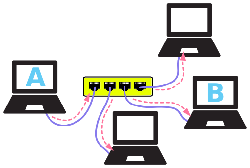

🔗 原文链接： [https://www.yuque.com/coding-fan/ne...](https://www.yuque.com/coding-fan/network/qbg87x)

采用以太网进行通信的主机，需要通过网线之类的介质连接到一起。那么，如何将多根网线连接在一起呢？ 最简单的方式是将所有网线接到一个集线器(hub)上，如下图：

集线器构造 集线器内部构造很简单，可以理解成只是把所有网线连接起来而已。换句话讲，集线器充当了共用导线的功能。

这样一来，从某个端口发送出去的电信号，将被传送到所有其他端口：

注释：这里端口(port)是指集线器的插口，或称为网口。 换句话讲，从一台主机发送出来的数据，将被传送到所有其他主机上。 以A往B发送数据为例：

看起来就像A发起了广播，其他所有主机都可以收到这个数据。 由于数据帧中包含目的地址，最终只有B接收并处理这个数据。 因此并无大碍，至少是可以正常工作的。

尽管如此，集线器还是存在一些缺陷，主要体现在两方面： 1所有主机(端口)共享带宽； 2所有主机(端口)处于同一冲突域(一台主机发送，其他只能等待)；

这两方面缺陷严重制约着集线器的传输效率，在接入端口数较多的情况下更是如此。 总结一下，集线器工作于物理层，主要特点如下：

●扩展终端数量；

●中继放大物理信号；

●延伸网络传输距离；

●所有端口同属一个冲突域；

●所有端口共享带宽；
