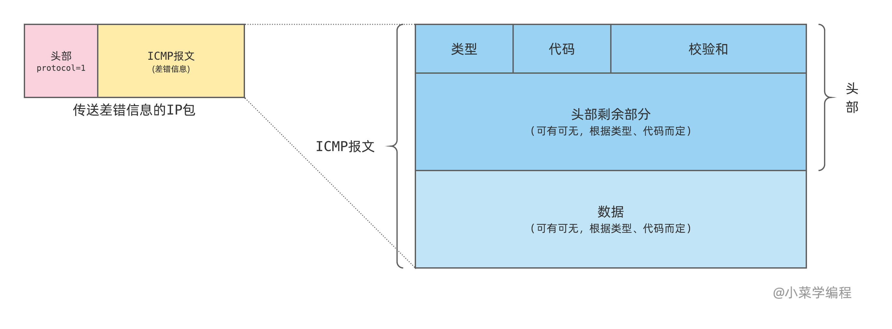
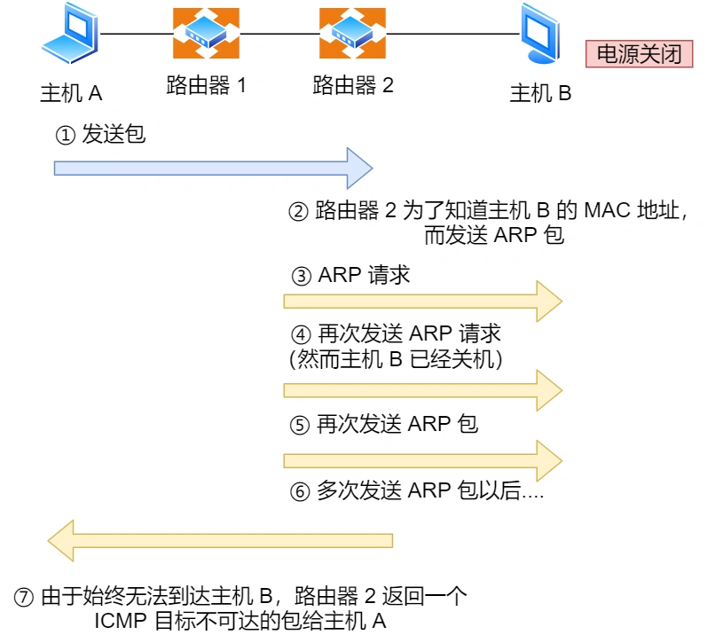
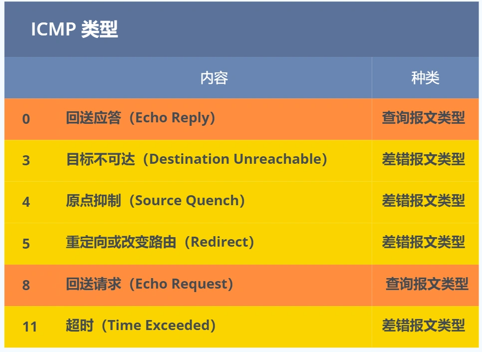
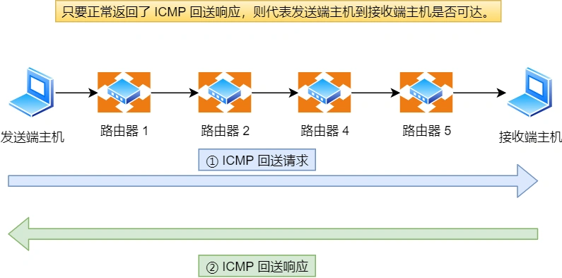
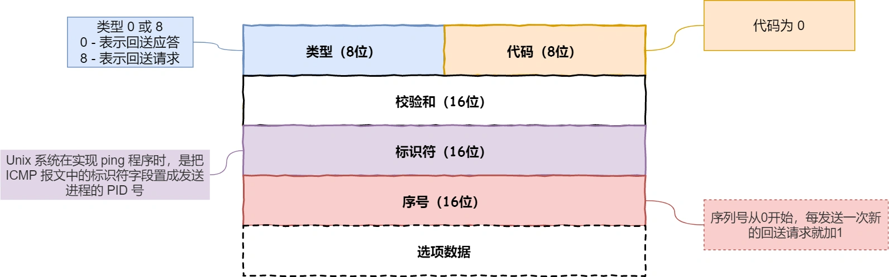
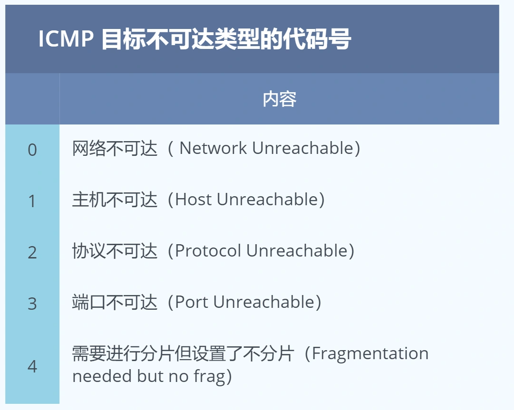
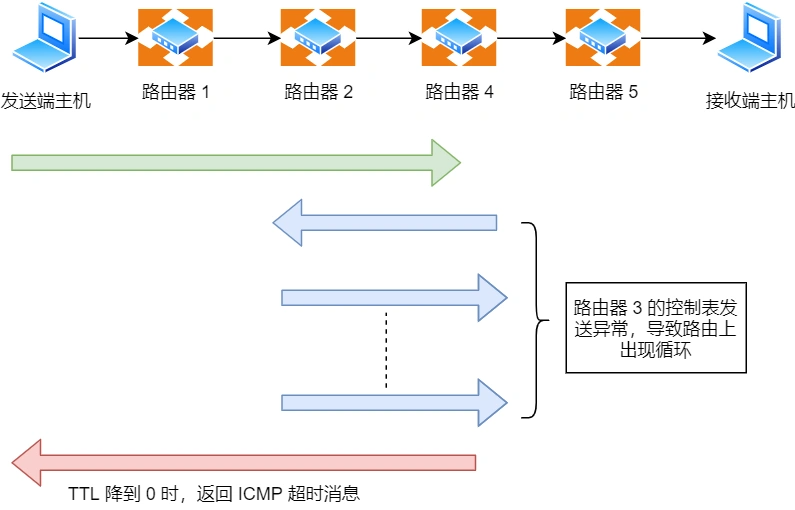

ICMP 全称是 **Internet Control Message Protocol**，也就是**互联网控制报文协议**。ICMP是IP协议的辅助协议，位于网络层。

里面有个关键词 —— **控制**，如何控制的呢？

网络包在复杂的网络传输环境里，常常会遇到各种问题。

当遇到问题的时候，总不能死个不明不白，没头没脑的作风不是计算机网络的风格。所以需要传出消息，报告遇到了什么问题，这样才可以调整传输策略，以此来控制整个局面。

ICMP报文结构：

ICMP报文作为数据封装在IP数据包中进行传输。

ICMP 主要的功能包括：**确认 IP 包是否成功送达目标地址、报告发送过程中 IP 包被废弃的原因和改善网络设置等。**

在 IP 通信中如果某个 IP 包因为某种原因未能达到目标地址，那么这个具体的原因将**由 ICMP 负责通知**。

如上图例子，主机 A 向主机 B 发送了数据包，由于某种原因，途中的路由器 2 未能发现主机 B 的存在，这时，路由器 2 就会向主机 A 发送一个 ICMP 目标不可达数据包，说明发往主机 B 的包未能成功。

ICMP 的这种通知消息会使用 IP 进行发送 。

因此，从路由器 2 返回的 ICMP 包会按照往常的路由控制先经过路由器 1 再转发给主机 A 。收到该 ICMP 包的主机 A 则分解 ICMP 的首部和数据域以后得知具体发生问题的原因。

ICMP 类型

ICMP 大致可以分为两大类：

- 一类是用于诊断的查询消息，也就是「**查询报文类型**」
- 另一类是通知出错原因的错误消息，也就是「**差错报文类型**」

## 查询报文类型

回送消息 —— 类型 0 和 8

**回送消息**用于进行通信的主机或路由器之间，判断所发送的数据包是否已经成功到达对端的一种消息，ping 命令就是利用这个消息实现的。

可以向对端主机发送**回送请求**的消息（ICMP Echo Request Message，类型 8），也可以接收对端主机发回来的**回送应答**消息（ICMP Echo Reply Message，类型 0）。

相比原生的 ICMP，这里多了两个字段：

- **标识符**：用以区分是哪个应用程序发 ICMP 包，比如用进程 PID 作为标识符；
- **序号**：序列号从 0 开始，每发送一次新的回送请求就会加 1， 可以用来确认网络包是否有丢失。

在**选项数据**中，ping 还会存放发送请求的时间值，来计算往返时间，说明路程的长短。

## 差错报文类型

接下来，说明几个常用的 ICMP 差错报文的例子：

- 目标不可达消息 —— 类型 为 3
- 原点抑制消息 —— 类型 4
- 重定向消息 —— 类型 5
- 超时消息 —— 类型 11

目标不可达消息（Destination Unreachable Message） —— 类型为 3

IP 路由器无法将 IP 数据包发送给目标地址时，会给发送端主机返回一个**目标不可达**的 ICMP 消息，并在这个消息中显示不可达的具体原因，原因记录在 ICMP 包头的**代码**字段。

由此，根据 ICMP 不可达的具体消息，发送端主机也就可以了解此次发送**不可达的具体原因**。

举例 6 种常见的目标不可达类型的**代码**：

- 网络不可达代码为 0
- 主机不可达代码为 1
- 协议不可达代码为 2
- 端口不可达代码为 3
- 需要进行分片但设置了不分片位代码为 4

IP 包中有一个字段叫做 TTL （Time To Live，生存周期），它的**值随着每经过一次路由器就会减 1，直到减到 0 时该 IP 包会被丢弃。**

此时，路由器将会发送一个 ICMP **超时消息**给发送端主机，并通知该包已被丢弃。

设置 IP 包生存周期的主要目的，是为了在路由控制遇到问题发生循环状况时，避免 IP 包无休止地在网络上被转发。

此外，有时可以用 TTL 控制包的到达范围，例如设置一个**较小的 TTL 值**。
