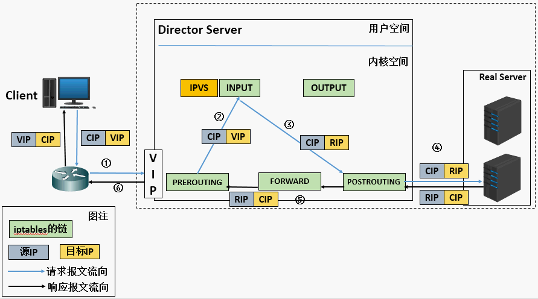
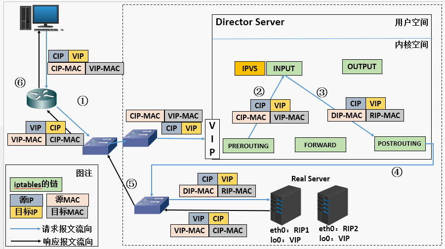
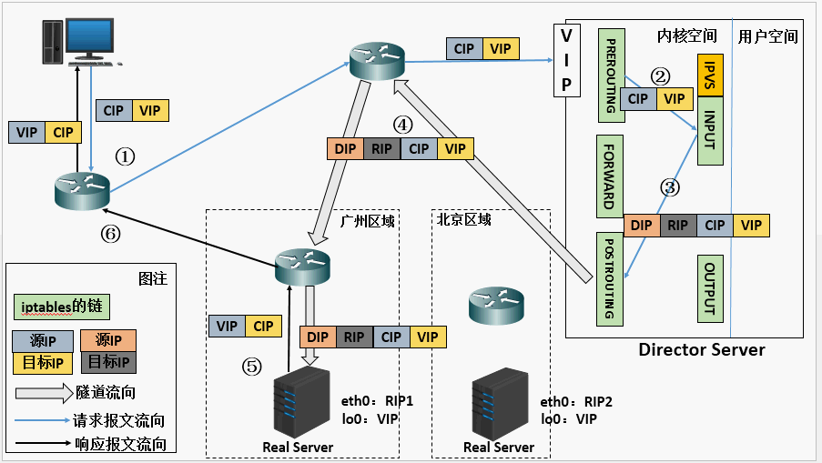
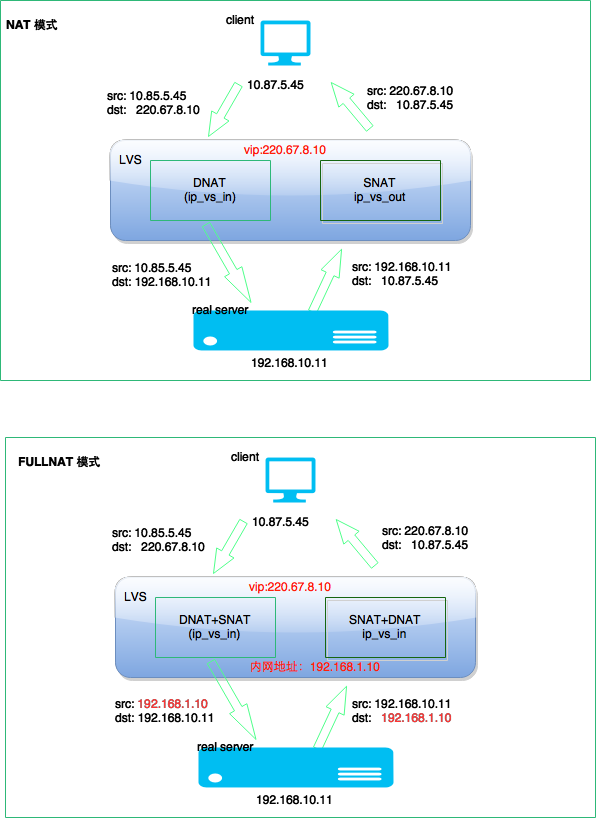
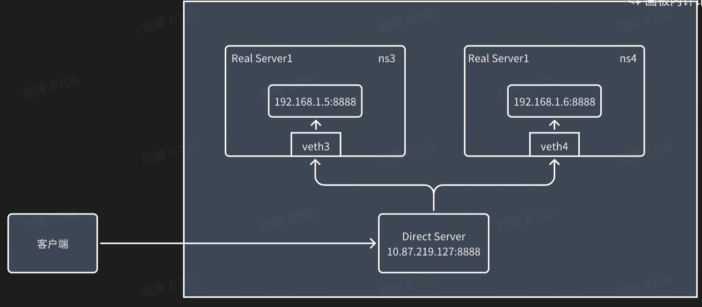
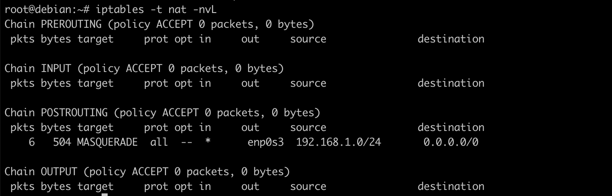
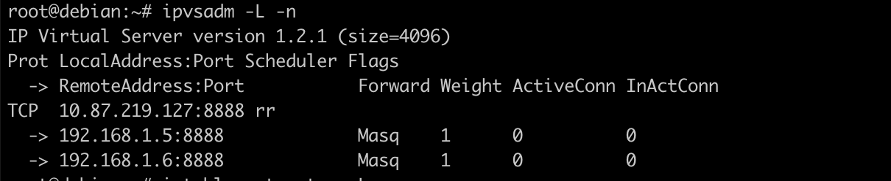
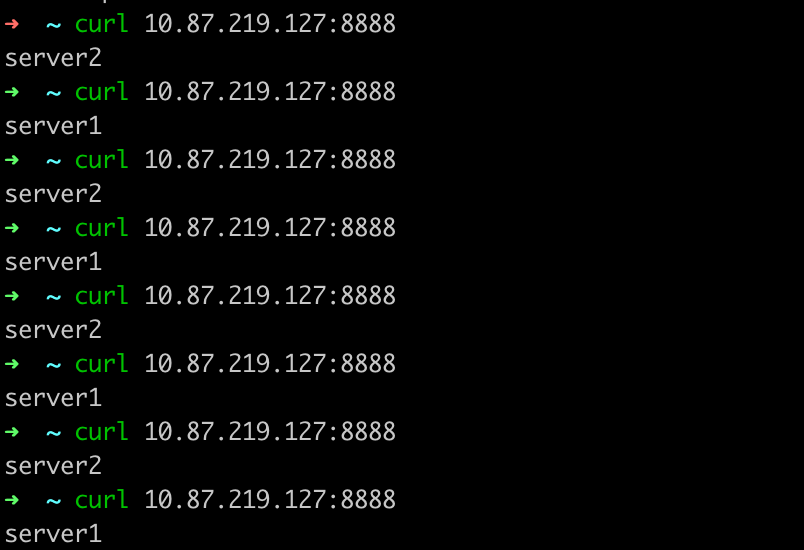

## lvs

Linux Virtual Server (lvs) 是Linux内核自带的负载均衡器，也是目前性能最好的软件负载均衡器之一。lvs包括ipvs内核模块和ipvsadm用户空间命令行工具两部分。

在lvs中，节点分为Director Server和Real Server两个角色，其中Director Server是负载均衡器所在节点，而Real Server则是后端服务节点。当用户的请求到达Director Server时，内核netfilter机制的PREROUTING链会将发往本地IP的包转发给INPUT链（也就是ipvs的工作链），在INPUT链上，ipvs根据用户定义的规则对数据包进行处理（如修改目的IP和端口等），并把新的包发送到POSTROUTING链，进而再转发给Real Server。

### 转发模式

**NAT**

NAT模式通过修改数据包的目的IP和目的端口来将包转发给Real Server。它的特点包括

- Director Server必须作为Real Server的网关，并且它们必须处于同一个网段内
- 不需要Real Server做任何特殊配置
- 支持端口映射
- 请求和响应都需要经过Director Server，易成为性能瓶颈



**DR**

DR（Direct Route）模式通过修改数据包的目的MAC地址将包转发给Real Server。它的特点包括

- 需要在Real Server的lo上配置vip，并配置arp_ignore和arp_announce忽略对vip的ARP解析请求
- Director Server和Real Server必须在同一个物理网络内，二层可达
- 虽然所有请求包都会经过Director Server，但响应报文不经过，有性能上的优势



**TUN**

TUN模式通过将数据包封装在另一个IP包中（源地址为DIP，目的为RIP）将包转发给Real Server。它的特点包括

- Real Server需要在lo上配置vip，但不需要Director Server作为网关
- 不支持端口映射



**FULLNAT**

FULLNAT是阿里在NAT基础上增加的一个新转发模式，通过引入local IP（CIP-VIP转换为LIP->RIP，而LIP和RIP均为IDC内网IP）使得物理网络可以跨越不同vlan，代码维护在[https://github.com/alibaba/LVS](https://github.com/alibaba/LVS)上面。其特点是

- 物理网络仅要求三层可达
- Real Server不需要任何特殊配置
- SYNPROXY防止synflooding攻击
- 未进入内核主线，维护复杂



### 调度算法

- 轮叫调度（Round-Robin Scheduling）
- 加权轮叫调度（Weighted Round-Robin Scheduling）
- 最小连接调度（Least-Connection Scheduling）
- 加权最小连接调度（Weighted Least-Connection Scheduling）
- 基于局部性的最少链接（Locality-Based Least Connections Scheduling）
- 带复制的基于局部性最少链接（Locality-Based Least Connections with Replication Scheduling）
- 目标地址散列调度（Destination Hashing Scheduling）
- 源地址散列调度（Source Hashing Scheduling）
- 最短预期延时调度（Shortest Expected Delay Scheduling）
- 不排队调度（Never Queue Scheduling）

# 基于IPVS实现负载均衡



拓扑：

暂时无法在飞书文档外展示此内容

前置准备：创建br0，配置IP地址192.168.1.52，添加veth3和veth4，为veth3和veth4设置ip地址为192.168.1.5和192.168.1.6，为veth设备设置br0作为默认网关。

设置Direct Server的iptables nat规则：

```
iptables -t nat -A POSTROUTING -s 192.168.1.0/24 -o enp0s3 -j MASQUERADE
```



设置ipvs规则：



在ns3和ns4分别启动python3的http服务：

在客户端中访问Direct Server：


