IPSec（Internet Protocol Security）是IETF（Internet Engineering Task Force）制定的一组开放的网络安全协议。它并不是一个单独的协议，而是一系列为IP网络提供安全性的协议和服务的集合。

IPSec用来解决IP层安全性问题的技术。IPSec被设计为同时支持IPv4和IPv6网络。

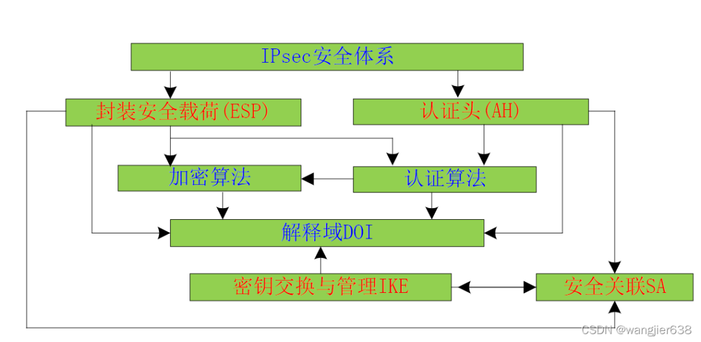

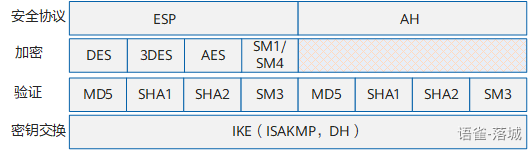

IPsec使用了下面的这些协议实现各种各样的功能：

- Authentication Headers(AH)（验证头）：可以同时提供数据完整性确认、数据来源确认、防报文重放等安全特性；AH常用摘要算法MD5和SHA1实现该特性。
- Encapsulating Security Payloads (ESP) （封装安全有效载荷）：可以同时提供数据完整性确认、数据加密、防重放等安全特性；ESP通常使用DES、3DES、AES等加密算法实现数据加密，使用MD5或SHA1来实现数据完整性。
- Security Associations (SA) ：提供算法和数据包，这些算法和数据包提供AH和ESP所需的参数。

IPSec通过加密与验证等方式，从以下几个方面保障了用户业务数据在Internet中的安全传输：

- 数据来源验证：接收方验证发送方身份是否合法。
- 数据加密：发送方对数据进行加密，以密文的形式在Internet上传送，接收方对接收的加密数据进行解密后处理或直接转发。
- 数据完整性：接收方对接收的数据进行验证，以判定报文是否被篡改。
- 抗重放：接收方拒绝旧的或重复的数据包，防止恶意用户通过重复发送捕获到的数据包所进行的攻击。

# 加密

ESP能够对IP报文内容进行加密保护，以防止IP报文内容在传输过程中被窥探。IPSec采用对称加密算法对数据进行加密和解密。对称加密算法是指数据发送方和接收方使用相同的密钥进行加密、解密。

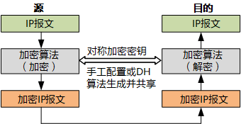

用于加密的对称密钥可以手工配置，也可以通过DH算法生成并在两端设备共享。

一般来说IPSec使用以下加密算法：

- DES（Data Encryption Standard）：使用64bit的密钥对一个64bit的明文块进行加密。
- 3DES（Triple Data Encryption Standard）：使用三个64bit的DES密钥（共192bit密钥）对明文形式的IP报文进行加密。
- AES-CBC-128（Advanced Encryption Standard Cipher Block Chaining 128）：使用128bit加密算法对IP报文进行加密。
- AES-CBC-192（Advanced Encryption Standard Cipher Block Chaining 192）：使用192bit加密算法对IP报文进行加密。
- AES-CBC-256（Advanced Encryption Standard Cipher Block Chaining 256）：使用256bit加密算法对IP报文进行加密。
- AES-GCM-128（Advanced Encryption Standard (AES) with 128-bit keys and 16-octet Integrity Check Value (ICV) in Galois/Counter Mode (GCM)）：使用128bit加密算法对IP报文进行加密。
- AES-GCM-192（Advanced Encryption Standard (AES) with 192-bit keys and 16-octet Integrity Check Value (ICV) in Galois/Counter Mode (GCM)）：使用192bit加密算法对IP报文进行加密。
- AES-GCM-256（Advanced Encryption Standard (AES) with 256-bit keys and 16-octet Integrity Check Value (ICV) in Galois/Counter Mode (GCM)）：使用256bit加密算法对IP报文进行加密。

3DES比DES安全得多，但是其加密速度慢于DES。AES比3DES更安全。

协议消息加密用于IKE协商阶段。协议消息加密所用的算法也是DES、3DES和AES。用于加密的对称密钥通过DH算法生成。

# 验证

IPSec采用HMAC（Keyed-Hash Message Authentication Code）功能进行认证。HMAC是HASH函数（单向散列函数）和消息认证码MAC（Message Authentication Code）的结合，HMAC利用Hash函数，以一个对称密钥和一个数据包作为输入，生成一个固定长度的输出，这个输出被称为完整性校验值ICV（Integrity Check Value）。接收方通过比较自身生成的ICV和对端发送的ICV来判断数据的完整性和真实性。

数据源验证和数据完整性验证统一被称为验证。因为这两种安全服务总是绑定在一起提供的。数据完整性验证是基于每个IP数据包进行计算；将完整性验证密钥同IPSec对端身份绑定的结果间接提供了数据源验证。

虽然加密后的数据只能通过原始的加密密钥进行解密，但是无法验证解密后的信息是否是原始发送的信息。另外加密和解密的过程非常的消耗CPU资源，恶意用户可能会通过发送欺骗数据包，占用CPU资源。HMAC功能通过比较数字签名进行数据包完整性和真实性验证，这个过程消耗的CPU资源非常少，效率非常高。

所以在IPSec VPN发送设备中，加密和验证通常配合使用。加密后的报文经HMAC生成数字签名，IP报文和数字签名同时发给对端（数字签名填写在AH和ESP报文头的完整性校验值ICV字段，请参见安全协议）；在接收设备中，通过比较数字签名进行数据完整性和真实性验证，验证不通过的报文直接丢弃，验证通过的报文再进行解密。

**常见的**hash算法：

- MD5：消息摘要MD5（Message Digest 5），输入任意长度的消息，MD5产生128位的签名。MD5比SHA更快，但是安全性稍差。
- SHA1：安全散列算法SHA（Secure Hash Algorithm）是由NIST开发的。在1994年对原始的HMAC功能进行了修订，被称为SHA1。输入长度小于264bit的消息，SHA1产生 **160位** 的消息摘要。SHA1比MD5要慢，但是更安全。因为它的签名比较长，具有更强大的防攻破功能，并可以更有效的发现共享的密钥。
- SHA2：SHA2是SHA1的加强版本，SHA2算法相对于SHA1加密数据长度有所上升，安全性能要远远高于SHA1。SHA2算法包括SHA2-256、SHA2-384和SHA2-512，密钥长度分别为256位、384位和512位。随着密钥长度的上升，认证算法安全强度更高，但计算速度越慢。一般情况下256位就可以充分满足安全需求。

# IPsec的封装模式

封装模式是指将AH或ESP相关的字段插入到原始IP报文中，以实现对报文的认证和加密，封装模式有传输模式和隧道模式两种。

## 传输模式

在传输模式中，AH头或ESP头被插入到IP头与传输层协议头之间，保护TCP/UDP/ICMP负载。传输模式不改变报文头。

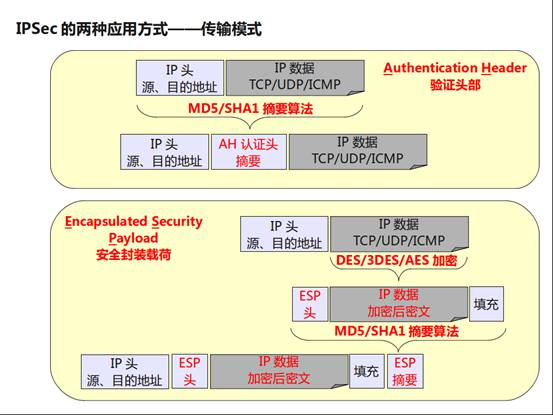

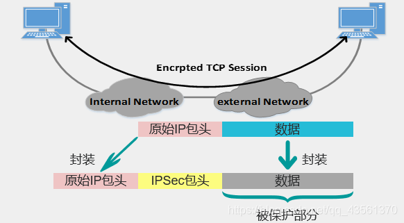

传输模式下，AH协议的完整性验证范围为整个IP报文。ESP协议验证报文的完整性检查部分包括ESP头、传输层协议头、数据和ESP包尾，但不包括IP头，因此ESP协议无法保证IP头的安全。ESP的加密部分包括传输层协议头、数据和ESP包尾。

## 隧道模式

在原IP头部之前插入ESP/AH头部，同时生成新的IP头部。

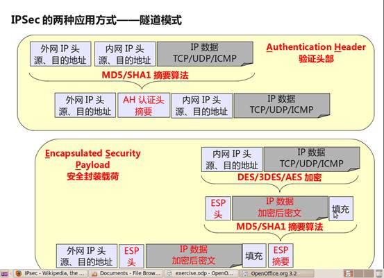

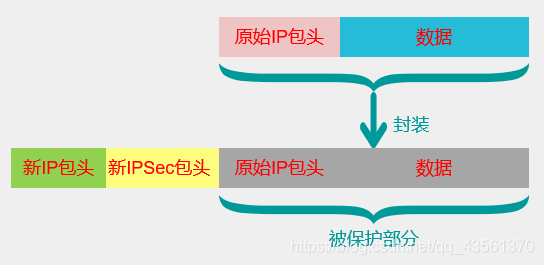

隧道模式下，AH协议的完整性验证范围为包括新增IP头在内的整个IP报文。ESP协议验证报文的完整性检查部分包括ESP头、原IP头、传输层协议头、数据和ESP报尾，但不包括新IP头，因此ESP协议无法保证新IP头的安全。ESP的加密部分包括原IP头、传输层协议头、数据和ESP报尾。

隧道模式下：

- 整个包被封装加密，形成新的IP头部。沿途路由器不检查内部的IP报头。
- 适用于隧道结束在某个非目的地(安全网关，防火墙)该目的地结束IPsec隧道，还原成原来数据包在本地网（局域网）传输（局域网不用理解IPsec）
- 隧道模式的另一个好处是可以将聚集TCP连接当成一个流加密。可以抵抗traffic analysis
- 加密发生在外部主机与安全网关之间或者发生在两个安全网关之间。

## 传输模式和隧道模式比较

传输模式和隧道模式的区别在于：

- 从安全性来讲，隧道模式优于传输模式。它可以完全地对原始IP数据报进行验证和加密。隧道模式下可以隐藏内部IP地址，协议类型和端口。
- 从性能来讲，隧道模式因为有一个额外的IP头，所以它将比传输模式占用更多带宽。

当安全协议同时采用AH和ESP时，AH和ESP协议必须采用相同的封装模式。

# 封装协议（安全协议）

IPSec使用认证头AH（Authentication Header）和封装安全载ESP（Encapsulating Security Payload）两种安全协议来传输和封装数据，提供认证或加密等安全服务。

## AH

- AH是一种基于IP的传输层协议，协议号为51。
- 只能支持认证 ，不支持加密 。
- 对整个头部进行认证。

**工作原理：**

其工作原理是在每一个数据包的标准IP报头后面添加一个AH报文头。如下所示：

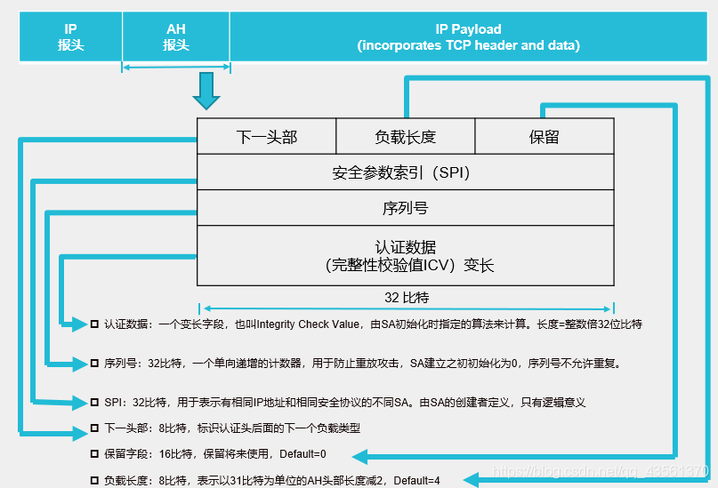

AH对数据包和认证密钥进行Hash计算，接收方收到带有计算结果的数据包后，执行同样的Hash计算并与原计算结果比较，传输过程中对数据的任何更改将使计算结果无效，这样就提供了数据来源认证和数据完整性校验。AH协议的完整性验证范围为整个IP报文。

**AH报文头字段含义：**

|   |   |   |
|---|---|---|
|字段|长度|含义|
|下一头部|8比特|标识AH报文头后面的负载类型。传输模式下，是被保护的上层协议（TCP或UDP）或ESP协议的编号；隧道模式下，是IP协议或ESP协议的编号。注意：当AH与ESP协议同时使用时，AH报文头的下一头部为ESP报文头。|
|负载长度|8比特|表示以32比特为单位的AH报文头长度减2，缺省为4。|
|保留字段|16比特|保留将来使用，缺省为0。|
|SPI|32比特|IPSec安全参数索引，用于唯一标识IPSec安全联盟。|
|序列号|32比特|是一个从1开始的单项递增的计数器，唯一地标识每一个数据包，用于防止重放攻击。|
|认证数据|一个变长字段，长度为32比特的整数倍，通常为96比特。|该字段包含数据完整性校验值 ICV（Integrity Check Value），用于接收方进行完整性校验。可选择的认证算法有MD5、SHA1、SHA2、SM3。|

**Ah****报文****抓包****示例：**

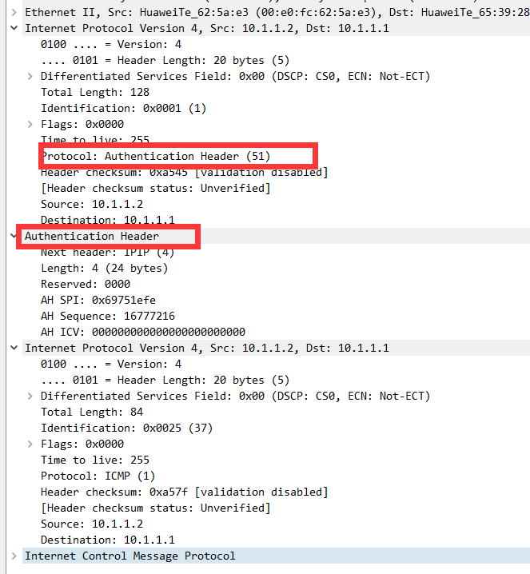

## ESP

ESP支持加密和认证。

ESP是一种基于IP的传输层协议， **协议号为50** 。其工作原理是在每一个数据包的标准IP报头后面添加一个ESP报文头，并在数据包后面追加一个ESP尾（ESP Tail和ESP Auth data）。与AH不同的是，ESP将数据中的有效载荷进行加密后再封装到数据包中，以保证数据的机密性，但ESP没有对IP头的内容进行保护。

ESP通常使用DES、3DES、AES等加密算法实现数据加密，使用MD5或SHA1来实现数据完整性认证。

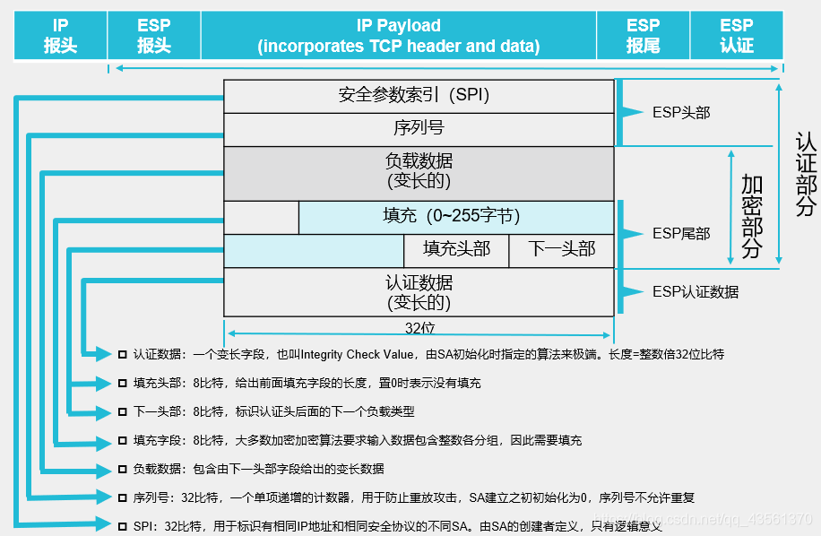

**ESP****报文头字段：**

|   |   |   |
|---|---|---|
|字段|长度|含义|
|SPI|32比特|IPSec安全参数索引，用于唯一标识IPSec安全联盟。|
|序列号|32比特|是一个从1开始的单项递增的计数器，唯一地标识每一个数据包，用于防止重放攻击。|
|负载数据|—|包含由下一头部字段给出的变长数据。|
|填充字段|—|用于增加ESP报文头的位数。填充字段的长度与负载数据的长度和算法有关。当待加密报文的明文长度不是加密算法所要求的块长度时，需要进行填充补齐。|
|填充长度|8比特|给出前面填充字段的长度，置0时表示没有填充。|
|下一头部|8比特|标识ESP报文头后面的下一个负载类型。传输模式下，是被保护的上层协议（TCP或UDP）的编号；隧道模式下，是IP协议的编号。|
|认证数据|一个变长字段，长度为32比特的整数倍，通常为96比特。|该字段包含数据完整性校验值ICV，用于接收方进行完整性校验。可选择的认证算法与AH的相同。ESP的验证功能是可选的，如果启动了数据包验证，会在加密数据的尾部添加一个ICV数值。|

**ESP****报文****抓包****示例：**

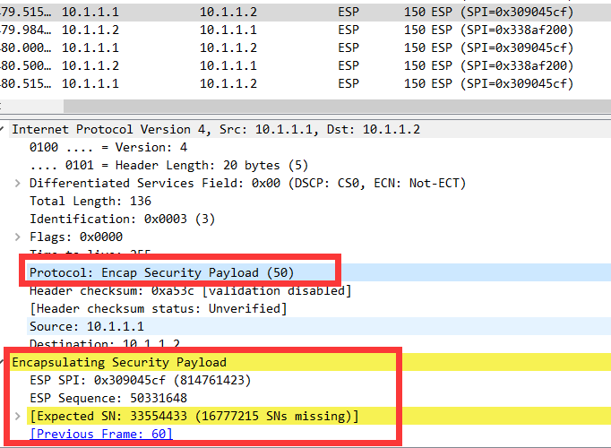

## AH协议和ESP协议比较

|   |   |   |
|---|---|---|
|安全特性|AH|ESP|
|协议号|51|50|
|数据完整性校验|支持（验证整个IP报文）|支持（不验证IP头）|
|数据源验证|支持|支持|
|数据加密|不支持|支持|
|防报文重放攻击|支持|支持|
|IPSec NAT-T（NAT穿越）|不支持|支持|

# **安全联盟**SA

**定义：** 安全联盟是要建立IPSec 隧道的通信双方对隧道参数的约定，包括隧道两端的IP地址、隧道采用的验证方式、验证算法、验证密钥、加密算法、共享密钥以及生命周期等一系列参数。

SA由三元组来**唯一标识**，这个三元组包括安全参数索引SPI（Security Parameter Index）、目的IP地址和使用的安全协议号（AH或ESP）。其中，SPI是为唯一标识SA而生成的一个32位比特的数值，它在AH和ESP头中传输。在手工配置SA时，需要手工指定SPI的取值。使用IKE协商产生SA时，SPI将随机生成。

SA是单向的逻辑连接，因此两个IPSec对等体之间的双向通信，最少需要建立两个SA来分别对两个方向的数据流进行安全保护。

SA是IPSec的一个基本组成部分，SA是SAD（安全关联数据库）的一个条目，它包含双方关于IKE和IPSec已经协商完毕的安全信息。

- IKE or ISAKMP SA：双向的，决定了IKE协议处理相关细节
- IPSec SA：单向的，与封装协议相关，决定了具体加密流量的处理方式。

两种类型的SA都是由IKE协议协商产生的。

**建立****IPSec****SA****的方式：**手工方式和IKE自动协商方式。

二者的主要区别为：

- 密钥生成方式不同：手工方式下，建立SA所需的全部参数，包括加密、验证密钥，都需要用户手工配置，也只能手工刷新，在中大型网络中，这种方式的密钥管理成本很高；IKE方式下，建立SA需要的加密、验证密钥是通过DH算法生成的，可以动态刷新，因而密钥管理成本低，且安全性较高。
- 生存周期不同：手工方式建立的SA，一经建立永久存在；IKE方式建立的SA，其生存周期由双方配置的生存周期参数控制。

# IKE协议介绍

因特网密钥交换lKE(Internet Key Exchange)协议由Internet安全联盟(SA)和密钥管理协议(ISAKMP)组成，是基于UDP(UserDatagram Protocol)的应用层协议。它为IPSec提供了自动协商密钥、建立IPSec安全联盟的服务，能够简化IPSec的使用和管理，大大简化IPSec的配置和维护工作。

## IKE的背景

1. 用IPSec保护一个IP包之前，必须先建立安全联盟（SA）。
2. IPSec的安全联盟可以通过手工配置的方式建立。但是当网络中节点较多时，手工配置将非常困难，而且难以保证安全性。这时就可以使用**IKE****（Internet Key Exchange）**自动进行安全联盟建立与密钥交换的过程。Internet密钥交换（IKE）就用于动态建立SA，代表IPSec对SA进行协商。

## IKE的认证方式

身份认证确认通信双方的身份（对等体的IP地址或名称），包括预共享密钥PSK（pre-shared key）认证、数字证书RSA（rsa-signature）认证和数字信封认证。

- 在预共享密钥认证中，认证字作为一个输入来产生密钥，通信双方采用共享的密钥对报文进行Hash计算，判断双方的计算结果是否相同。如果相同，则认证通过；否则认证失败。
- 在数字证书认证中，通信双方使用CA证书进行数字证书合法性验证，双方各有自己的公钥（网络上传输）和私钥（自己持有）。发送方对原始报文进行Hash计算，并用自己的私钥对报文计算结果进行加密，生成数字签名。接收方使用发送方的公钥对数字签名进行解密，并对报文进行Hash计算，判断计算结果与解密后的结果是否相同。如果相同，则认证通过；否则认证失败。
- 在数字信封认证中，发送方首先随机产生一个对称密钥，使用接收方的公钥对此对称密钥进行加密（被公钥加密的对称密钥称为数字信封），发送方用对称密钥加密报文，同时用自己的私钥生成数字签名。接收方用自己的私钥解密数字信封得到对称密钥，再用对称密钥解密报文，同时根据发送方的公钥对数字签名进行解密，验证发送方的数字签名是否正确。如果正确，则认证通过；否则认证失败。

## IKE v1工作过程

IKE经过两个阶段为IPSec进行密钥协商并建立安全联盟：

- 第一阶段交换：通信各方彼此间建立了一个已通过身份验证和安全保护的通道，此阶段的交换建立了一个ISAKMP安全联盟，即ISAKMP SA（也可称为IKE SA）。第一阶段交换有两种协商模式：

- 主模式协商，一般情况下，IKE的主模式适用于两设备的公网IP固定、且要实现设备之间点对点的环境。
- 野蛮模式协商，对于例如ADSL拨号用户，其获得的公网IP不是固定的，且可能存在NAT设备的情况下，采用野蛮模式做NAT穿越，同时，由于IP不是固定的，用name作为id-type，总部采用模板的方式接收分支的IPSEC接入。

- 第二阶段交换：用已经建立的安全联盟（IKE SA）为IPSec协商SA，产生真正可以用来加密数据流的密钥，IPSec SA用于最终的IP数据安全传送。

### DH交换算法

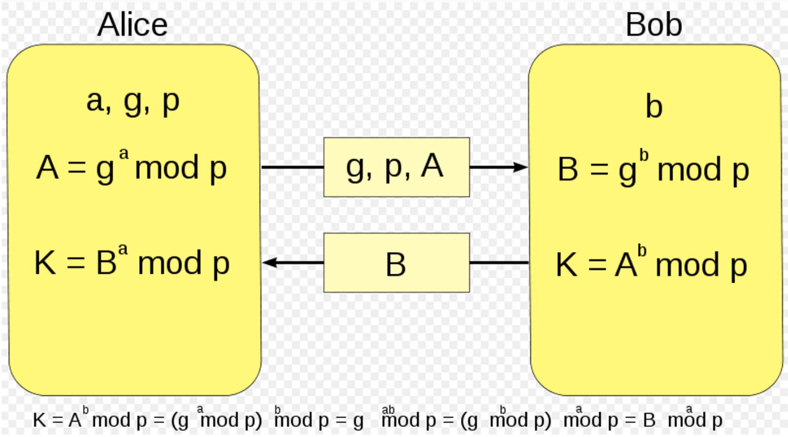

### IKE阶段1

协商过程：

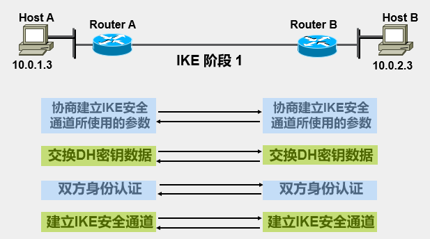

#### 主模式

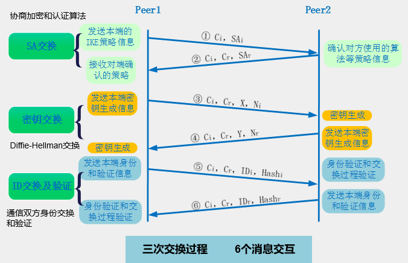

第一次交换：**策略协商**

- 在第1个数据包的传输过程中，发送方发起一个包含cookie (记为：Ci ) 和SA负载（记为：SAi，携带协商IKE SA的各项参数（5元组），包括IKE的认证算法如MD5；加密算法如DES、3DES等；认证方式如预共享密钥、数字签名等；DH组；密钥有效期）的数据包用来协商参数。
- 接收方查看IKE策略消息，在本地寻找与发送方IP地址匹配的策略，找到后发回一条消息去响应。响应者发送一个cookie （记为：Cr）和SA负载（记为：SAr，已经挑选的安全参数）；如果没有可以挑选的参数，响应者会返回一个负载拒绝。

第二次交换：Diffie-Hellman交换

- 执行DH交换，发起者和接收者交换伪随机数nonce和本端的DH公共值，用于计算共享密钥。

第三次交换（消息5和6）：使用加密密钥交换身份信息和认证信息的密文。

在5、6个包里，就用前面产生的认证密钥进行相互认证，这里可以通过预共享、数字签名、加密临时值来实现。当相互认证通过，那么为第二阶段协商IPSEC SA策略的安全通道立即打开，两端的VPN服务器会用第一阶段协商的安全策略对第二阶段协商的IPSEC SA策略进行安全加密和认证。

同时要注意，从第5个包起，后面的所有包将会加密，只不过不同的是，第5、6个包和第二阶段用于协商的3个包都是通过第一阶段协商的安全策略进行加密的，而用户通信的数据则是用第二阶段协商的IPSEC SA策略进行加密和认证的，至于两者的密钥是否一样，就要看在第二阶段是否定义了PFS策略，如果应用了，那第二阶段的密钥将与第一阶段的不同，否则两者的密钥是一样的。

#### 野蛮模式

野蛮模式同样包含三个步骤，仅通过三个包进行传输，野蛮模式标识为Aggressive。

野蛮模式交互过程少，所以在传输过程中，其传输的数据比较多，并且前两个数据为明文传输，仅消息3为加密传输。

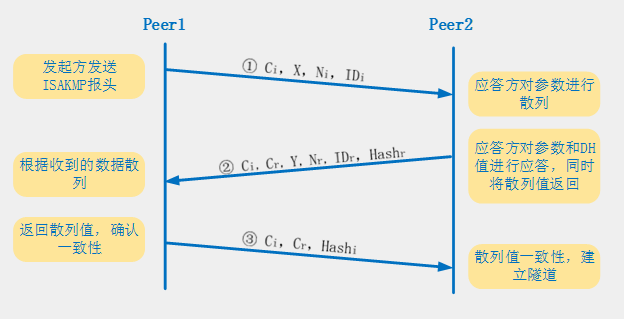

1. 第一条消息：发起者触发IKEv1第一阶段野蛮模式协商，发送一个包括SA载荷、秘钥交换载荷、Nonce随机数载荷和身份信息载荷。野蛮模式将主模式中需要进行交换的数据全部进行了发送。
2. 第二条消息：响应者发送SA载荷、秘钥交换载荷、Nonce载荷、身份信息和供发起者使用的HASH认证信息。当响应方接收到发起方发送来的消息1后，通过查看自身SPD是否存在与发起方匹配的相关策略，若存在，则利用消息1中信息与自身配置进行计算，生成身份验证hash值后，将自身配置策略信息和hash值传送给发起方。
3. 第三条消息：发起者认证响应者的消息，发送HASH认证信息，供响应者认证。

但是要注意: 包含身份信息的消息未被加密, 所以和主模式不同，野蛮模式不提供身份保护。

#### 两种模式对比

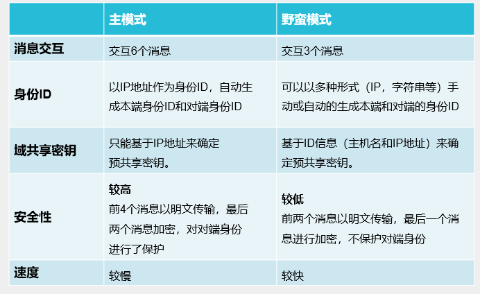

1. NAT支持：对预共享密钥认证：主模式不支持NAT转换，而野蛮模式支持。而对于证书方式认证：两种模式都能支持
2. 对等体标识：主模式只能采用IP地址方式标识对等体；而野蛮模式可以采用IP地址方式或者Name方式标识对等体。这是由于主模式在交换完3、4消息以后，需要使用预共享密钥来计算SKEYID，当一个设备有多个对等体时，必须查找到该对等体对应的预共享密钥，但是由于其对等体的ID信息在消息5、6中才会发送，此时主模式的设备只能使用消息3、4中的IP报文源地址来找到与其对应的预共享密钥；如果主模式采用Name方式，Name信息却包含在消息5、6中，而设备必须在消息5、6之前找到其对等体的预共享密钥，就造成了矛盾，无法完成Name方式的标识。而在野蛮模式中，ID消息在消息1、2中就已经发送了，设备可以根据ID信息查找到对应的预共享密钥，从而计算SKEYID。但是由于野蛮模式交换的2个消息没有经过加密，所以ID信息也是明文的，也相应造成了安全隐患。

### IKE阶段2

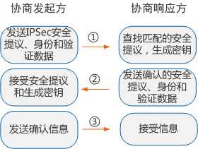

与第一阶段的过程类似，参与者交换建议，以确定在SA中采用哪些安全参数。

双方协商IPSec安全参数，称为变换集transform set，包括：加密算法、Hash算法、安全协议、封装模式、存活时间。

阶段2提案还包括安全协议-封装安全有效载荷（ESP）或认证头（AH）以及所选的加密和认证算法。

## IKE v2

正常情况下，IKEv2通过初始交换就可以完成第一对IPSec SA的协商建立。IKEv2初始交换对应IKEv1的第一阶段，初始交换包含两次交换四条消息。

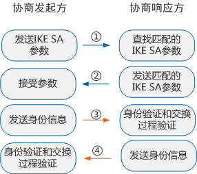

消息①和②属于第一次交换（称为IKE_SA_INIT交换），以明文方式完成IKE SA的参数协商，包括协商加密和验证算法，交换临时随机数和DH交换。IKE_SA_INIT交换后生成一个共享密钥材料，通过这个共享密钥材料可以衍生出IPSec SA的所有密钥。相当于IKEv1的主模式的第1,3个包。

消息③和④属于第二次交换（称为IKE_AUTH交换），以加密方式完成身份认证、对前两条信息的认证和IPSec SA的参数协商。IKEv2支持RSA签名认证、预共享密钥认证以及扩展认证方法EAP（Extensible Authentication Protocol）。EAP认证是作为附加的IKE_AUTH交换在IKE中实现的，发起者通过在消息3中省去认证载荷来表明需要使用EAP认证。

# 路由模式

## 目的路由

对于任何来源和目的地址的报文，会建立或服用IPsec SA。

## 感兴趣流

根据源网段和目的网段规则，判断是否建立IPsec SA或者复用IPsec SA。

IKEv1下双方的感兴趣流规则需要互为镜像

IKEv2下没有限制，会取双方感兴趣流规则的交集。

# NAT-T介绍

- NAT-T协议在IKE协商和VPN连接时，允许源端口非UDP500端口，目的端口为4500；
- ESP/AH是网络层协议，没有端口的概念，为了让NAT设备可以处理IPsec协议包，NAT-T为IPsec流量添加了UDP头部，允许进行NAT，默认使用4500端口。

## 协商过程的NAT支持

在采用数字证书方式进行认证时，IP地址的改变不会影响认证。

在采用预共享密钥认证时：

- IKEv1野蛮模式：在消息1和2中明文传输身份信息，可以通过非IP地址的字符串，如域名来作为身份标识，天然支持NAT。但安全性较低。
- IKEv1主模式在消息5和消息6之前，只知道对端的IP地址，因此只能用IP地址作为身份信息，但是经过NAT网关会改变IP地址，导致认证失败。想要在主模式下支持NAT需要开启NAT-T功能。
- IKEv2和IKEv1的主模式类似，只能通过IP地址进行认证，但IKEv2默认开启NAT-T功能。

## 传输协议的NAT支持

1. 传输模式

- 对AH协议，其Authenticate范围是整个IP报文，所以如果两个IPsec之间存在NAT设备，修改了报文IP Header中的地址，就会导致接收方的Authenticate失败。
- 对ESP协议，其Authenticate范围不包括IP Header，所以接收方的Authenticate会通过，但如果中间的NAT设备修改了IP Header中的地址，而TCP和UDP计算校验和时都会加上IP伪头部进行计算，IP Header改变，后面的TCP/UDP checksum也会随之修改，但这部分在ESP协议中是加密的，NAT设备没有办法修改，所以接收端在接收时会出现checksum校验失败。

2. 隧道模式

- 对AH协议，Authenticate范围包含了外层IP Header，因此同样会造成接收方Authenticate失败。
- 对ESP协议，与Transport模式不同的是，经过NAT设备。内层IP Header并不会改变，所以TCP checksum也不会变化，接收方不会出现checksum校验失败，因此隧道模式下，经过NAT设备可以传输成功。

然而，即使是隧道模式的ESP协议，如果不开启NAT-T，也仅支持IP的NAT（因为它没有端口，无法通过NAPT设备），不支持IP+端口的NAT。

## UDP-Encapsulate

IPsec采用的办法是在ESP Header前加上一个UDP Header, 这个方法同时适用于ESP-Transport和ESP-Tunnel模式。 下图展示了ESP-Transport下的UDP-Encapsulate过程。

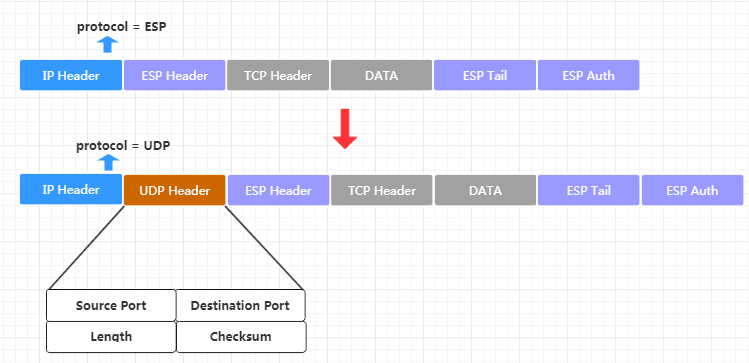

UDP Header是有端口字段的，有了端口，NAT设备便可以进行端口转换。RFC3948中规定UDP Header中的端口要使用和IKE协商时相同的端口号，这个端口号在RFC3947中规定为4500.

在下面这样的拓扑中，NAT设备背后有两台内网主机，它们都与Server建立IPsec连接。

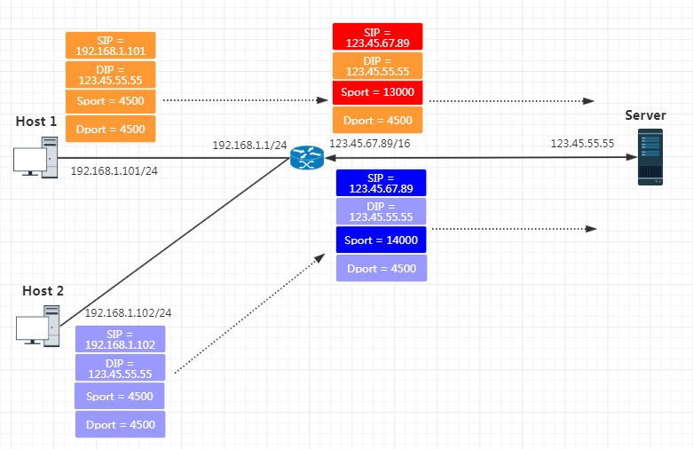

Host 1与Host 2发出的IPsec报文都附加了一个UDP Header。NAT网关替换该报文的Source IP和Source Port。

对于ESP-Transport模式, 内层TCP报文的checksum校验的问题如何解决呢？要知道，经过NAT设备之后，报文的IP地址发生了变化，这势必导致接收端校验失败。IPsec采用的方法是在IKE协商时，就将自己原始IP地址信息发给对端，这样Server在解密出TCP报文后，可以根据这个信息修正checksum。

## IKEv1 NAT-T

IPsec的通信实体之间需要在IKE时完成协商才能使用上面UDP-Encapsulate，完成NAT-T。

在IKEv1的阶段1

- 双方探测出双方都支持NAT-T
- 双方探测出了报文传输路径上存在NAT设备

在IKE的阶段2

- 双方协商NAT-T的封装模式，UDP-Encapsulated-Tunnel还是UDP-Encapsulated-Transport
- (UDP-Encapsulated-Transport)模式向对方发送自己的原始IP地址, 让对方可以据此修正后续TCP报文的checksum

阶段1具体流程：

1. IKEv1的前两个消息会发送标识NAT-T能力的VendorID载荷（主模式+野蛮模式），用于检查双方是否支持NAT-T。
2. 主模式消息3和4（野蛮模式2和3）会发送NAT-D载荷，探测通信双方隧道中是否存在NAT网关。通信双方会交换自己的和自己眼中对方的IP和Port的哈希值，如果中间存在NAT设备，则该值一定与该报文本身的IP和Port计算出的值不一致。

如果双方存在NAT网关，则后续通信（主模式消息5和6，野蛮模式消息3）开启NAT-T，采用UDP 4500端口通信，报文标识“Non-ESP Marker”。

## IKEv2 NAT-T

开启NAT-T后，在消息1和2中探测NAT网关是否存在，如果存在，在消息3和4启用NAT-T，用UDP封装ISAKMP报文进行通信。
