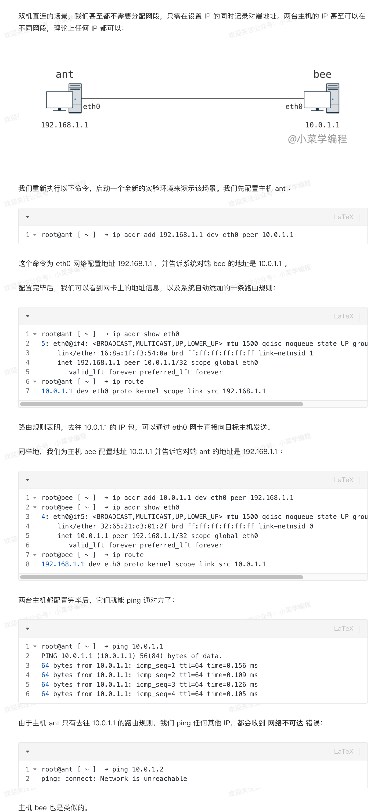
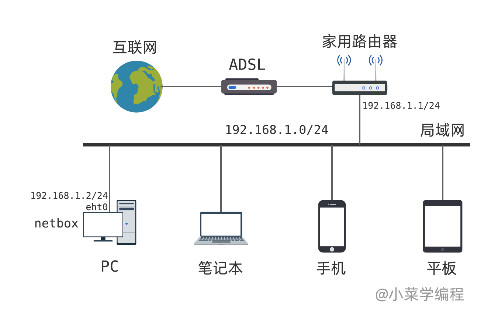
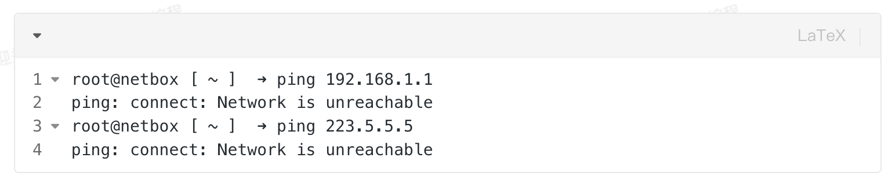
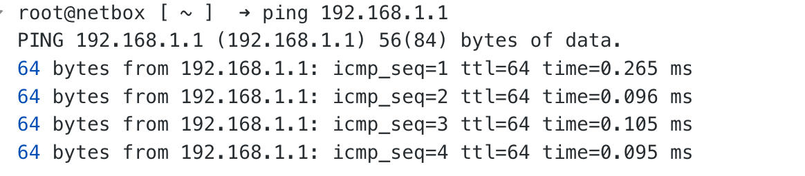

# 双机直连



# 家庭网络配置

下图是一个典型的家用局域网拓扑，路由器通过 ADSL 连接互联网，局域网内的网络设备则通过路由器上网。那么，对于接入这个局域网的一台主机，如何设置 IP 地址，才能上网呢？



现在，以上图中的 PC 为例，进行实验。

PC 通过 eth0 网卡连接局域网，刚开始时网卡还没配置 IP 地址，因此，这时 PC 无法 ping 通局域网中的其他设备，比如路由；更别说访问公网服务了：



223.5.5.5 是一个公网 IP ，运行着阿里提供的公共 DNS 服务。

我们先执行 ip 命令，为 eth0 网络配置一个局域网 IP 地址。如无意外，PC 就可以访问局域网中的其他设备了：

```
ip addr add 192.168.1.2/24 dev eth0
```



请注意，选用的 IP 地址必须与局域网在同一个网段，而且不能与其他设备冲突。

IP 地址配置好后，是不是就可以访问公网了呢？ 显然不是。我们 ping 公网地址时，ping 命令报网络不可达错误。这是为什么呢？ PC 路由表一开始是空的，我们为 eth0 配置好 IP 地址后，系统自动添加了一条直接路由，用于访问局域网：

```
root@netbox [ ~ ] ip route
192.168.1.0/24 dev eth0 proto kernel scope link src 192.168.1.2
```

这条路由的意思是，去往 192.168.1.0/24 这个网段的 IP 包，可以通过 eth0 网卡，直接发到目标设备。

由于 223.5.5.5 不在这个这个网段内，系统也就不知道该如何处理发给它的 IP 包，这也是 ping 命令报错的原因。

为了访问互联网，我们为 PC 添加一条默认路由，以路由器 192.168.1.1 为下一跳：

```
ip route add default via 192.168.1.1
```

有了这条默认路由，如果一个 IP 包未命中其他任何路由规则，默认将发给路由器 192.168.1.1 ，由它负责转发。

这样一来，去往 223.5.5.5 的 IP 包，系统将发给路由器 192.168.1.1 ，路由器则接力将包发送到互联网。

有了默认路由之后，我们就可以 ping 通公网 IP 223.5.5.5 了。
