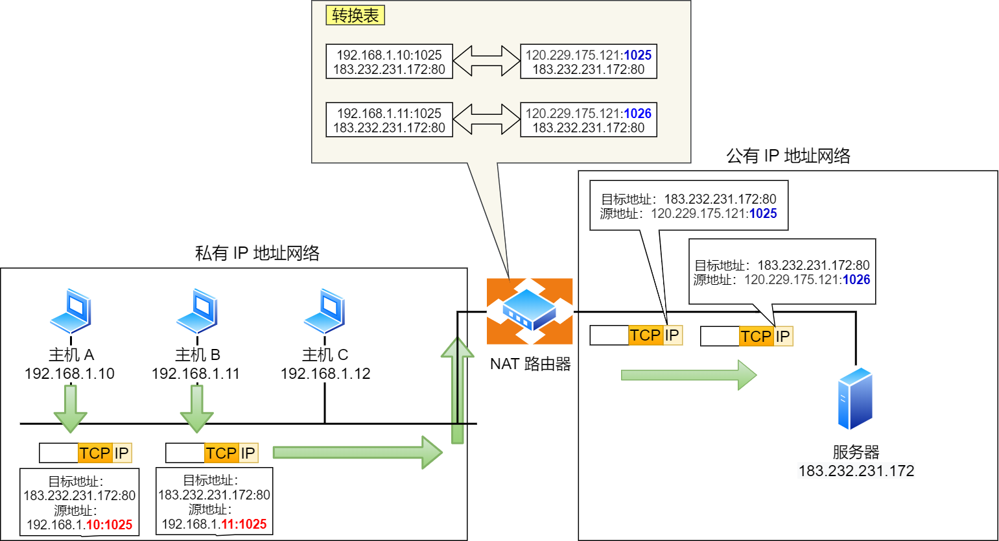

# NAT协议



**两个私有 IP 地址都转换 IP 地址为公有地址 120.229.175.121，但是以不同的端口号作为区分。**

由于 NAT/NAPT 都依赖于自己的转换表，因此会有以下的问题：

- 外部无法主动与 NAT 内部服务器建立连接，因为 NAPT 转换表没有转换记录。
- 转换表的生成与转换操作都会产生性能开销。
- 通信过程中，如果 NAT 路由器重启了，所有的 TCP 连接都将被重置。

**NAT的实现依赖`connection tracking`**

**`connection tracking`是实现`NAT`地址转换的灵魂，一个连接仅在首次经过`netfilter`链条时会计算`NAT`表，一旦`connection tracking`记录下这次的改写关系，后续无论是去程包还是回程包都是依据`connection tracking`表进行改写关系的处理，不会再重复执行`NAT`表中的`DNAT/SNAT`规则**

系统根据一组现有连接检查每个数据包，将更新数据包所属连接的状态，或增加一个新的连接。**在`raw table chains`中标记有`NOTRACK target`的数据包将绕过`connection tracking`处理流程**

在`connection tracking`中，一个数据包可能被标记为如下几种状态

1. **`NEW`**：当前数据包不属于任何一个现有的`connection`，且是一个合法的`first package`，那么将会创建一个新的`connection`
2. **`ESTABLISHED`**：当收到一个`response`时，`connection`会从`NEW`状态变为`ESTABLISHED`状态。对于`TCP`，这意味着这是一个`SYN/ACK`数据包；对于`UDP`，这意味着这是一个`ICMP`数据包
3. **`RELATED`**：当前数据包不属于任何一个现有的`connection`，但是关联到某个`connection`。这通常是一个`helper connection`，例如`FTP data transmission connection`或者是`ICMP`对其他协议的`连接尝试`的响应
4. **`INVALID`**：当前数据包不属于任何一个现有的`connection`，也不是一个合法的`first package`
5. **`UNTRACKED`**：通过`raw table`的配置，绕过`connection tracking`的处理流程
6. **`SNAT`**：`source address`被`NAT`修改时设置的虚拟状态，被记录在`connection tracking`中，以便在`reply package`（我回复别人）中更改`source address`
7. **`DNAT`**：`destination address`被`NAT`修改时设置的虚拟状态，被记录在`connection tracking`中，以便在路由`reply package`（别人回复我）时知道更改`destination address`

# NAT穿透技术

NAT 穿越技术拥有这样的功能，它能够让网络应用程序主动发现自己位于 NAT 设备之后，并且会主动获得 NAT 设备的公有 IP，并为自己建立端口映射条目，注意这些都是 NAT设备后的应用程序自动完成的。

也就是说，在 NAT 穿透技术中，NAT设备后的应用程序处于主动地位，它已经明确地知道 NAT 设备要修改它外发的数据包，于是它主动配合 NAT 设备的操作，主动地建立好映射，这样就不像以前由 NAT 设备来建立映射了。

说人话，就是客户端主动从 NAT 设备获取公有 IP 地址，然后自己建立端口映射条目，然后用这个条目对外通信，就不需要 NAT 设备来进行转换了。

# 基于iptables实现SNAT

```
ip netns add ns3

ip link add veth3-ns type veth peer name veth3

ip link set veth3-ns netns ns3
ip link set veth3 up

ip netns exec ns3 ip addr add 192.168.1.5/24 dev veth3-ns
ip netns exec ns3 ip link set veth3-ns up

ip netns exec ns3 route add default gw 192.168.1.52

echo 1 > /proc/sys/net/ipv4/ip_forward 

iptables -t nat -A POSTROUTING -s 192.168.1.0/24 -o enp0s3 -j MASQUERADE
```

# 基于iptables实现DNAT

```
#!/bin/sh

ip netns add ns4

ip link add veth4-ns type veth peer name veth4

ip link set veth4-ns netns ns4
ip netns exec ns4 ip addr add 192.168.1.6/24 dev veth4-ns
ip netns exec ns4 ip link set veth4-ns up

ip link set veth4 up

ip netns exec ns4 route add default gw 192.168.1.52
iptables -t nat -A PREROUTING -d 10.87.217.187 -p tcp --dport 39999 -i enp0s3 -j DNAT --to 192.168.1.6:9999

echo 1 > /proc/sys/net/ipv4/ip_forward

ovs-vsctl add-port br0 veth4
```

在ns4开启一个http server

```
root@debian:~# ip netns exec ns4 python3 -m http.server 9999
Serving HTTP on 0.0.0.0 port 9999 (http://0.0.0.0:9999/) ...
10.87.219.127 - - [04/Aug/2023 15:02:47] "GET / HTTP/1.1" 200 -
```

在另一台虚拟机访问

```
root@debian:~# curl 10.87.217.187:39999
<!DOCTYPE HTML PUBLIC "-//W3C//DTD HTML 4.01//EN" "http://www.w3.org/TR/html4/strict.dtd">
<html>
<head>
<meta http-equiv="Content-Type" content="text/html; charset=utf-8">
<title>Directory listing for /</title>
</head>
<body>
<h1>Directory listing for /</h1>
<hr>
<ul>
<li><a href=".bash_history">.bash_history</a></li>
<li><a href=".bashrc">.bashrc</a></li>
<li><a href=".gnupg/">.gnupg/</a></li>
<li><a href=".profile">.profile</a></li>
<li><a href=".python_history">.python_history</a></li>
<li><a href=".ssh/">.ssh/</a></li>
<li><a href=".viminfo">.viminfo</a></li>
<li><a href="dnat.sh">dnat.sh</a></li>
<li><a href="init.sh">init.sh</a></li>
</ul>
<hr>
</body>
</html>
```

# ICMP协议的NAT

https://zhuanlan.zhihu.com/p/375937088

首先ICMP的报文格式如下

|   |   |   |
|---|---|---|
|类型（Type）|代码（Code）|检验和（Checksum）|
|标识符（Identifier）|   |序列号（Sequence number）|
|选项（Option）|   |   |

在A发送ICMP报文的时候，会根据（Type+Code）的值生成源端口号，根据Identifier的值生成目的端口号，即发送到路由器的报文如下：

源报文：

|   |   |   |   |
|---|---|---|---|
|源IP|源端口|目的IP|目的端口|
|192.168.0.2|（Type+Code）|200.10.2.1|Identifier|

在路由器上进行SNAT，源IP更改后ICMP报文中的Identifier会改变，记作IDENTIFIER。这时候的报文如下：

|   |   |   |   |
|---|---|---|---|
|源IP|源端口|目的IP|目的端口|
|188.10.1.2|IDENTIFIER|200.10.2.1|Identifier|

Nat表

|   |   |   |   |   |
|---|---|---|---|---|
|源IP|源端口|协议|目的IP|目的端口|
|192.168.0.2|(Type+Code)|ICMP|188.10.1.2|IDENTIFIER|

在web服务器C收到ICMP请求后，生成ICMP响应报文，响应报文中的（Type+Code）会作为源端口，IDENTIFIER作为目的端口

源报文

|   |   |   |   |
|---|---|---|---|
|源IP|源端口|目的IP|目的端口|
|200.10.2.1|（Type+Code）|188.10.1.2|IDENTIFIER|

报文到达路由器后，根据NAT表中，查询目的IP和目的端口为188.10.1.2和IDENTIFIER的信息。将目的IP和目的端口换为

192.168.0.2和（Type+Code）,这样报文就可以成功的到达A了。

所以ICMP报文的NAT大致是根据ICMP报文的字段，形成伪端口，然后根据TCP报文的流程来处理。
