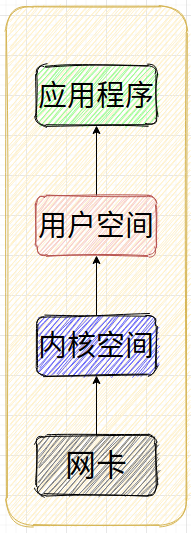
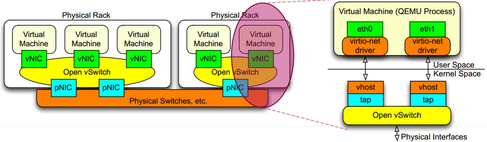
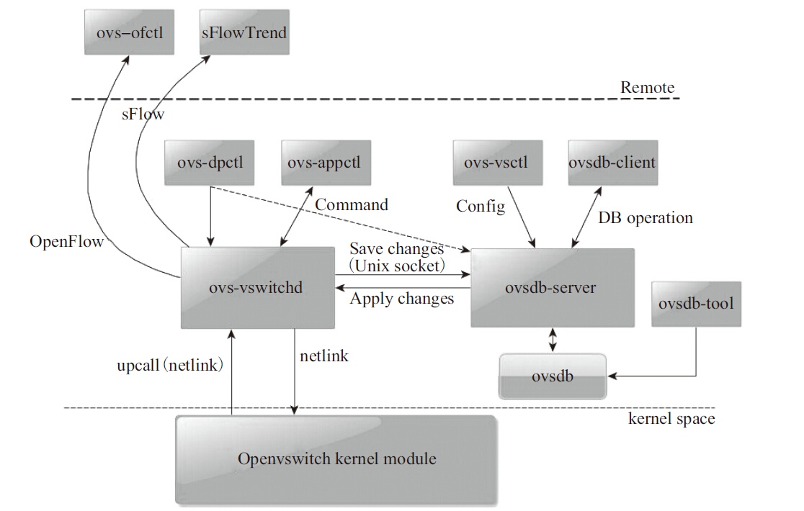
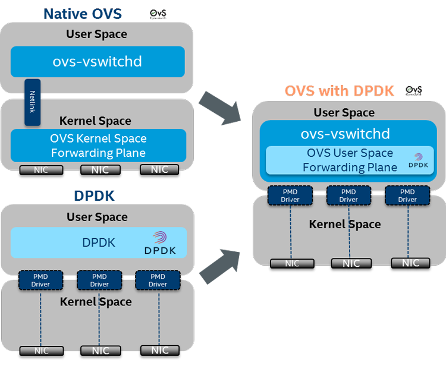

# overview

**DPDK**(Data Plane Development Kit)：  
是一组快速处理数据包的开发平台及接口，提供在用户态直接操作物理网卡的库函数。由intel主导开发，主要基于Linux系统，用于快速数据包处理的函数库与驱动集合，可以极大提高数据处理性能和吞吐量，提高数据平面应用程序的工作效率。

**DPDK的作用**：  
在数据平面应用中为快速处理数据包提供一个简单而完善的架构。在理解此工具集之后，开发人员可以以此为基础进行新的原型设计处理大并发网络数据请求。

当前数据包的处理流程是这样：  
数据包到达网卡，网卡发送中断通知CPU，CPU将数据包拷贝到内核空间中，应用程序从内核空间中拷贝数据到用户态空间，数据处理。

**dpdk解决问题办法：**

1. DPDK技术是重载网卡驱动，直接将数据传递给用户态的应用程序，避免了中间环节的经过TCP/IP协议栈，内核空间到用户空间的copy。
2. 同时针对第一点网卡频繁的中断，应用程序可以使用轮询的方式获取网卡上的数据，避免中断造成的场景切换和恢复浪费的时间。

# OVS应用场景

对于这个场景有两个通信路径：

● VM -> vNic -> OvS -> vNic -> VM (VM in the same host)

● VM -> vNic -> OvS -> pNic -> OvS -> vNic -> VM(different hosts)

第一个路径是同一台host主机上的VM之间的互相通信，第二个则是不同主机上的VM的通信路径，第二个路径也包含了外部主机访问虚拟机的路径。

# 网络开销

在传统的内核协议栈中，当有新的数据包到来时，网卡会通过硬件中断通知协议栈，内核的网卡驱动负责处理这个硬件的中断，将数据包从网卡拷贝到内核开辟的缓冲区中，所以协议栈的主要处理开销分为中断处理，内存拷贝，系统调用和协议处理4个方面。

硬件中断：网卡每次收到数据都发送中断，打断cpu的工作。切换和恢复过程都耗时

内存拷贝：数据先从网卡缓存区通过PIO或DMA方式传送到内核开辟的缓冲区中，然后还要通过socket从内核空间复制到用户空间，统计表明，在Linux协议栈中，数据包从内核态拷贝到用户态所用的时间甚至占到了数据包整个处理流程时间的**57.1%。**

系统调用：系统调用是内核态向用户态提供的一组API集，系统调用一般通过软中断来实现，会产生较大的上下文切换开销。

协议处理：主要的耗时包括校验、计算、定时器管理、IP分片/重组、PCB连接管理、可靠传输机制和拥塞控制。

当千兆万兆网络出现后，网络数据包的协议处理占据着大量的CPU计算能力，网络协议栈的处理能力容易成为系统总体性能的瓶颈。传统的协议栈是针对通用性设计的，由于在内核实现，应用程序无法直接访问协议栈的地址空间，协议栈的安全性较高。

在用户空间层上实现TCP/IP协议栈，选择绕过内核使我们可以采用某些高级的捕获数据包技术（如直接写TAP字符设备或使用Libpcap捕包技术，或性能更高得多的零拷贝捕包技术，这些由于同在用户态中具有相同的特权指令级别，所以在user_buffer和nic_buffer之间可以直接做内存映射，例如virtio application 直接在网卡和用户空间形成通道，减少内存的复制次数。同时，可以按照自己的需求定制协议栈的协议处理流程，简化某些冗余的处理机制，因此，用户态协议栈的可定制性和可扩展性都比内核态协议栈要高。

在多核CPU硬件结构中，要充分发挥计算能力，必须采用多进程执行，使得同一时刻都有一个线程（用户线程，内核线程，硬件线程）运行在一个CPU核上。

对于用户态协议栈的构建，可以分为两种模式：一种是用户程序与协议栈分别作为独立的进程，互相之间通过IPC通信；另一种方式是将用户程序和协议栈作为一个进程空间的两个线程实现，假如选择系统开销更小的线程来实现的话，用户态无法像在内核态一样使用中断来进行驱动，用户态的协议栈的数据来源也两种（网络数据包和socket请求），它们本质上都可以看成是消息，因此，用户态的驱动机制可以成为消息驱动机制。

对于基于传统的全虚拟化网卡技术+传统的Hypervisor+传统的Linux内核技术实现云环境，其中一个虚拟机到物理网卡会存在如下的性能开销：

VM，在基于传统的Hypervisor技术中VM是宿主机用户空间的一个进程。在Linux中，一般使用TAP设备作为虚拟网卡，TAP设备在用户空间会有一个字符设备供虚拟机进程读写。

Hypervisor层横跨用户空间和内核空间，这中间会存在数据在内核空间和用户空间的拷贝及切换。

内核网桥再访问物理网卡。

# ovs-dpdk

## 普通ovs

ovs的架构图：  

**ovs**处理流表的过程是：  
1.ovs的datapath接收到从ovs连接的某个网络设备发来的数据包，从数据包中提取源/目的IP、源/目的MAC、端口等信息。  
2.ovs在**内核状态**下查看流表结构（通过Hash），观察是否有缓存的信息可用于转发这个数据包。  
3.内核不知道如何处置这个数据包会将其发送给用户态的ovs-vswitchd。  
4.ovs-vswitchd进程接收到upcall后，将检查数据库以查询数据包的目的端口是哪里，然后告诉内核应该将数据包转发到哪个端口，例如eth0。  
5.内核执行用户此前设置的动作。即内核将数据包转发给端口eth0，进而数据被发送出去。

## ovs-dpdk

DPDK加速的OVS与原始OVS的区别在于，从OVS连接的某个网络端口接收到的报文不需要openvswitch.ko内核态的处理，报文通过DPDK PMD驱动直接到达用户态ovs-vswitchd里。  

**DPDK加速的OVS**数据流转发的大致流程如下：  
1.OVS的ovs-vswitchd接收到从OVS连接的某个网络端口发来的数据包，从数据包中提取源/目的IP、源/目的MAC、端口等信息。  
2.OVS在**用户态**查看精确流表和模糊流表，如果命中，则直接转发。  
3.如果还不命中，在SDN控制器接入的情况下，经过OpenFlow协议，通告给控制器，由控制器处理。  
4.控制器下发新的流表，该数据包重新发起选路，匹配；报文转发，结束。

# 安装dpdk

[https://www.cnblogs.com/goldsunshine/p/14260941.html](https://www.cnblogs.com/goldsunshine/p/14260941.html)

# NFV实现NAT的缺点

依赖Linux内核，转发性能，新建性能差。

Init方法调用start

正常工作流程：

1. 设置定时任务，默认30s收集一次监控指标。
2. 将所有nat网关的指标写入cache文件（覆盖更新）
3. 将每一个nat网关的每一个metric写入channel，等待telegraf消费

重启：

1. 读取cache文件，计算下次收集需要sleep的时间
2. 以下次的点的值为参考，按百分比设置丢失点的值
3. 写入cache文件
4. 写入channel

读取配置的原理：

执行shell命令，获取openvswitch的监控数据，对文本进行处理。

细节：

- 如果是第一次执行，则不上报metric，而是给cache设置初始值，下一次收集指标时上报变化率。
- 如果程序重启，缓存文件中有数据，则根据当前收集的数据和缓存文件的数据，补齐丢失的point，上报丢失的point对应的metric
- 统计的字节数是递增的，**如果出现字节数减少的情况，说明 datapath 重启或 openvswitch 重启，**则清空 cache，此次上报的metric记录重启后当前的数据与0的差值，随后将cache设置为当前的数据，之后上报的metric为相比cache中数据的变化量。

无并发安全问题。

NAT主备，检测为从节点时，不写入channel（仅更新本地cache文件）
