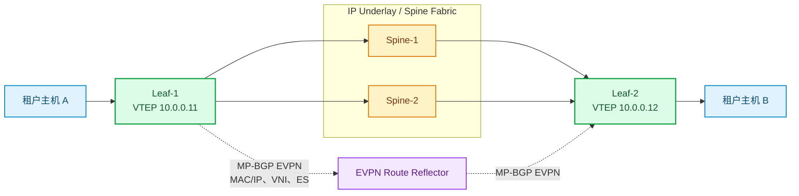
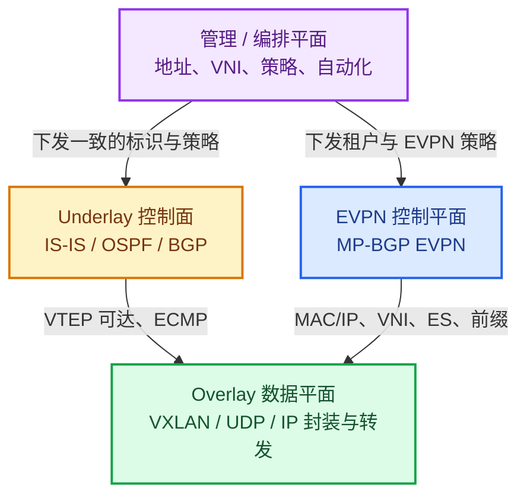
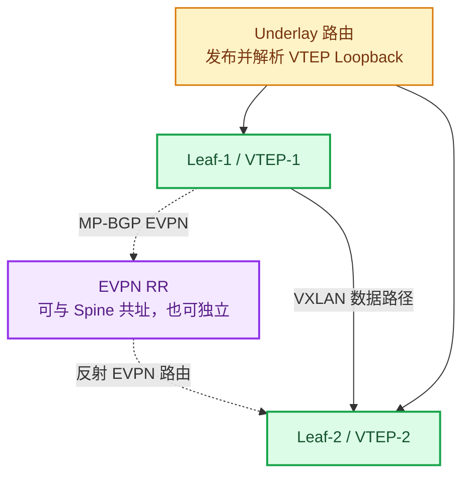
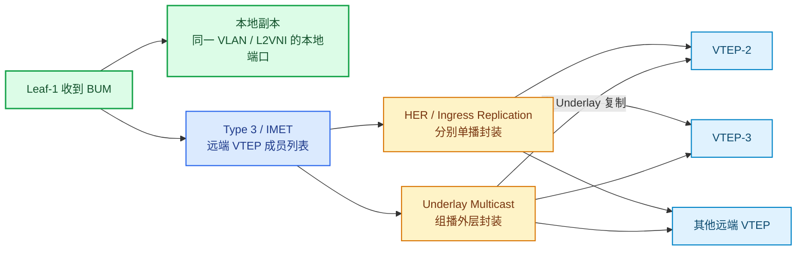
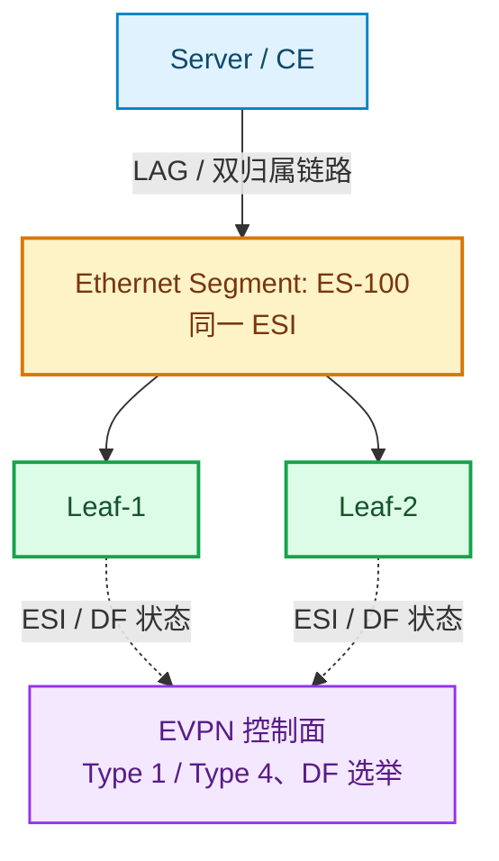

# EVPN + VXLAN：从原理、设计到验证与排障


## 目录

- [一分钟建立模型](#一分钟建立模型)
- [为什么需要 EVPN + VXLAN](#为什么需要-evpn--vxlan)
- [先认识四个平面](#先认识四个平面)
- [核心对象与术语](#核心对象与术语)
- [协议与报文：VXLAN 如何承载业务](#协议与报文vxlan-如何承载业务)
- [EVPN 控制平面：BGP 在通告什么](#evpn-控制平面bgp-在通告什么)
- [五类核心 EVPN 路由](#五类核心-evpn-路由)
- [端到端转发：四个必须会的流程](#端到端转发四个必须会的流程)
- [IRB 与跨子网通信](#irb-与跨子网通信)
- [多归属与高可用](#多归属与高可用)
- [BUM、ARP/ND 与组播](#bumarpnd-与组播)
- [设计方法与配置骨架](#设计方法与配置骨架)
- [验证、排障与抓包](#验证排障与抓包)
- [性能、安全与常见误区](#性能安全与常见误区)
- [学习路线与权威资料](#学习路线与权威资料)

---

## 一分钟建立模型

EVPN + VXLAN 可以用一句话概括：

> **底层 IP Fabric 负责把 VTEP 彼此可靠地送达；VXLAN 负责把租户二层/三层报文封装穿越 Fabric；MP-BGP EVPN 负责提前告诉每个 VTEP“谁在哪里、哪些 VTEP 属于这个虚拟网络、以及怎样进行多归属转发”。**



实线表示业务报文的 Underlay 承载路径；虚线表示 EVPN 控制面。Spine 按外层 IP 转发，通常不终结 VXLAN；RR 反射 EVPN 路由，通常不在业务数据路径上。

在实践中，Leaf 往往同时扮演三种角色：接入交换机、三层网关和 VTEP；Spine 通常只承担 Underlay IP 转发和路由反射器（Route Reflector，RR）功能。Spine **不必**解析或终结 VXLAN。

### 最小心智模型

| 问题 | 谁回答 | 典型信息 |
|---|---|---|
| 去目标 VTEP 的外层 IP 怎么走？ | Underlay 路由协议 | Loopback/VTEP IP 的可达路由、ECMP 下一跳 |
| 一个租户对应哪个隔离域？ | VXLAN | VNI；L2VNI 对应二层广播域，L3VNI 对应 VRF |
| 某个 MAC/IP 在哪个 VTEP？ | EVPN Type 2 | MAC、可选 IP、下一跳 VTEP、VNI、MAC Mobility 序列号 |
| 哪些远端 VTEP 需要接收 BUM？ | EVPN Type 3 | EVI/VNI 与远端 VTEP |
| 双归属主机怎样避免环路并实现快速收敛？ | EVPN Type 1/4 | Ethernet Segment、DF 选举、别名/备份路径、批量撤销 |

---

## 为什么需要 EVPN + VXLAN

### 传统 VLAN 和纯数据面 VXLAN 的边界

传统二层网络依赖 VLAN、MAC 学习和广播/未知单播泛洪。它在小规模网络中简单有效，却会在大规模数据中心暴露明显限制：

- VLAN 标识只有 12 位，理论上最多 4094 个可用二层隔离域；VXLAN 的 VNI 是 24 位，可提供约 1600 万个标识。
- 为了实现“同一网段可跨机架迁移”，传统网络常扩大二层域，STP、广播域和故障域随之扩大。
- 纯数据面 VXLAN 通过泛洪与源地址学习发现 MAC/VTEP 映射，未知单播、ARP/ND、广播会被复制到大量无关节点。
- 依赖 Underlay 组播会增加网络、运维和故障域复杂度；静态远端 VTEP 列表又难以扩展。
- 主机双归属、链路故障和虚拟机迁移时，仅凭数据面学习难以既快速又无环地收敛。

EVPN 不改变 VXLAN “UDP 封装、在 IP 网络上构建 Overlay” 的本质；它改变的是学习与分发方式：将 MAC/IP、VTEP 成员、前缀和多归属状态从数据面泛洪迁移到 BGP 控制平面。

### EVPN + VXLAN 带来的工程收益

| 能力 | 纯数据面/静态 VXLAN | EVPN + VXLAN |
|---|---|---|
| VTEP 发现 | 组播、静态清单或控制器 | Type 3 自动通告与发现 |
| MAC/IP 学习 | 数据面泛洪后学习 | Type 2 控制面通告，可保留本地学习 |
| BUM 复制 | 多播或静态复制 | EVPN 学习成员后 HER/组播 |
| ARP/ND | 广播/组播泛洪 | 基于 Type 2 的抑制或代答 |
| 租户路由 | 外部网关或特定方案 | 集中式/分布式 IRB + L3VNI |
| 多归属 | MLAG 等域内机制为主 | 标准化 ES、DF、别名、批量撤销 |
| 故障收敛 | 依赖 MAC 老化或泛洪 | BGP 撤销、序列号与 ES 机制 |

**不应误解为“有 EVPN 就没有泛洪”。** 广播、未知单播和某些组播仍可能存在；EVPN 的目标是将其控制在必要范围内，并用控制面缩小或替代无意义的泛洪。

---

## 先认识四个平面

将故障与设计分为四个平面，是理解和排障最快的方式。



1. **Underlay 数据/控制平面**：Leaf/Spine 间的物理链路和 IP 路由。它只需保证 VTEP Loopback 间三层可达、可 ECMP、可快速收敛。常见选择是 eBGP、IS-IS 或 OSPF。
2. **Overlay 数据平面**：VTEP 把内层帧封装为 VXLAN，再以外层 IP 在 Underlay 转发。Fabric 看不到也不需要理解租户地址。
3. **Overlay 控制平面**：MP-BGP 的 `L2VPN EVPN` 地址族通告 EVPN NLRI。它决定远端 MAC/IP、VNI 成员、三层前缀及 Ethernet Segment 状态。
4. **管理/编排平面**：负责租户、VRF、VLAN、VNI、RT、网关及策略的一致性。它不是协议的一部分，却最容易制造“控制面正常但业务不通”的配置性故障。

排障时推荐从外到内检查：**物理/Underlay 可达 → BGP 邻居与 EVPN 路由 → VNI/VRF 导入导出 → MAC/ARP/FIB 编程 → 业务包与策略**。

---

## 核心对象与术语

| 名称 | 全称/含义 | 工程上的作用 |
|---|---|---|
| VTEP | VXLAN Tunnel End Point | VXLAN 的封装/解封装端点；常使用稳定的 Loopback IP 作为源地址。 |
| VNI | VXLAN Network Identifier | 24 位 Overlay 标识。常见地，一个 L2VNI 对应一个二层广播域，一个 L3VNI 对应一个 VRF。 |
| EVI / MAC-VRF | EVPN Instance / MAC-VRF | 承载一个二层 EVPN 服务实例的逻辑表，保存 MAC、BUM 成员等。不同厂商命名不同。 |
| IP-VRF | IP Virtual Routing and Forwarding | 租户三层路由域。分布式网关时，它绑定 L3VNI。 |
| RD | Route Distinguisher | 使相同 EVPN NLRI 在 BGP 中唯一；它**不承担导入策略**。通常每个 VTEP/实例唯一。 |
| RT | Route Target | BGP 扩展团体属性，决定 EVPN 路由向哪些 EVI/VRF 导入或从哪里导出；它才是租户隔离的关键之一。 |
| ES / ESI | Ethernet Segment / Identifier | 描述同一台或同一组 CE 经多条链路连接到多个 PE/VTEP 的逻辑以太段。ESI 必须在该段全网唯一。 |
| DF | Designated Forwarder | 对一个 ES + VLAN/EVI 选出的 BUM 下行转发者，防止多归属环境重复转发。 |
| IRB | Integrated Routing and Bridging | 在同一 VTEP 上把二层桥接与三层路由结合，实现跨子网通信。 |
| Anycast Gateway | 任播网关 | 多个 Leaf 使用相同网关 IP 和 MAC；主机总是把流量交给本地 Leaf，减少发夹流量。 |
| BUM | Broadcast, Unknown-unicast, Multicast | 需要复制的二层流量集合。不是“所有流量”，而是尚不能单播定位的流量。 |
| HER | Head-End Replication | 源 VTEP 根据远端成员列表，为每个远端 VTEP 复制一份单播 VXLAN 包。 |

### RD 与 RT：最常见的混淆

- **RD 解决“路由是否唯一”**。两个 Leaf 都可能通告同一 MAC/IP；不同 RD 使 BGP 能保存多条路径和属性。
- **RT 解决“这条路由应进入哪些表”**。同一租户的相关 EVI/IP-VRF 使用匹配的导出/导入 RT；错误的 RT 会造成租户不通或租户泄漏。
- RD 通常使用 `VTEP-IP:编号` 这类能保持全局唯一的形式；RT 的编号通常以租户/VNI 的一致规划为核心。具体格式由设备能力和组织规范决定。

---

## 协议与报文：VXLAN 如何承载业务

### 封装结构

```text
+---------------- Outer Ethernet ----------------+
| dst = Underlay 下一跳 MAC | src = 出接口 MAC     |
+---------------- Outer IP ----------------------+
| src = 本端 VTEP IP | dst = 远端 VTEP IP         |
+---------------- UDP ---------------------------+
| src = 哈希出的熵端口 | dst = 4789（常用）        |
+---------------- VXLAN (8 bytes) ---------------+
| Flags（I 位） | 保留 | VNI（24 bits） | 保留   |
+---------------- Inner Ethernet / IP / L4 -------+
| 原始租户报文，端主机看不到外层封装                |
+-------------------------------------------------+
```

VXLAN 头部为 8 字节。携带 IPv4 外层头时，典型额外开销为 **50 字节**（外层 Ethernet 14 + IPv4 20 + UDP 8 + VXLAN 8；不含可选 VLAN 标签）；IPv6 外层的 IP 头更大。最终 MTU 还受以太网 FCS、标签和设备实现影响。

### 为什么使用 UDP

UDP 源端口通常由 VTEP 按内层五元组哈希生成。Underlay 设备因此可对大量不同 UDP 源端口执行 ECMP 哈希，使多条 Spine 路径被有效利用。不要把它误认为应用使用了这个 UDP 端口：租户 L4 报文仍然完整地放在内层。

### MTU 是上线前的硬门槛

若租户主机 MTU 为 1500，Underlay 每跳至少应能承载 `1500 + VXLAN 开销`，实践中通常统一配置 1550、1600、9000 或更高，具体取决于标签、设备与运营规范。**先确认设备的 MTU 计数口径**：在典型 IPv4 外层封装下，外层 IP 包约为 1550 字节，而在线路上、加上外层以太网头的帧约为 1564 字节（FCS 是否计入又因平台而异）。因此，“接口设为 1550”并不必然足够；应以实际端口、LAG、系统 MTU 与设备文档共同验证。

以下任一情况都可能表现为“偶发大包不通”：

- Leaf 下联、Leaf-Spine、Spine-Leaf 的 MTU 不一致；
- 只提高了接口 MTU，系统/协议/端口通道 MTU 仍有限制；
- ICMP `Fragmentation Needed` / `Packet Too Big` 被过滤，导致 PMTUD 失效；
- 使用 IPv6 外层却沿用 IPv4 开销预算。

---

## EVPN 控制平面：BGP 在通告什么

EVPN 是 MP-BGP 的一个地址族：**AFI=25（L2VPN），SAFI=70（EVPN）**。BGP 会话既可以在 Leaf 间全互联，也更常通过 Spine/RR 反射。RR 反射路由，不参与 VXLAN 封装，也无需在数据路径上。

EVPN 路由通常携带或关联以下信息：

- EVPN NLRI：路由类型和该类型的关键对象，如 MAC/IP、VTEP IP、IP Prefix、ESI；
- BGP Next Hop：通常是发布 VTEP 的地址，必须能由 Underlay 解析并到达；
- RD：保证唯一性；
- RT：控制 EVI/MAC-VRF 或 IP-VRF 的导入导出；
- PMSI Tunnel 属性：主要用于 BUM 复制信息；
- 扩展团体属性：例如 MAC Mobility、ESI Label、Default Gateway、Router MAC 等。

### 典型控制面拓扑



控制面可达并不等同于数据面可达。常见现象是：BGP 邻居已建立、EVPN 路由已接收，但 BGP Next Hop 的 VTEP 地址没有被 Underlay 解析，或者下一跳在 ECMP 路径上被 ACL/MTU 阻断。

### EVPN 路由的生命周期

以本地学习到主机 `MAC-A / IP-A` 为例：

1. Leaf-1 在接入口学习到 MAC-A；若启用 IP 学习，还得到 IP-A。
2. Leaf-1 将 MAC/IP 写入本地 MAC-VRF，并发出 Type 2 路由，下一跳为自己的 VTEP IP。
3. Leaf-2 的对应 EVI 依据 RT 导入该路由，安装远端 MAC（必要时同时安装 ARP/ND、主机路由）。
4. Leaf-2 向 MAC-A 发送单播业务时，查表得到 VTEP-1，再以相应 VNI 封装。
5. MAC-A 迁移到 Leaf-3 时，Leaf-3 发布带更高 MAC Mobility 序列号的 Type 2；旧位置的学习/通告被撤销或被较高序列号覆盖。

---

## 五类核心 EVPN 路由

不同 RFC、设备显示命令和厂商文档在字段呈现上可能不同；下表聚焦“什么场景、解决什么问题、在 VXLAN 中怎样理解”。

| 类型 | 常用名称 | 主要解决的问题 | VXLAN 场景中的核心信息 |
|---|---|---|---|
| Type 1 | Ethernet Auto-Discovery（EAD） | 多归属发现、别名/备份路径、批量撤销 | ESI、EVI/ES 状态、ESI Label 等 |
| Type 2 | MAC/IP Advertisement | MAC 和可选 IP 的控制面学习、ARP/ND 抑制、主机路由 | MAC、IP、VNI、VTEP、MAC Mobility |
| Type 3 | Inclusive Multicast Ethernet Tag（IMET） | 自动发现同一广播域的远端 VTEP，建立 BUM 复制列表 | VNI/EVI、发布者 VTEP、PMSI 信息 |
| Type 4 | Ethernet Segment | 通告连接同一 ES 的 VTEP，辅助 DF 选举 | ESI、VTEP 地址 |
| Type 5 | IP Prefix | 通告非直连主机的 IP 前缀，常用于外部路由/汇总路由 | IP Prefix、IP-VRF/L3VNI、VTEP |

### Type 1：Ethernet Auto-Discovery

Type 1 是多归属机制的基础。它有两类常见用途：

- **EAD per ES**：表明“我连接到这个 Ethernet Segment”；配合 Type 4 参与 ES 成员发现、别名和故障处理。
- **EAD per EVI**：表明“我连接到这个 ES，且这个 EVI/VLAN 在该 ES 上可用”；可用于按业务实例进行批量 MAC 撤销（mass withdrawal）。

当一台双归属服务器或接入交换机故障，依赖 MAC 老化逐条清理远端表项会很慢。Type 1 撤销能让远端 VTEP 立即使与该 ES/EVI 关联的学习失效或改走备份，显著缩短收敛。

### Type 2：MAC/IP Advertisement

Type 2 是最常见也最关键的路由。它可携带：

- 主机 MAC；
- 可选的 IPv4 或 IPv6 地址；
- Ethernet Tag / 服务实例信息；
- 与 VXLAN 映射相关的 VNI/标签语义；
- MAC Mobility 扩展团体（序列号）；
- 在 IRB 场景中可能附带网关/路由器 MAC 相关信息。

Type 2 的三个常用结果：

1. **远端 MAC 转发表**：把 `MAC -> 远端 VTEP + L2VNI` 安装到 MAC-VRF/FDB。
2. **ARP/ND 抑制**：当 IP 与 MAC 一同通告时，VTEP 可在本地回答 ARP/ND，或把请求改为目标 MAC 的单播。
3. **主机路由**：分布式 IRB 设备可据此安装 `IP -> MAC -> 远端 VTEP` 的精确主机可达信息。

#### MAC Mobility：迁移时为何不会“旧位置抢回流量”

同一 MAC 从 Leaf-1 移到 Leaf-2 后，Leaf-2 通告的 Type 2 带更高的 Mobility Sequence Number。远端 VTEP 选择序列号更高的通告；旧 Leaf 发现本地已不再有效后撤销旧路由。

若同一 MAC 在短时间内在多个端口/Leaf 间反复出现，设备可能触发 **MAC duplication / dampening** 保护并临时冻结该 MAC。它既可能说明环路、虚拟机克隆或错误双活，也可能是迁移阈值过低；排障前不要盲目关闭保护。

### Type 3：IMET

Type 3 解决“这个 L2VNI 内还有哪些远端 VTEP”的问题。每个加入某 EVI/L2VNI 的 VTEP 发布 IMET 路由；其他 VTEP 导入后形成 BUM 复制列表。

在常见的 **Ingress Replication / HER** 实现中，源 VTEP 对每一个远端 VTEP 单独封装一份相同的内层 BUM 帧，然后以单播外层 IP 发出。优点是不要求 Underlay 支持组播；代价是复制工作集中在入口 VTEP，规模较大时要评估 CPU/ASIC 与带宽。

### Type 4：Ethernet Segment

Type 4 标识一个 VTEP 是某个 ESI 对应 Ethernet Segment 的成员。它通常与 Type 1、DF 选举共同出现，作用包括：

- 发现同一 ES 的对等 VTEP；
- 计算 DF 选举候选集合；
- 支持 ES 故障检测与收敛。

单归属主机和纯 Leaf-to-host 接入通常看不到 Type 4；但只要设计中存在 EVPN Multihoming，就应把 Type 1/4 的状态作为验收项。

### Type 5：IP Prefix

Type 5 用于通告 IP 前缀，而非某个特定直连 MAC。典型用途包括：

- 通过 Border Leaf 向 EVPN 传播外部网络、共享服务或数据中心互联的前缀；
- 向 Overlay 发布汇总路由，避免把外部网络拆成大量 Type 2 主机路由；
- 在 IP-VRF/L3VNI 内提供纯三层可达性。

需要区分 Type 2 与 Type 5：

| 比较项 | Type 2 | Type 5 |
|---|---|---|
| 描述对象 | 主机 MAC，且可选携带主机 IP | IP 前缀 |
| 最适用的对象 | Overlay 内直连端主机 | 外部网络、汇总路由、非 MAC 可见前缀 |
| 典型转发依赖 | MAC/FDB、ARP/ND、主机路由 | IP 路由/FIB，通常转向广告 VTEP 或下一跳 |
| 规模风险 | 主机数很多时控制面表项大 | 过度汇总会掩盖故障域；过细则表项大 |

### 进阶：其他路由类型

实际部署还可能使用 Type 6（选择性组播 Ethernet Tag）等扩展，以优化组播服务。是否支持、如何映射到 VXLAN 和是否需要它，强烈依赖设备与业务需求；没有明确组播业务时，先把 Type 1–5 的语义、设计和运维做好。

---

## 端到端转发：四个必须会的流程

以下示例假设：Host-A 在 Leaf-1，Host-B 在 Leaf-2；二者属于同一个 L2VNI 10100。Leaf-1/2 的 VTEP Loopback 分别为 `10.0.0.11`、`10.0.0.12`。

先把“冷启动”和“稳态”连起来：B 接入或首次发包时，Leaf-2 先在本地学习 B 的 MAC/IP，并发布 Type 2；随后 A 可以直接使用已导入的映射。若 B 尚未被学习，A 的 ARP/ND 请求才会按 Type 3 指引的 BUM 成员范围复制，B 的应答促成后续学习与 Type 2 通告。

### 1. 已知单播：同网段主机 A 到 B

```text
Host-A --[inner dst MAC = B]--> Leaf-1
Leaf-1 FDB: MAC-B -> VTEP 10.0.0.12, VNI 10100
Leaf-1 --[outer dst = 10.0.0.12, VNI = 10100]--> IP Fabric --> Leaf-2
Leaf-2 解封装，按本地 FDB 将内层帧交给 Host-B
```

关键点：

- 内层目的 MAC 决定 Overlay 的二层目的；外层目的 IP 是远端 VTEP，不是 Host-B 的 IP。
- Fabric 只转发外层 IP 包，可对 UDP 源端口做 ECMP。
- Leaf-1 学到 MAC-B 的来源通常是导入 Type 2，而不是“先泛洪再从回包学习”。

### 2. ARP/ND：A 先要知道 B 的 MAC

**有 ARP/ND 抑制**时：

1. Host-A 广播 ARP Request（或发送 IPv6 NS）。
2. Leaf-1 查询由 Type 2 安装的 ARP/ND 抑制表，找到 `IP-B -> MAC-B`。
3. Leaf-1 在本地代答，或将请求改写为只发向 MAC-B 的单播；无需向所有 VTEP 复制。

**无对应表项**时：

1. Leaf-1 将请求视为 BUM。
2. 按 Type 3 成员表执行 HER，或使用设计好的 Underlay 多播。
3. Leaf-2 向本地接入口泛洪；Host-B 响应。
4. Leaf-2 学习/通告 B 的 MAC/IP，后续请求可被抑制。

ARP/ND 抑制的前提不是“开启一个开关”这么简单：设备必须能可靠获取 IP-MAC 绑定，正确导入 Type 2，并处理 DHCP、静态 IP、IPv6 DAD/RA、虚拟 IP 等边界场景。

### 3. BUM：广播、未知单播、组播



务必确认设备行为：某些平台可以配置未知单播抑制、BUM 限速、IGMP snooping 或 ARP 抑制；它们的默认值和覆盖范围不同。错误地抑制未知单播会使尚未被控制面学习的合法主机不可达。

### 4. 跨子网单播：A 到另一个子网的 C

以对称 IRB 为例：

1. Host-A 把目标 IP-C 的报文交给本地 Anycast Gateway（Leaf-1）。
2. Leaf-1 在源 L2VNI 解封装/接收内层帧，进行三层查表，命中 IP-VRF 中的 C 主机路由（Type 2）或前缀路由（Type 5）。
3. Leaf-1 重新封装报文：内层二层头改为路由后的下一跳 MAC，外层 VXLAN 使用 **L3VNI**；外层目的为承载目的/下一跳的 Leaf。
4. Leaf-2/3 在同一 IP-VRF 中解封装 L3VNI，路由/桥接到 C 所在的目标 L2VNI，交付 Host-C。

这也是“对称”二字的含义：入口 Leaf 和出口 Leaf 都在 VRF/L3VNI 中执行路由语义，而不是只在入口做一次路由并把目标二层域跨网延伸。

---

## IRB 与跨子网通信

### 分布式任播网关

典型分布式网关让每个接入该 VLAN 的 Leaf 配置相同的网关 IP 与虚拟 MAC：

```text
VLAN 10 / L2VNI 10100: 10.10.10.0/24, gateway 10.10.10.1, MAC 00:00:5e:00:01:01
VLAN 20 / L2VNI 10200: 10.10.20.0/24, gateway 10.10.20.1, MAC 00:00:5e:00:01:01
Tenant-A VRF / L3VNI 50001
```

这样 Host-A 的第一跳永远是本机架 Leaf，即使目标在远端子网，也无需先把报文二层送往“集中网关”。任播 MAC 的配置与设备间一致性极其关键：不一致会造成 ARP 正常、跨子网流量却在错误的 MAC/路由表处理。

### 非对称 IRB 与对称 IRB

| 模式 | 基本思想 | 优点 | 主要限制 |
|---|---|---|---|
| 非对称 IRB | 入口 VTEP 路由后，使用目标 L2VNI 将二层帧送至出口 | 概念直观，早期部署常见 | 每个参与路由的 VTEP 常需知道/承载更多 L2VNI；规模和灵活性较差 |
| 对称 IRB | 入口/出口都通过 L3VNI/IP-VRF 处理三层转发，出口再映射目标 L2VNI | 租户规模更好、VLAN 局部化、现代 Fabric 常用 | 需要明确的 L3VNI、IP-VRF、路由 MAC 与 Type 2/5 设计 |

对于新建的大型 Fabric，通常优先评估对称 IRB；但“平台支持、互通要求、运维经验”比模式名称更重要。不要把两种模式的 VNI 映射或路由通告方式混用。

### Type 2 主机路由与 Type 5 前缀路由如何配合

- Overlay 内端主机通常由 Type 2 通告；主机迁移时能精确更新 IP-MAC-VTEP 关系。
- Border Leaf 从外部路由协议重分发/引入的网段通常由 Type 5 通告；可按策略汇总。
- 业务 FIB 选择遵循最长前缀匹配和路由策略。若 Type 2 的 `/32` 或 `/128` 与 Type 5 汇总路由同时存在，前者通常更具体；但优先级、ECMP、递归下一跳取决于平台实现与策略。

---

## 多归属与高可用

### 两类高可用不要混为一谈

| 类型 | 示例 | 主要机制 |
|---|---|---|
| Overlay/路由高可用 | Leaf-Spine 多路径、VTEP 或 RR 故障 | Underlay ECMP、BGP 多路径、BFD、RR 冗余 |
| 接入多归属 | 服务器双网卡 LACP 到两台 Leaf，或 CE 双归属 | EVPN Ethernet Segment、ESI、DF 选举、别名、批量撤销 |

MLAG/MC-LAG 也能提供双归属，但它往往需要设备间状态同步和专有互联。EVPN Multihoming 以标准化控制面表达 ES 状态，可减少对跨设备二层域的依赖。二者能否叠加、如何互通，必须以具体平台设计指南为准。

### Ethernet Segment、DF 与 Split Horizon



- 同一个接入段的 Leaf 使用相同 ESI，向 EVPN 发布 Type 1/4。
- 对每个 EVI/VLAN，参与者选出一个 **DF**。通常只有 DF 将来自 Overlay 的 BUM 流量下送到该 ES，防止服务器/CE 收到重复帧。
- 从 ES 接收到的流量不应再经 Overlay 回送到同一 ES；这是 split-horizon 的基本要求。
- **Aliasing** 允许远端 VTEP 在已知某 MAC 位于多归属 ES 时，把单播流量分担给多个活跃 PE/VTEP。
- **Backup path** 可在单活或失败情形下提供备份出口。

### 设计/验收多归属时至少验证

1. 两台或多台 Leaf 的 ESI 完全一致，且与其他 ES 不冲突。
2. Type 1/4 可在所有相关 VTEP 上被正确导入。
3. 各 VLAN/EVI 的 DF 选举结果符合预期；DF 偏好或算法变化后不会全量抖动。
4. 单条成员链路、单 Leaf、整个 ES、LACP 状态变化时，单播与 BUM 都无环、无重复且能在目标时间内恢复。
5. Type 1 撤销能触发批量收敛，而不是等待大量 MAC 超时。

---

## BUM、ARP/ND 与组播

### HER 与 Underlay Multicast 的取舍

| 方式 | 工作方式 | 优点 | 代价/注意点 |
|---|---|---|---|
| HER（Ingress Replication） | 源 VTEP 按 Type 3 清单逐个单播复制 | Underlay 仅需 IP 单播；部署和排障直观 | 复制负载在入口，VTEP 数量和 BUM 比例大时带宽/性能成本上升 |
| Underlay Multicast | 源 VTEP 向组播组封装，Underlay 构建复制树 | 网络中复制，入口压力低 | 需 PIM/IGMP/组播状态、组地址规划与额外排障能力 |

没有绝对正确的选择。若 BUM 流量很少，HER 常是更简单的默认方案；若网络规模很大、组播业务明确或入口复制成为瓶颈，再评估 Underlay Multicast。结论应来自容量模型和设备能力，而不是“组播一定更高级”或“HER 一定简单”。

### ARP/ND 抑制的收益与边界

ARP/ND 抑制能显著降低主机发现流量，却并非“应答一切请求”：

- 只应对可信、已学习并且属于正确 VRF/VNI 的 IP-MAC 绑定代答；
- DHCP、静态配置、GARP/NA、IPv6 DAD、Router Advertisement 等可能需要特殊处理；
- IP 重复、MAC 移动、迁移未收敛时，过期的抑制条目会导致黑洞；
- 建议为 ARP/ND 表、Type 2 数量、未抑制 ARP/NS、代答失败设置可观测性指标。

### 组播不等于 BUM

BUM 中的 `M` 指二层组播帧；其处理还与 IGMP/MLD snooping、组播控制协议和业务需求有关。EVPN Type 3 用于“全体成员”的 IMET/BUM 发现；大规模多租户组播可能需要选择性组播相关扩展，而不是把所有组播都当广播复制。

---

## 设计方法与配置骨架

### 推荐的设计顺序

1. **确定业务边界**：哪些租户、网段、VRF 可互通；哪些网络必须隔离；北南向出口在哪里。
2. **先完成 Underlay**：每台 Leaf 的 VTEP Loopback 必须稳定可达，任意 Leaf 对任意 Leaf 应有预期 ECMP 与 MTU。
3. **规划标识符**：ASN、Loopback、VLAN、L2VNI、L3VNI、RD、RT、ESI、组播地址（如使用）。不要让多个系统各自分配。
4. **建立 EVPN BGP**：先验证邻居、RR、下一跳可达与 RT 策略，再创建业务 VNI。
5. **部署 L2 服务**：VLAN/BD ↔ L2VNI ↔ MAC-VRF，观察 Type 3 与 Type 2。
6. **部署 L3 服务**：VRF ↔ L3VNI、SVI/Anycast Gateway、Type 2/5 与外部路由策略。
7. **加入高级能力**：ARP/ND 抑制、多归属、边界互联、组播、加密/安全策略。每次只加一个可验证层次。

### 一个小型租户的规划表

| 项目 | Tenant-A 示例 | 说明 |
|---|---|---|
| IP-VRF | `TENANT-A` | 租户三层隔离域 |
| L3VNI | `50001` | 对称 IRB 的 VRF VNI |
| VLAN 10 / L2VNI | `10 / 10100` | Web 子网 `10.10.10.0/24` |
| VLAN 20 / L2VNI | `20 / 10200` | App 子网 `10.10.20.0/24` |
| Anycast gateway MAC | `00:00:5e:00:01:01` | 所有承载此网关的 Leaf 一致 |
| EVPN RT | 例如 `target:65000:50001` | 示例而非固定规则；须与 import/export 设计匹配 |
| RD | 每 Leaf/实例唯一 | 例如由 VTEP IP 与实例号派生 |

### 厂商无关伪配置

```text
# 1) Underlay：必须先满足 VTEP Loopback 全网可达、ECMP、足够 MTU
interface loopback0
  ip address 10.0.0.11/32

vxlan vtep-source loopback0

# 2) EVPN BGP：仅表示逻辑，具体语法因厂商而异
router bgp 65011
  neighbor RR-1 remote-as 65000
  address-family l2vpn evpn
    neighbor RR-1 activate
    advertise-all-vni

# 3) 二层实例：VLAN/Bridge Domain 映射到 L2VNI
vlan 10
  vxlan vni 10100
  evpn rd auto-or-unique
  evpn route-target import target:65000:10100
  evpn route-target export target:65000:10100

# 4) 三层实例：VRF 映射到 L3VNI，并关联各 SVI
vrf TENANT-A
  vxlan vni 50001
  evpn rd auto-or-unique
  evpn route-target import target:65000:50001
  evpn route-target export target:65000:50001

interface vlan10
  vrf TENANT-A
  ip address virtual 10.10.10.1/24
  mac-address virtual 00:00:5e:00:01:01

# 5) 可选：只有在验证 IP-MAC 学习链路正确后才启用
evpn arp-nd-suppression enable
```

### 配置中的四条不变量

- 对端 VTEP 地址必须可由 **Underlay** 路由解析，不要依赖某条租户 EVPN 路由来访问 VTEP。
- 同一二层业务的 L2VNI 与 RT 导入/导出必须一致；同一 VRF 的 L3VNI 与 VRF RT 必须一致。
- 同一任播网关的 IP/MAC 必须在所有相关 Leaf 上一致，但每台设备的 VTEP IP 与 RD 应唯一。
- 在进行双归属时，同一 Ethernet Segment 的 ESI 一致、不同 Ethernet Segment 的 ESI 唯一。

---

## 验证、排障与抓包

### 分层验收清单

| 层次 | 必查项 | 正常现象 |
|---|---|---|
| 物理 | 链路、LAG、错误计数、MTU | 所有成员 up；无持续 CRC/丢包；MTU 足够 |
| Underlay | Loopback 路由、ECMP、BFD/IGP/BGP 邻居 | 任意 VTEP IP 可达；下一跳数量符合设计 |
| EVPN BGP | 会话、AFI/SAFI 激活、RR 反射、Next Hop | `L2VPN EVPN` 已建立且下一跳可解析 |
| L2 EVPN | VNI 状态、Type 3、Type 2、RT | 正确导入远端 VTEP/MAC；无意外租户路由 |
| L3 EVPN | VRF/L3VNI、Type 2/5、FIB | 主机/前缀在正确 VRF 内安装 |
| 数据面 | FDB、ARP/ND、VXLAN 封装计数 | `MAC -> VTEP`、`IP -> MAC`、封装/解封装均递增 |
| 业务 | 同网段、跨网段、迁移、故障切换 | 正向/反向路径都通，故障收敛符合目标 |

### 厂商无关的命令意图

不同 NOS 的命令完全不同，但你要找的对象相同：

```text
# Underlay
show route <remote-vtep-loopback>
ping <remote-vtep-loopback> source <local-vtep-loopback>
tracepath / traceroute <remote-vtep-loopback>
show interface <leaf-spine-port> counters mtu

# BGP/EVPN
show bgp l2vpn evpn summary
show bgp l2vpn evpn route type [1|2|3|4|5]
show bgp l2vpn evpn route <mac-or-ip-or-prefix> detail
show bgp route-target import/export

# VNI、MAC、ARP、路由
show vxlan vni
show evpn instance / mac-vrf / ethernet-segment
show mac-address-table vlan <vlan>
show arp vrf <vrf> ; show ipv6 neighbors vrf <vrf>
show route vrf <vrf> <destination>
show forwarding / hardware table <destination>

# 数据面与抓包
show vxlan tunnel / peer / statistics
capture on access port, vtep loopback-facing port, and egress port
```

### 最有效的故障定位矩阵

| 症状 | 优先检查 | 常见根因 |
|---|---|---|
| 所有跨 Leaf 业务不通 | Underlay 到远端 VTEP、UDP 4789 ACL、MTU | Loopback 未发布、路由黑洞、ACL/NAT、接口 MTU |
| 只有某个 VNI 不通 | L2VNI 状态、Type 3、RT | VLAN-VNI 映射错、RT 不匹配、VNI 未启用 |
| 某主机同网段不通 | Type 2、远端 FDB、ARP/ND | MAC/IP 未通告、MAC 移动冻结、ARP 抑制陈旧 |
| 同网段通、跨子网不通 | VRF/L3VNI、SVI、Type 2/5、路由 MAC | VRF 绑定错、L3VNI/RT 不一致、网关 MAC 不一致、缺默认路由 |
| 小包通大包不通 | 各跳 MTU、PMTUD/ICMP | VXLAN 开销未预留、链路/端口通道 MTU 不一致 |
| BUM/ARP 异常 | Type 3、HER 列表或组播状态、ARP/ND 抑制 | IMET 未导入、复制配置错、组播树缺失、表项过期 |
| 双归属重复包或黑洞 | Type 1/4、ESI、DF、LACP | ESI 不同、DF 状态不一致、split-horizon/端口配置错误 |
| 主机迁移后短时或持续不通 | Type 2 Mobility 序列号、旧 MAC、迁移流程 | GARP/NA 未到达、MAC duplication、旧通告未撤销 |

### 首轮三步排查（可直接照做）

1. **把对象钉死**：记录源/目的 MAC、IP、VLAN、VRF、L2VNI/L3VNI、接入 Leaf 和端口；避免在错误租户或错误 VNI 的表中查路由。
2. **在源 Leaf 查目标**：查目标 MAC/IP 的 Type 2、对应 FDB 与 ARP/ND（跨子网还查 VRF FIB/Type 5）。若缺失，沿 `RT 导入 → EVPN BGP 邻居/路由 → 对端本地学习` 反向检查。
3. **已知目标却仍不通时查隧道**：确认远端 VTEP Loopback 的 Underlay 路由、ECMP 与 MTU；再看 VXLAN 封装/解封装计数，必要时在源端、Underlay 与目的端三处抓包。

### 抓包时应该看到什么

在源 Leaf 的 Underlay 出口抓包，已知单播的典型特征是：

```text
outer src IP = 本地 VTEP Loopback
outer dst IP = 目标 VTEP Loopback
UDP dst port = 4789（或网络实际配置的端口）
VXLAN VNI = 目标 L2VNI 或 L3VNI
inner src/dst = 原始业务报文（可能已由 IRB 重写二层头）
```

若源 Leaf 根本没有发出外层 VXLAN 包，问题通常在本地 FDB/ARP/FIB、VNI 或策略；若发出了而目标 Leaf 没收到，优先查 Underlay；若目标收到却未向接入口发出，检查解封装后的 VNI 映射、本地 MAC/FIB 和安全策略。

### 一份可复用的故障工单信息

不要只写“EVPN 不通”。至少记录：

- 源/目的主机的 MAC、IP、VLAN、VRF、接入 Leaf 与端口；
- 发生时间、单向还是双向、是否只影响大包/新连接/BUM；
- 对应 L2VNI/L3VNI、VTEP IP、RT、是否多归属；
- 源/目的 Leaf 的 Type 2/3/5 路由、FDB、ARP/ND、VRF FIB 输出；
- VTEP 到 VTEP 的路由与 MTU 证据；
- 两端同时刻的抓包/计数器，明确外层包是否离开与到达。

---

## 性能、安全与常见误区

### 容量与性能

- **控制面规模**：按租户、主机 MAC、IPv4/IPv6、前缀、ES、VNI 和 BGP 路径数量估算，不只看“主机数”。双栈 Type 2 的占用会增加。
- **数据面规模**：确认 ASIC/软件转发平面对 MAC、ARP/ND、VRF、VNI、ECMP、HER 复制的表项与吞吐上限。
- **BUM 预算**：监控每 VNI 的 BUM pps/bps、复制扇出和 ARP/ND 抑制命中率。低比例 BUM 在 HER 下通常没问题；异常突增往往是环路、扫描或错误配置的信号。
- **收敛目标**：明确 Underlay、BGP、BFD、MAC 移动、DF 选举的定时器与抖动策略，按“单链路/单 Leaf/单 RR/迁移”分别压测。

### 安全与隔离

- 使用 RT 设计、VRF、VNI 和边界策略共同保障隔离；RT 错配可能造成跨租户路由泄漏。
- 限制 BGP 邻居来源，使用认证、TTL/直连保护、前缀/RT 过滤和最大路由数保护；RR 不应无差别反射未经策略校验的租户路由。
- 将 Underlay/VTEP 地址与租户地址分离；管理面、控制面和数据面 ACL 分域。
- 对接入口执行 DHCP snooping、IP Source Guard、动态 ARP 检查、IPv6 RA Guard 等时，验证它们与 ARP/ND 抑制、迁移和双归属的兼容性。
- VXLAN 本身不是加密协议；跨不可信网络承载时，应使用 MACsec、IPsec 或受信任的加密传输方案。

### 十个常见误区

1. **“EVPN 就是 VXLAN。”** EVPN 是控制平面，VXLAN 是一种常见的数据平面；EVPN 也可与其他封装结合。
2. **“BGP 已建立，Overlay 一定正常。”** 还需要 AFI/SAFI、RT、Next Hop 可达、VNI/VRF 和数据面编程全部正确。
3. **“Type 2 只表示 MAC。”** 它可以携带 IP，并支撑 ARP/ND 抑制和主机可达信息。
4. **“Type 3 是组播路由，所以必须部署 Underlay Multicast。”** Type 3 是 IMET/成员发现信息；HER 下外层仍可完全单播。
5. **“RD 和 RT 可以随便复用。”** RD 需保证路由唯一，RT 决定导入边界；两者语义完全不同。
6. **“任播网关就是多台设备配置相同 IP。”** 还需要一致的网关 MAC、VRF/VNI、路由语义与平台支持。
7. **“开启 ARP 抑制后广播就消失。”** 未知/无绑定的请求仍需处理；IPv6 与特殊协议有额外边界。
8. **“VXLAN 只多 50 字节，MTU 不重要。”** 每一跳都必须匹配；任何一条 1500 MTU 链路都可能导致大包黑洞。
9. **“Spine 是 VXLAN 隧道端点。”** 经典 Clos 设计中，Leaf 通常是 VTEP，Spine 转发外层 IP；除非明确设计为 Spine VTEP。
10. **“多归属等于 MLAG。”** EVPN Multihoming 使用 ES/ESI/DF 等控制面语义，和 MLAG 的状态同步模型并不相同。

---

## 学习路线与权威资料

### 建议的学习顺序

1. 先读 [VXLAN](VXLAN.md)：理解 VTEP、VNI、封装、UDP ECMP 与 MTU。
2. 在实验环境搭一个两 Leaf、一租户、同网段的静态或纯 VXLAN 场景，观察 BUM 和 MAC 学习。
3. 引入 MP-BGP EVPN，只观察 Type 3 和 Type 2 如何替代静态远端 VTEP/MAC 学习。
4. 加入分布式任播网关与对称 IRB，分别验证同网段、跨子网、Type 2 和 Type 5。
5. 最后再练多归属、ARP/ND 抑制、迁移、Border Leaf 和组播；每个场景都做故障注入与抓包。

### 推荐实验问题

- 删除一条 Type 2 后，远端 FDB 和业务何时变化？
- 在 Type 3 未导入时，已知单播、ARP 和 BUM 各自表现如何？
- 修改一个 Leaf 的任播网关 MAC，跨子网包在何处失败？
- 将一段 Underlay 链路 MTU 调回 1500，哪些报文先受影响？
- 让同一 MAC 同时出现在两个 Leaf，Mobility 序列号与 duplicate 检测如何变化？
- 在双归属 ES 上切断 DF 或非 DF，BUM 与已知单播分别如何收敛？

### 标准与资料

- [RFC 7348 — Virtual eXtensible Local Area Network (VXLAN)](https://www.rfc-editor.org/rfc/rfc7348)
- [RFC 7432 — BGP MPLS-Based Ethernet VPN](https://www.rfc-editor.org/rfc/rfc7432)
- [RFC 8365 — A Network Virtualization Overlay Solution Using EVPN](https://www.rfc-editor.org/rfc/rfc8365)
- [RFC 9135 — Integrated Routing and Bridging in EVPN](https://www.rfc-editor.org/rfc/rfc9135)
- [RFC 9136 — IP Prefix Advertisement in EVPN](https://www.rfc-editor.org/rfc/rfc9136)

阅读 RFC 时建议优先抓住“路由类型、RT 导入、下一跳、分割视界、MAC 移动和 IRB 行为”，再回到具体厂商文档确认命令、限制、默认值与互通矩阵。协议语义是稳定的，CLI 和显示字段则高度依赖平台。

---

## 速查卡

```text
同网段已知单播：
  内层目的 MAC -> Type 2 / FDB -> 远端 VTEP -> L2VNI VXLAN 封装

同网段 ARP/ND：
  IP-MAC 已知 -> 本地抑制/代答；未知 -> Type 3 指引的 BUM 复制

跨子网：
  本地 Anycast GW -> IP-VRF 查 Type 2 或 Type 5 -> L3VNI -> 出口 Leaf/目标 L2VNI

多归属：
  Type 1/4 + ESI -> DF 避免 BUM 重复；Aliasing/Backup + Mass Withdrawal 加速单播收敛

排障顺序：
  Underlay VTEP 可达 -> EVPN BGP/RT/Next Hop -> VNI/VRF -> MAC/ARP/FIB -> 抓包和策略
```
