安装ovs

```
sudo apt-get update
sudo apt-get upgrade

#安装OVS
sudo apt-get install openvswitch-switch

#验证
sudo ovs-vsctl show
```

安装指定版本：

```
https://www.cnblogs.com/goldsunshine/p/10331606.html
```

# 基本命令

Bridge、Port和Interface三者就像俄罗斯套娃一般，添加一个bridge会配套同名的port和interface，添加一个port则会配套同名的interface。同样，删除一个bridge则会将隶属于该bridge的所有port和interface一并删除。与俄罗斯套娃的不同之处就是，一个bridge下可以有多个port，而一个port下也可能会有多个inerface（bond模式）。

查看网桥和接口：

```
ovs-vsctl show
```

添加网桥：

```
ovs-vsctl add-br br0
ovs-vsctl set bridge br0 datapath_type=netdev
# 设置交换机的dpid
ovs-vsctl set bridge br0 other-config:datapath-id=0000000000000001
# 查看设置是否成功
ovs-ofctl show br0
```

添加port，将port的网卡挂在到br0上：

```
ovs-vsctl add-port br0  eth0
# for system interfaces
ovs-vsctl add-port br0 eth1
# for DPDK
ovs-vsctl add-port br0 dpdk1 -- set interface dpdk1 type=dpdk options:dpdk-devargs=0000:01:00.0
# for DPDK bonds
ovs-vsctl add-bond br0 dpdkbond0 dpdk1 dpdk2 \
    -- set interface dpdk1 type=dpdk options:dpdk-devargs=0000:01:00.0 \
    -- set interface dpdk2 type=dpdk options:dpdk-devargs=0000:02:00.0
# or new version
ovs-vsctl add-port br0 dpdkbond0 \
    -- set interface dpdkbond0 type=dpdk options:dpdk-devargs=0000:01:00.0,0000:02:00.0
```

删除port，可以删除手动添加的port，不能单独删除bridge配套生成的port：

```
ovs-vsctl del-port br0 eth0
ovs-vsctl del-port br0 br0
ovs-vsctl del-port br0 port0
```

删除bridge，删除bridge不仅仅会一并删除配套生成的port，该bridge下所有的port和interface都会一起删除：

```
ovs-vsctl del-br br0
```

查看网桥的配置：

```
root@n:~# ovs-vsctl list bridge testbr
_uuid               : 0776......
```

设置/清除网桥的openflow协议版本：

```
ovs-vsctl set bridge br0 protocols=OpenFlow13
ovs-vsctl clear bridge br0 protocols
```

查看某网桥当前流表：

```
ovs-ofctl dump-flows br0
ovs-ofctl -O OpenFlow13 dump-flows br0
ovs-appctl bridge/dump-flows br0
```

设置/删除控制器：

```
ovs-vsctl set-controller br0 tcp:1.2.3.4:6633
ovs-vsctl del-controller br0
```

查看控制器列表：

```
ovs-vsctl list controller
```

查看接口统计：

```
ovs-ofctl dump-ports br0
```

查看ovs的数据：

```
ovs-appctl fdb/show mybridge
ovs-ofctl show mybridge
ovs-ofctl dump-flows mybridge
```

# 简单流表操作

查看bridge信息：`ovs-ofctl show br0`

查看流表项：`ovs-ofctl dump-flows br0`

下发流表，以in_port作为匹配字段，将in_port为2的所有数据包从3端口转发出去:

```
ovs-ofctl add-flow br0 'in_port=2,actions=output:3'
```

下发流表，以nw_dst、nw_dst作为匹配字段，丢弃所有源IP地址为10.0.0.2，目的IP地址为10.0.0.3的数据包，需要注意的是需要指定以太网类型，其中0x800代表IPv4协议:

```
ovs-ofctl add-flow br0 'dl_type=0x0800,nw_src=10.0.0.2,nw_dst=10.0.0.3,actions=drop'
```

下发流表，以dl_src、dl_dst作为匹配字段，将源mac地址为fa:16:3e:86:44:6c，目的mac地址为fa:13:23:3e:12:14的数据包从2端口转发出去，并且指定该流表项的优先级为25:

```
ovs-ofctl add-flow br0 'priority=25,dl_src=fa:16:3e:86:44:6c,dl_dst=fa:13:23:3e:12:14,actions=output:2'
```

通过指定匹配字段删除对应的流表项，例如，删除所有in_port=2的流表项:

```
ovs-ofctl del-flows br0 'in_port=2'
```

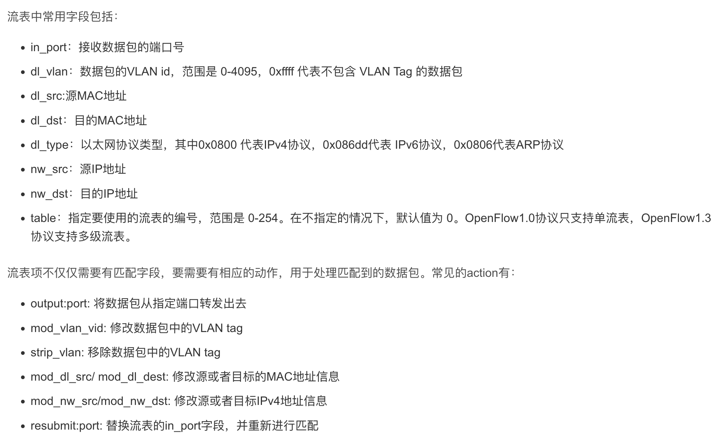

# ovs-dpctl

**ovs-dpctl**：可以统计每条 datapath 上的设备通过的流量，打印流的信息。datapath模块是最底层交换机机制的实现，功能是接收网包-查表-执行action。

```
root@n248-187-151:~# ovs-dpctl show
system@ovs-system:
	lookups: hit:6 missed:571 lost:0
	flows: 0
	masks: hit:593 total:1 hit/pkt:1.03
	port 0: ovs-system (internal)
	port 1: testbr (internal)
	port 2: vetha
	port 3: vethc
```

```
root@n248-187-151:~# ovs-vsctl set Port vetha tag=100
root@n248-187-151:~# ip netns exec ns1 ping -c1 192.168.1.2
PING 192.168.1.2 (192.168.1.2) 56(84) bytes of data.
64 bytes from 192.168.1.2: icmp_seq=1 ttl=64 time=0.911 ms

--- 192.168.1.2 ping statistics ---
1 packets transmitted, 1 received, 0% packet loss, time 0ms
rtt min/avg/max/mdev = 0.911/0.911/0.911/0.000 ms
root@n248-187-151:~# ovs-dpctl dump-flows system@ovs-system
recirc_id(0),in_port(3),eth(src=92:60:f4:86:da:8c,dst=f6:e3:82:79:08:95),eth_type(0x0806), packets:0, bytes:0, used:never, actions:2
recirc_id(0),in_port(2),eth(src=f6:e3:82:79:08:95,dst=ff:ff:ff:ff:ff:ff),eth_type(0x0806),arp(sip=192.168.1.1,tip=192.168.1.2,op=1/0xff), packets:0, bytes:0, used:never, actions:push_vlan(vid=100,pcp=0),1,pop_vlan,3
recirc_id(0),in_port(3),eth(src=92:60:f4:86:da:8c,dst=f6:e3:82:79:08:95),eth_type(0x0800),ipv4(frag=no), packets:0, bytes:0, used:never, actions:2
recirc_id(0),in_port(2),eth(src=f6:e3:82:79:08:95,dst=92:60:f4:86:da:8c),eth_type(0x0800),ipv4(frag=no), packets:0, bytes:0, used:never, actions:3
```

# demo1

首先，电脑只有一个eth0接口，与IP协议栈直连，通过DHCP获取IP地址并上网

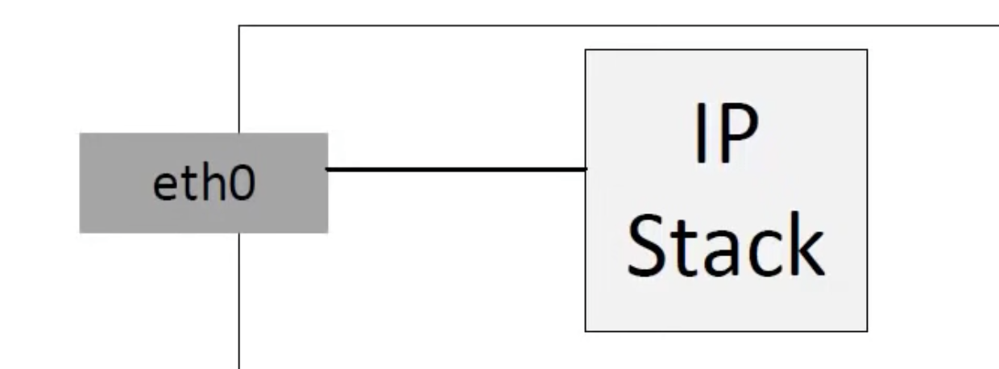

使用ovs创建一个bridge：

```
ovs-vsctl add-br mybridge
```

于是：

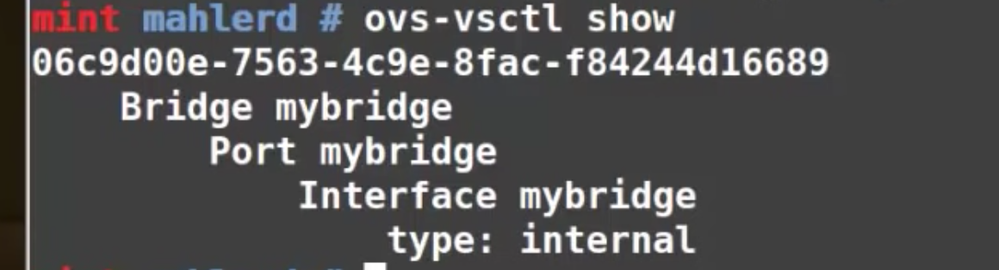

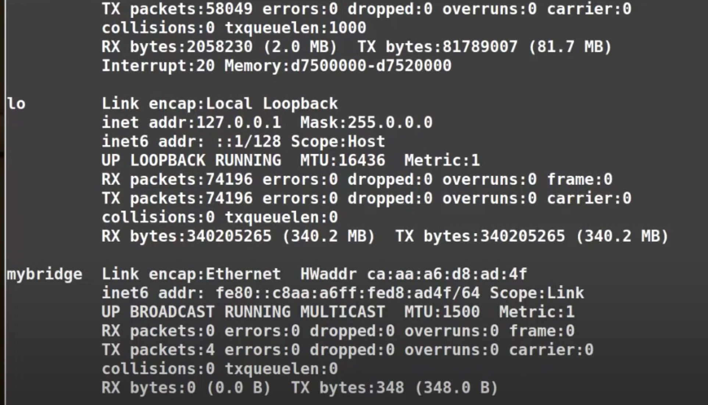

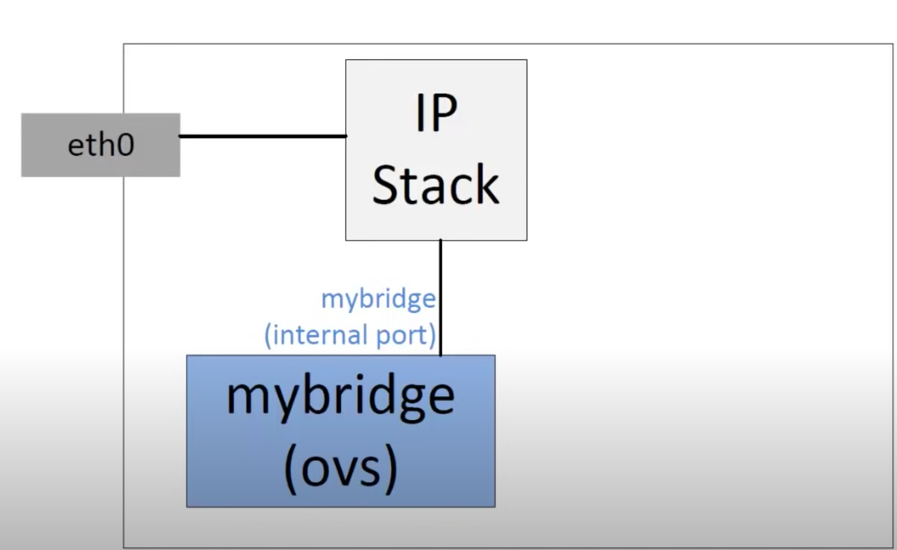

此时mybridge连接到了IP协议栈

然后，将eth0添加到mybridge中：

```
ovs-vsctl add-port mybridge eth0
```

此时，电脑无法再上网

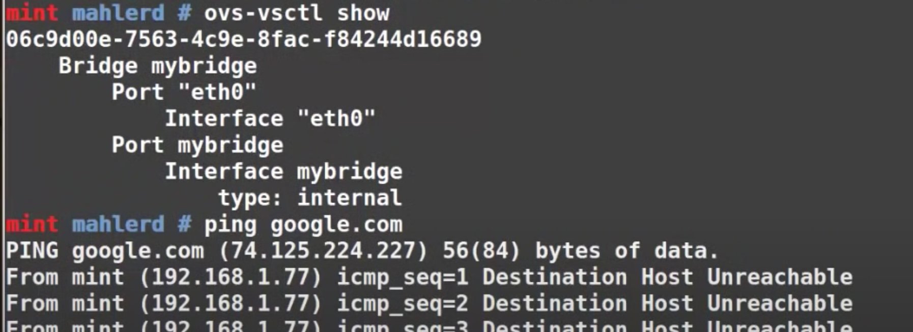

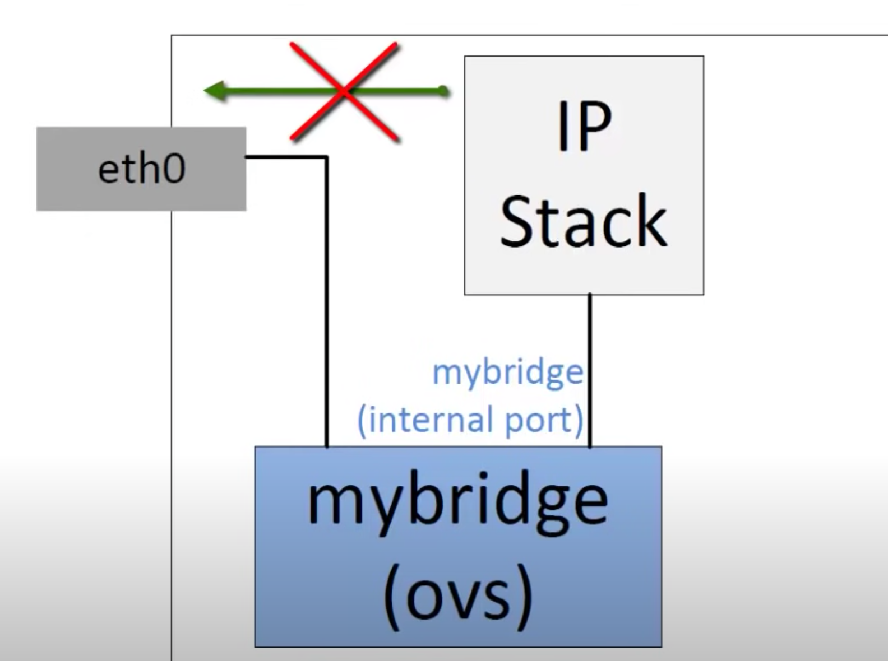

为了访问外部网络，需要清空eth0的IP，为mybridge配置DHCP

```
# 将指定网络接口 eth0 的 IP 地址设置为 0.0.0.0。这个命令通常用于暂时禁用网络
# 接口或将其配置为静态 IP 地址之前清除其现有的 IP 地址。
# 当执行此命令时，网络接口 eth0 将不再具有有效的 IP 地址，这意味着该接口将无法
# 与其他计算机或网络通信。但是，该接口仍然可以保留其 MAC 地址和其他网络配置信息。
$ ifconfig eth0 0
# 将mybridge设置为DHCP客户端
$ dhclient mybridge
```

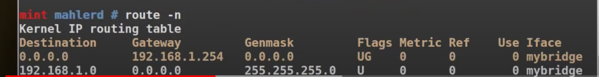

这样机器即可访问外部网站

创建两个port连接到mybridge

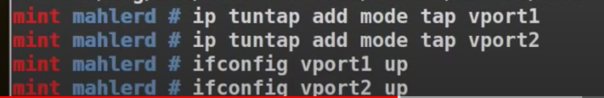

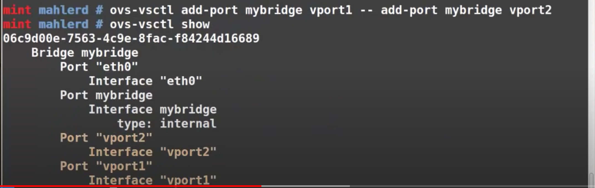

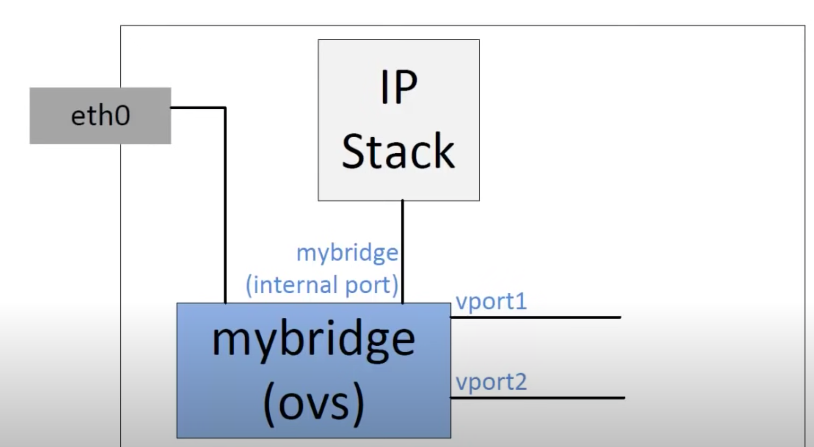

接下来，为这两个vport绑定两台虚拟机

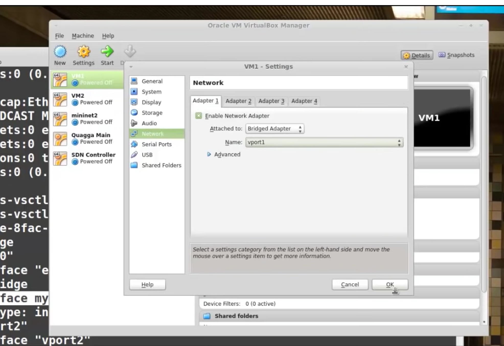

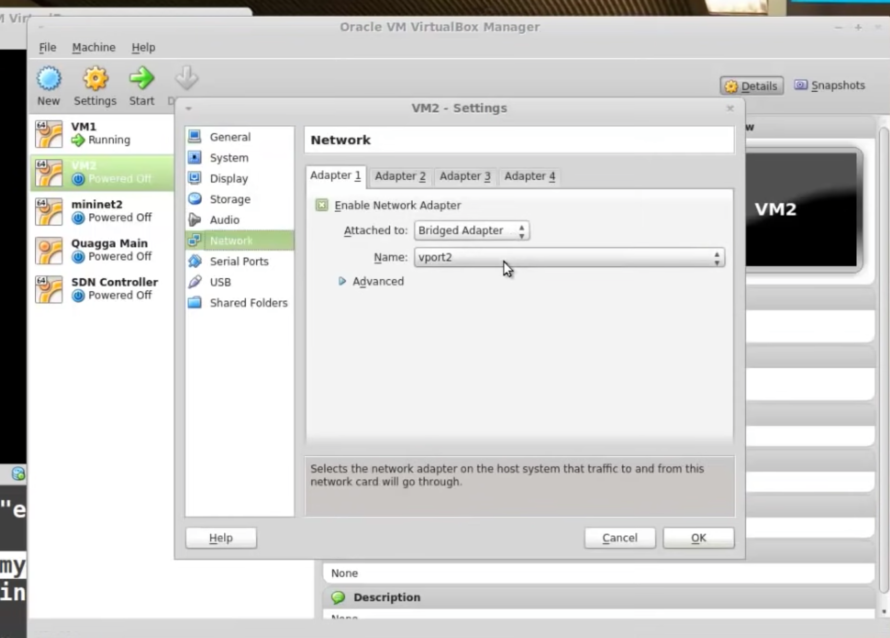

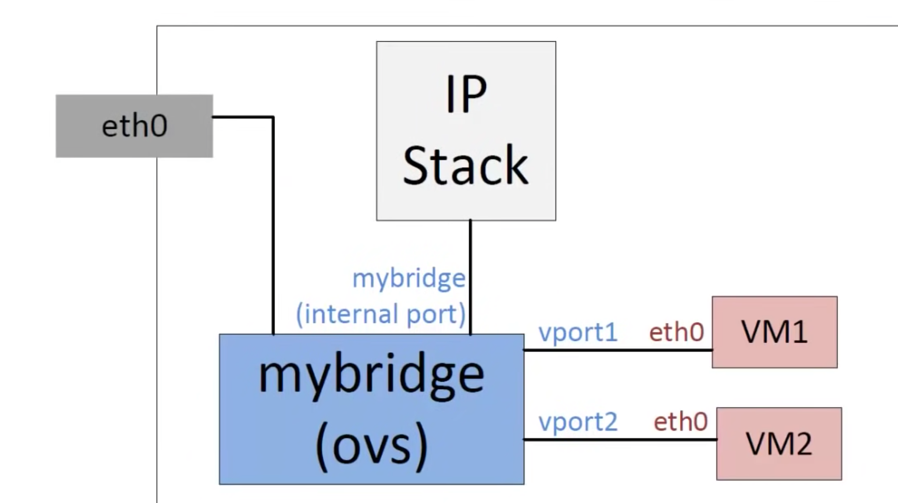

两个虚拟机均可访问外网

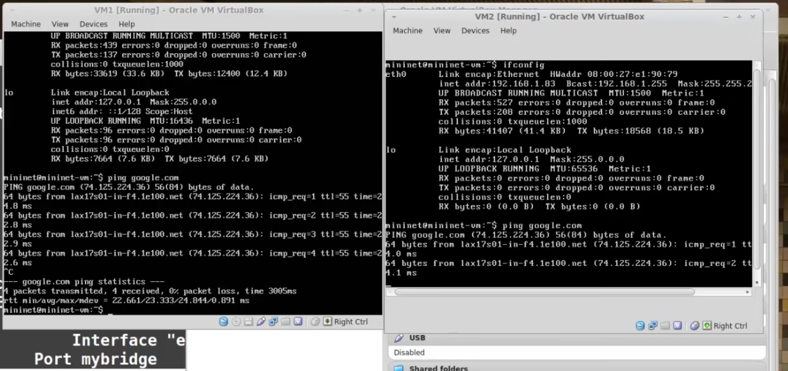
