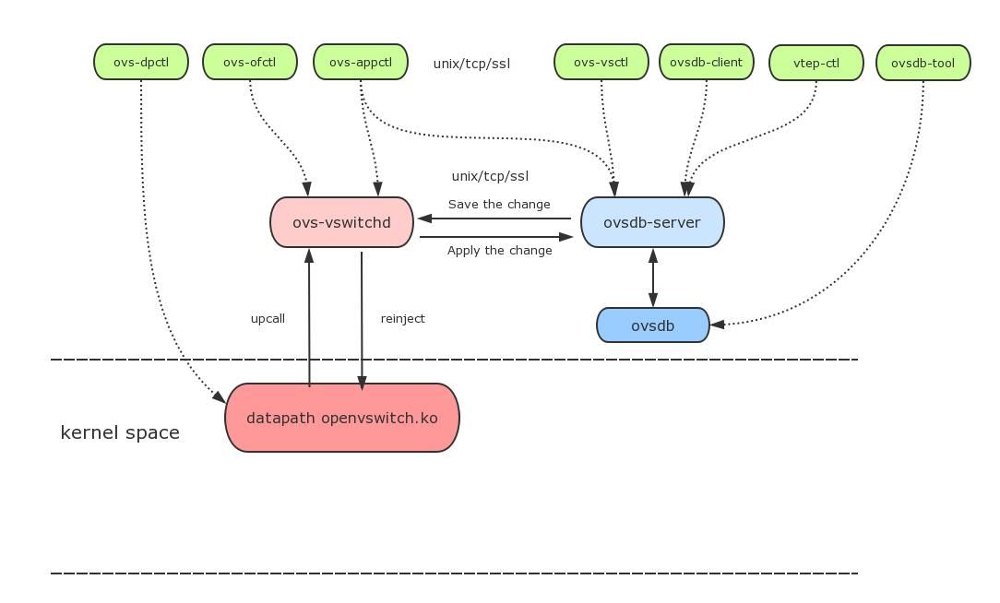
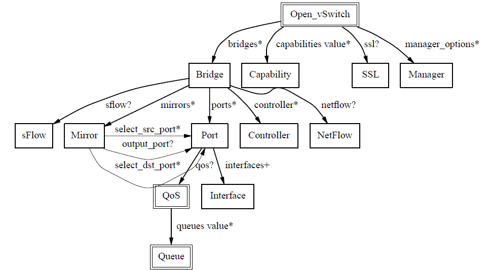

# 介绍

在过去，数据中心的服务器是直接连在硬件交换机上，后来VMware实现了服务器虚拟化技术，使虚拟服务器(VMs)能够连接在虚拟交换机上，借助这个虚拟交换机，可以为服务器上运行的VMs或容器提供逻辑的虚拟的以太网接口，这些逻辑接口都连接到虚拟交换机上，有三种比较流行的虚拟交换机: VMware virtual switch, Cisco Nexus 1000V,和Open vSwitch

Open vSwitch(OVS)是运行在虚拟化平台上的虚拟交换机，其支持OpenFlow协议，也支持gre/vxlan/IPsec等隧道技术。在OVS之前，基于Linux的虚拟化平台比如KVM或Xen上，缺少一个功能丰富的虚拟交换机，因此OVS迅速崛起并开始在Xen/KVM中流行起来，并且应用于越来越多的开源项目，比如openstack neutron中的网络解决方案

在虚拟交换机的Flow控制器或管理工具方面，一些商业产品都集成有控制器或管理工具，比如Cisco 1000V的Virtual Supervisor Manager(VSM)，VMware的分布式交换机中的vCenter。而OVS则需要借助第三方控制器或管理工具实现复杂的转发策略。例如OVS支持OpenFlow 协议，我们就可以使用任何支持OpenFlow协议的控制器来对OVS进行远程管理。OpenStack Neutron中的ML2插件也能够实现对OVS的管理。但这并不意味着OVS必须要有一个控制器才能工作。在不连接外部控制器情况下，OVS自身可以依靠MAC地址学习实现二层数据包转发功能，就像Linux Bridge

在基于Linux内核的系统上，应用最广泛的还是系统自带的虚拟交换机Linux Bridge，它是一个单纯的基于MAC地址学习的二层交换机，简单高效，但同时缺乏一些高级特性，比如OpenFlow,VLAN tag,QOS,ACL,Flow等，而且在隧道协议支持上，Linux Bridge只支持vxlan，OVS支持gre/vxlan/IPsec等，这也决定了OVS更适用于实现SDN技术

OVS支持以下[features](https://link.jianshu.com?t=http%3A%2F%2Fopenvswitch.org%2Ffeatures%2F)

- 支持NetFlow, IPFIX, sFlow, SPAN/RSPAN等流量监控协议
- 精细的ACL和QoS策略
- 可以使用OpenFlow和OVSDB协议进行集中控制
- Port bonding，LACP，tunneling(vxlan/gre/Ipsec)
- 适用于Xen，KVM，VirtualBox等hypervisors
- 支持标准的802.1Q VLAN协议
- 基于VM interface的流量管理策略
- 支持组播功能
- flow-caching engine(datapath模块)

# 组成

ovs交换机的组成：

- **ovs-vswitchd：**ovs守护进程，实现基于流的交换，实现内核datapath upcall 处理以及ofproto 查表，同时是dpdk datapath处理程序。与ovsdb-server通信使用OVSDB协议，与内核模块使用netlink机制通信，与controller通信使用OpenFlow协议。
- **ovsdb-server：**OVS 轻量级的数据库服务器的服务程序，用于保存整个 OVS 的配置信息。数据库服务程序, 使用目前普遍认可的ovsdb 协议。
- **ovs-vsctl：**网桥、接口等的创建、删除、设置、查询等。
- **ovs-dpctl：**配置vswitch内核模块
- **ovs-appctl：**发送命令消息到ovs-vswithchd, 查看不同模块状态
- **ovs-ofctl：**下发流表信息。该命令可以配置其他openflow 交换机（采用openflow 协议）
- **datapath:** Datapath把流的match和action结果缓存，避免后续同样的流继续upcall到用户空间进行流表匹配。
- **ovs-db：**开放虚拟交换机数据库是一种轻量级的数据库，它是一个JSON文件，默认路径:/etc/openvswitch/conf.db;

可以通过命令ovsdb-client dump将数据库结构打印出来。OVSDB中包含一系列记录网桥、端口、QoS等网络配置信息的表，这些表均以JSON格式保存。

每一个ovs交换机中，数据库中存在的表如下：

数据包处理流程：

1.ovs的datapath接收到从ovs连接的某个网络设备发来的数据包，从数据包中提取源/目的IP、源/目的MAC、端口等信息。

2.ovs在内核状态下查看流表结构（通过Hash），观察是否有缓存的信息可用于转发这个数据包。

3.假设数据包是这个网络设备发来的第一个数据包，在OVS内核中，将不会有相应的流表缓存信息存在，那么内核将不会知道如何处置这个数据包。所以内核将发送upcall给用户态。

4.ovs-vswitchd进程接收到upcall后，将检查数据库以查询数据包的目的端口是哪里，然后告诉内核应该将数据包转发到哪个端口，例如eth0。

5.内核执行用户此前设置的动作。即内核将数据包转发给端口eth0，进而数据被发送出去。

Bridge：网桥，一个Bridge代表一个交换机，Bridge可以根据一定的规则，把某一个端口接收到的数据报文转发到另一个或多个端口上，也可以修改或者丢弃数据报文。

Port：**端口**，需要注意的是它和TCP里面的端口不是同样的概念，它更像是物理交换机上面的插口，可以接水晶头的那种。Port隶属于Bridge，必须先添加了Bridge才能在Bridge上添加Port。Port有以下几种类型：

- **Normal**：用户可以把操作系统中已有的网卡添加到Open vSwitch上，Open vSwitch会自动生成一个同名的Port开处理这张网卡进和出的数据报文。  
    不过需要注意的是这种方式添加的Port不支持分配IP地址，如果之前网卡上配置的有IP，挂载到OVS上面之后将不可访问。此类型的Port常用于VLAN模式的多台物理主机相连的那个口，交换机一端属于Trunk模式。
- **Internal**：当Port的类型是Internal时，OVS会自动创建一个[虚拟网卡](https://www.zhihu.com/search?q=%E8%99%9A%E6%8B%9F%E7%BD%91%E5%8D%A1&search_source=Entity&hybrid_search_source=Entity&hybrid_search_extra=%7B%22sourceType%22%3A%22article%22%2C%22sourceId%22%3A%22336487371%22%7D)（Interface），此端口收到的数据报文都会转发给这块网卡，从这块网卡发出的数据报文也会通过Port交给OVS处理。当OVS创建一个新的网桥时，会自动创建一个与网桥同名的Internal Port，同时也会创建一个与网桥同名的Interface，因此可以通过ip命令在操作系统中查看到这张虚拟网卡，但是状态是down的。
- **Patch**：Patch Port和veth pair功能相同，总是成双成对的出现，在其中一端收到的数据报文会被转发到另一个Patch Port上，就像是一根网线一样。Patch Port常用于连接两个Bridge，这样两个网桥就和一个网桥一样了。
- **Tunnel**：OVS 支持 GRE、VXLAN、STT、Geneve和IPsec隧道协议，这些隧道协议就是overlay网络的基础协议，通过对物理网络做的一层封装和扩展，解决了二层网络数量不足的问题，最大限度的减少对底层物理网络拓扑的依赖性，同时也最大限度的增加了对网络的控制。

**Interface**：（iface/接口）接口是OVS与操作系统交换数据报文的组件，一个接口即是操作系统上的一块网卡，这个网卡可能是OVS生成的虚拟网卡，也有可能是挂载在OVS上的物理网卡，操作系统上的虚拟网卡（TUN/TAP）也可以被挂载在OVS上。

**Controller：**OpenFlow控制器，OVS可以接收一个或者多个OpenFlow控制器的管理，功能主要是下发流表，控制转发规则。

**Flow**：流表是OVS进行数据转发的核心功能，定义了端口之间转发数据报文的规则，一条流表规则主要分为匹配和动作两部分，匹配部分决定哪些数据报文需要被处理，动作决定了匹配到的数据报文该如何处理。
