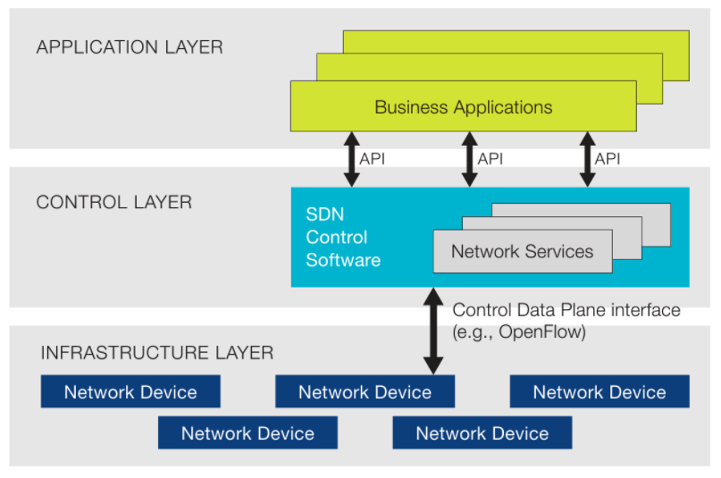

# 软件定义网络（SDN）

软件定义网络（Software-Defined Networking，SDN）是一类网络架构思想，核心是将控制逻辑与数据转发解耦，并通过可编程接口提升网络自动化能力。它并非由单一机构或单一协议定义；OpenFlow 是早期具有代表性的南向协议之一，但 **SDN 不等于 OpenFlow**。

传统网络设备往往将控制逻辑与转发功能集中在同一设备中。SDN 可以将部分或全部控制逻辑集中到控制器，也可以采用分布式控制器集群：控制器维护逻辑上的全局视图、计算策略或路径，并通过南向接口将期望状态或转发表下发到设备；上层应用通过北向接口表达业务意图、策略与自动化流程。

**通用 SDN 架构图**：

通常将控制器面向应用/编排系统的接口称为**北向接口**，面向网络设备或代理的接口称为**南向接口**。二者均不存在唯一的行业标准：南向接口可以是 OpenFlow、NETCONF/RESTCONF、gNMI、P4Runtime 或厂商 API；北向接口通常是控制器提供的 REST、gRPC 或意图 API。

## 基本特征

- 控制与转发解耦：数据平面负责按规则高速转发；控制平面负责计算、下发和回收规则。二者可以物理分离，也可以只在逻辑上分层。
- 可编程接口：通过北向和南向 API 将业务策略转换为网络期望状态，减少逐设备手工配置。
- 逻辑集中、实现可分布：控制器可以以集群方式部署以满足规模与高可用需求，同时向应用提供统一的抽象。
- 闭环可观测：采集拓扑、状态、指标与事件，验证实际网络是否收敛到期望状态；没有遥测与回滚，自动化难以安全运行。

## 与 EVPN + VXLAN 的关系

EVPN + VXLAN 可以由集中式 SDN 控制器编排，也可以使用分布式 MP-BGP EVPN 控制平面独立运行。二者不是替代关系：控制器可负责租户、VNI、RT 与策略的生命周期管理，EVPN 则负责在网络设备间分发 MAC/IP、VTEP 与多归属状态。详见 [EVPN + VXLAN](EVPNVXLAN.md)。
