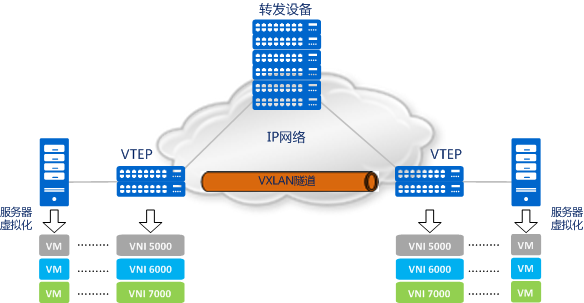
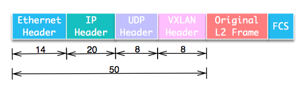
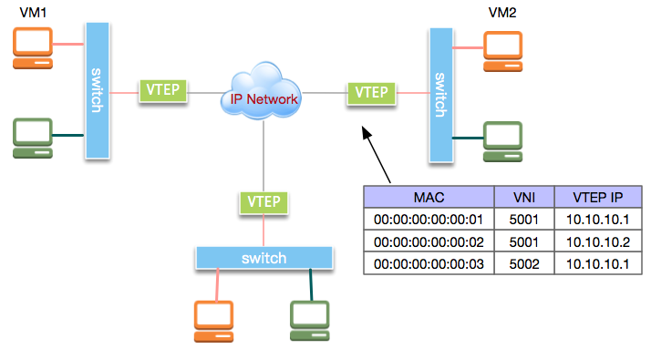
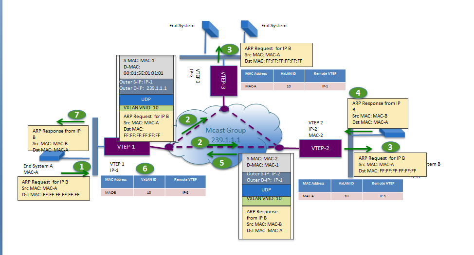
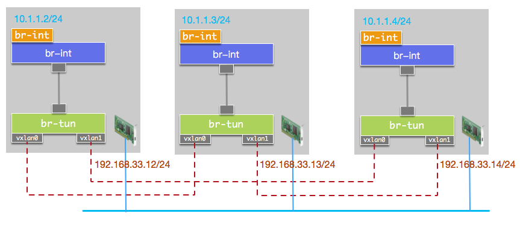
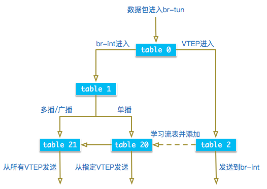

VXLAN 全称是 Virtual eXtensible Local Area Network，虚拟可扩展的局域网。它是一种 overlay 技术，通过三层的网络来搭建虚拟的二层网络。rfc7348 (参考资料1) 上的介绍是这样的：

A framework for overlaying virtualized layer 2 networks over layer 3 networks.

每一个技术出来都有它要解决的问题，VXLAN 也不例外，那么我们先看看 VXLAN 到底要解决哪些问题。

- 虚拟化（虚拟机和容器）的兴起使得一个数据中心会有成千上万的机器需要通信，而传统的 VLAN 技术只能支持 4096 个网络上限，已经满足不了不断扩展的数据中心规模
- 越来越多的数据中心（尤其是公有云服务）需要提供多租户的功能，不同用户之间需要独立地分配 ip 和 MAC 地址，如何保证这个功能的扩展性和正确性也是一个待解决的问题
- 云计算业务对业务灵活性要求很高，虚拟机可能会大规模迁移，并保证网络一直可用，也就是大二层的概念。解决这个问题同时保证二层的广播域不会过分扩大，也是云计算网络的要求
- 构建Overlay网络后，虚拟机可以分布在任意机器上，不受物理机的限制

传统二层+三层的网络在应对这些要求时变得力不从心，虽然很多改进型的技术比如堆叠、SVF、TRILL 等能够增加二层的范围，努力改进经典网络，但是要做到对网络改动小同时保证灵活性高却非常困难。

# VXLAN 模型

vxlan 这类隧道网络的一个特点是对原有的网络架构影响小，原来的网络不需要做任何改动，在原来网络基础上架设一层新的网络。

vxlan 自然会引入一些新的概念，这部分就讲讲它们。下面这张图 是 vxlan 的工作模型，它创建在原来的 IP 网络（三层）上，只要是三层可达（能够通过 IP 互相通信）的网络就能部署 vxlan。在每个端点上都有一个 vtep 负责 vxlan 协议报文的封包和解包，也就是在虚拟报文上封装 vtep 通信的报文头部。物理网络上可以创建多个 vxlan 网络，这些 vxlan 网络可以认为是一个隧道，不同节点的虚拟机能够通过隧道直连。每个 vxlan 网络由唯一的 VNI 标识，不同的 vxlan 可以不相互影响。



- VTEP（VXLAN Tunnel Endpoints）：vxlan 网络的边缘设备，用来进行 vxlan 报文的处理（封包和解包）。vtep 可以是网络设备（比如交换机），也可以是一台机器（比如虚拟化集群中的宿主机）
- VNI（VXLAN Network Identifier）：VNI 是每个 vxlan 的标识，是个 24 位整数，一共有 2^24 = 16,777,216（一千多万），一般每个 VNI 对应一个租户，也就是说使用 vxlan 搭建的公有云可以理论上可以支撑千万级别的租户
- Tunnel：隧道是一个逻辑上的概念，在 vxlan 模型中并没有具体的物理实体相对应。隧道可以看做是一种虚拟通道，vxlan 通信双方（图中的虚拟机）认为自己是在直接通信，并不知道底层网络的存在。从整体来说，每个 vxlan 网络像是为通信的虚拟机搭建了一个单独的通信通道，也就是隧道

# VXLAN报文



从这个报文中可以看到三个部分：

1. 最外层的 UDP 协议报文用来在底层网络上传输，也就是 vtep之间互相通信的基础
2. 中间是 VXLAN 头部，vtep 接受到报文之后，去除前面的 UDP 协议部分，根据这部分来处理 vxlan 的逻辑，主要是根据 VNI 发送到最终的虚拟机
3. 最里面是原始的报文，也就是虚拟机看到的报文内容

**Original L2 可以是各种协议成的帧**

报文各个部分的意义如下：

- VXLAN header：vxlan 协议相关的部分，一共 8 个字节

- VXLAN flags：标志位
- Reserved：保留位
- VNID：24 位的 VNI 字段，这也是 vxlan 能支持千万租户的地方
- Reserved：保留字段

- UDP 头部，8 个字节

- UDP 应用通信双方是 vtep 应用，其中目的端口就是接收方 vtep 使用的端口，IANA 分配的端口是 4789

- IP 头部：20 字节

- 主机之间通信的地址，可能是主机的网卡 IP 地址，也可能是多播 IP 地址

- Ethernet 头部：14 字节

- 主机之间通信的 MAC 地址，源 MAC 地址为主机 MAC 地址，目的 MAC 地址为下一跳设备的 MAC 地址

可以看出 vxlan 协议比原始报文多 50 字节的内容，这会降低网络链路传输有效数据的比例。vxlan 头部最重要的是 VNI 字段，其他的保留字段主要是为了未来的扩展，目前留给不同的厂商用这些字段添加自己的功能。

VXLAN的整体应用示意拓朴结构如图:



我们来看VXLAN的通信过程。在上图的虚拟机VM1和VM2处于逻辑二层网络中。VM1发出的二层以太网帧由VTEP封装进IP数据包，之后发送到VM2所在主机。VM2所在主机接收到IP报文后，解封装出原始的以太网帧再转发给VM2。然而，VM1所在主机的VTEP做完数据封装后，如何知道要将封装后的数据包发到哪个VTEP呢？

实际上，VTEP通过查询转发表来确定目标VTEP地址，而转发表通过泛洪和学习机制来构建。FDB的key为MAC地址，其他列可以有重复。

目标MAC地址在转发表中不存在的流量称为未知单播(Unknown unicast)。广播(broadcast)、未知单播(unknown unicast)和组播(multicast)一般统称为BUM流量。VXLAN规范要求BUM流量使用IP组播进行洪泛，将数据包发送到除源VTEP外的所有VTEP。目标VTEP发送回响应数据包时，源VTEP从中学习MAC地址、VNI和VTEP的映射关系，并添加到转发表中。后续VTEP再次发送数据包给该MAC地址时，VTEP会从转发表中直接确定目标VTEP，从而只发送单播数据到目标VTEP。

# vxlan 网络通信过程

通过上节的内容，我们大致了解 vxlan 报文的发送过程。虚拟机的报文通过 vtep 添加上 vxlan 以及外部的报文层，然后发送出去，对方 vtep 收到之后拆除 vxlan 头部然后根据 VNI 把原始报文发送到目的虚拟机。

上面的过程是双方已经知道所有通信信息的过程，但是在第一次通信之前还有很多问题有解决：

- 哪些 vtep 需要加到一个相同的 VNI 组？
- 发送方虚拟机怎么知道对方的 MAC 地址？
- vtep 怎么知道目的虚拟机在哪一台宿主机上？

这三个问题可以归结为同一个问题：vxlan 网络怎么感知彼此的存在并选择正确的路径传输报文？

而且第一个问题也是不用回答的，因为 vtep 形成的组是虚构的概念，只要某些 vtep 能够正确地传递报文，它们就是在同一个组内。也就是说，我们只要回答后面两个问题就行。

要回答这两个问题，我们还是回到 vxlan 协议报文上，看看一个完整的 vxlan 报文需要哪些信息。

- 内层报文：通信的虚拟机双方要么直接使用 IP 地址，要么通过 DNS 等方式已经获取了对方的 IP 地址，因此网络层地址已经知道。同一个网络的虚拟机需要通信，还需要知道**对方虚拟机的 MAC 地址**，vxlan 需要一个机制来实现传统网络 ARP 的功能
- vxlan 头部：只需要知道 VNI，这一般是直接配置在 vtep 上的，要么是提前规划写死的，要么是根据内部报文自动生成的，也不需要担心
- UDP 头部：最重要的是源地址和目的地址的端口，源地址端口是系统生成并管理的，目的端口也是写死的，比如 IANA 规定的 4789 端口，这部分也不需要担心
- IP 头部：IP 头部关心的是 vtep 双方的 IP 地址，源地址可以很简单确定，目的地址是**虚拟机所在地址宿主机 vtep 的 IP 地址**，这个也需要由某种方式来确定
- MAC 头部：如果 vtep 的 IP 地址确定了，MAC 地址可以通过经典的 ARP 方式来获取，毕竟 vtep 网络在同一个三层，经典网络架构那一套就能直接用了

总结一下，一个 vxlan 报文需要确定两个地址信息：目的虚拟机的 MAC 地址和目的 vtep 的 IP 地址，如果 VNI 也是动态感知的，那么 vtep 就需要一个三元组：

内部 MAC <—> VNI <—> VTEP IP

根据实现的不同，一般分为两种方式：多播和控制中心。多播的概念是同个 vxlan 网络的 vtep 加入到同一个多播网络，如果需要知道以上信息，就在组内发送多播来查询；控制中心的概念是在某个集中式的地方保存了所有虚拟机的上述信息，自动化告知 vtep 它需要的信息。

## 多播

简单来说，每个多播组对应一个多播 IP 地址，往这个多播 IP 地址发送的报文会发给多播组的所有主机。

为什么要使用多播？因为 vxlan 的底层网络是三层的，广播地址无法穿越三层网络，要给 vxlan 网络所有 vtep 发送报文只能通过多播。



vtep 建立的时候会通过配置加入到多播组（具体做法取决于实现），图中的多播组 IP 地址是 239.1.1.1。

路由器会定期发出组播的请求，连到同一个路由器的机器会向路由器答复自己所在的组，目的地址为组播时，路由器会把报文发送给组里的所有机器。同一个机器可以属于两个组，取决于机器上的网络接口的组播地址。

1. 机器 A 只知道对方的 IP 地址，不知道 MAC 地址，因此会发送 ARP 报文进行查询，内部的 ARP 报文很普通，目标地址为全 1 的广播地址
2. vtep 收到 ARP 报文，发现虚拟机目的 MAC 为广播地址，封装上 vxlan 协议头部之后（外层 IP 为多播组 IP，MAC 地址为多播组的 MAC 地址），发送给多播组 239.1.1.1，支持多播的底层网络设备（交换机和路由器）会把报文发送给组内所有的成员
3. vtep 接收到 vxlan 封装的 ARP 请求，去掉 vxlan 头部，并通过报文学习到发送方 <虚拟机 MAC - VNI - Vtep IP> 三元组保存起来，把原来的 ARP 报文广播给主机
4. 主机接收到 ARP 请求报文，如果 ARP 报文请求的是自己的 MAC 地址，就返回 ARP 应答
5. vtep-2 此时已经知道发送方的虚拟机和 vtep 信息，把 ARP 应答添加上 vxlan 头部（外部 IP 地址为 vtep-1 的 IP 地址，VNI 是原来报文的 VNI）之后通过单播发送出去
6. vtep-1 接收到报文，并学习到报文中的三元组，记录下来。然后 vtep 进行解包，知道内部的 IP 和 MAC 地址，并转发给目的虚拟机
7. 虚拟机拿到 ARP 应答报文，就知道了到目的虚拟机的 MAC 地址

在这个过程中，只有一次多播，因为 vtep 有自动学习的能力，后续的报文都是通过单播直接发送的。可以看到，多播报文非常浪费，每次的多播其实只有一个报文是有效的，如果某个多播组的 vtep 数量很多，这个浪费是非常大的。但是多播组也有它的实现起来比较简单，不需要中心化的控制，只有底层网络支持多播，只有配置好多播组就能自动发现了。

单播报文的发送过程就是上述应答报文的逻辑，应该也非常容易理解了。还有一种通信方式，那就是不同 VNI 网络之间的通信，这个需要用到 vxlan 网关（可以是物理网络设备，也可以是软件），它接收到一个 vxlan 网络报文之后解压，根据特定的逻辑添加上另外一个 vxlan 头部转发出去。

因为并不是所有的网络设备都支持多播，再加上多播方式带来的报文浪费，在实际生产中这种方式很少用到。

## 分布式控制中心

从多播的流程可以看出来，其实 vtep 发送报文最关键的就是知道对方虚拟机的 MAC 地址和虚拟机所在主机的 vtep IP 地址。如果能够事先知道这两个信息，直接告诉 vtep，那么就不需要多播了。

在虚拟机和容器的场景中，当虚拟机或者容器启动还没有进行网络通讯时，我们就可以知道它的 IP 和 MAC（可能是用某种方式获取，也有可能是事先控制这两个地址），分布式控制中心保存了这些信息。除此之外，控制中心还保存了每个 vxlan 网络有哪些 vtep，这些 vtep 的地址是多少。有了这些信息，vtep 就能发送报文时直接查询并添加头部，不需要多播去满网络地问了。

一般情况下，在每个 vtep 所在的节点都会有一个 agent，它会和控制中心通信，获取 vtep 需要的信息以某种方式告诉 vtep。具体的做法取决于具体的实现，每种实现可能会更新不同的信息给 vtep，比如 HER（Head End Replication）只是把多播组替换成多个单播报文，也就是把多播组所有的 VTEP IP 地址告诉 vtep，这样查询的时候不是发送多播，而是给组内每个 vtep 发送一个单播报文；有些实现只是告诉 vtep 目的虚拟机的 MAC 地址信息；有些实现告诉 MAC 地址对应的 vtep IP 地址。

此外，什么时候告诉 vtep 这些信息也是有区别的。一般有两种方式：常见的是一旦知道了虚拟机的三元组信息就告诉 vtep（即使某个 vtep 用不到这个信息，因为它管理的虚拟机不会和这个地址通信），一般这时候第一次通信还没有发生；另外一种方式是在第一次通信时，当 vtep 需要这些信息的时候以某种方式通知 agent，然后 agent 这时候才告诉 vtep 信息。

分布式控制的 vxlan 是一种典型的 SDN 架构，也是目前使用最广泛的方式。

## 实验：

[https://blog.csdn.net/u014044624/article/details/106595164](https://blog.csdn.net/u014044624/article/details/106595164)

# OVS实现VXLAN

OVS不支持组播，需要为任意两个主机之间建立VXLAN单播隧道。与上边示例的拓朴结构相比，我们使用了两个OVS网桥，将虚拟逻辑网络的接口接入网桥br-int，将所有VXLAN接口接入br-tun。两个网桥使用PATCH类型接口进行连接。由于网桥br-tun上有多个VTEP，当BUM数据包从其中某个VTEP流入时，数据包会从其他VTEP接口再流出，这会导致数据包在主机之间无限循环。因而我们需要添加流表使VTEP流入的数据包不再转发至其他VTEP。若逻辑网络接口与VTEP连接同一网桥，配置流表将比较繁琐。单独将逻辑网络接口放到独立的网桥上，可以使流表配置非常简单，只需要设置VTEP流入的数据包从PATCH接口流出。

拓朴结构如图:



首先在主机1上创建网桥br-int和br-tun:

```
ovs-vsctl add-br br-int
ovs-vsctl add-br br-tun
```

创建PATCH接口连接br-int和br-tun:

```
ovs-vsctl add-port br-int patch-int -- set interface patch-int type=patch options:peer=patch-tun
ovs-vsctl add-port br-tun patch-tun -- set interface patch-tun type=patch options:peer=patch-int
```

创建单播VTEP连接主机2:

```
ovs-vsctl add-port br-tun vxlan0 -- set interface vxlan0 type=vxlan options:remote_ip=192.168.33.13
```

创建单播VTEP连接主机3:

```
ovs-vsctl add-port br-tun vxlan1 -- set interface vxlan1 type=vxlan options:remote_ip=192.168.33.14
```

接下来，我们给br-tun添加流表来处理流量。

首先查看br-tun上各接口的PORT ID，从结果看到Patch Port为1，VTEP分别为5和6:

```
[root@localhost vagrant]# ovs-ofctl show br-tun
OFPT_FEATURES_REPLY (xid=0x2): dpid:00006e12f4fd6949
n_tables:254, n_buffers:256
capabilities: FLOW_STATS TABLE_STATS PORT_STATS QUEUE_STATS ARP_MATCH_IP
actions: output enqueue set_vlan_vid set_vlan_pcp strip_vlan mod_dl_src mod_dl_dst mod_nw_src mod_nw_dst mod_nw_tos mod_tp_src mod_tp_dst
1(patch-tun): addr:92:fa:08:fb:3c:bf
     config:     0
     state:      0
     speed: 0 Mbps now, 0 Mbps max
5(vxlan0): addr:e6:65:c2:85:79:ea
     config:     0
     state:      0
     speed: 0 Mbps now, 0 Mbps max
6(vxlan1): addr:2a:38:b0:fa:b2:98
     config:     0
     state:      0
     speed: 0 Mbps now, 0 Mbps max
LOCAL(br-tun): addr:6e:12:f4:fd:69:49
     config:     PORT_DOWN
     state:      LINK_DOWN
     speed: 0 Mbps now, 0 Mbps max
OFPT_GET_CONFIG_REPLY (xid=0x4): frags=normal miss_send_len=0
```

清空br-tun流表:

```
ovs-ofctl del-flows br-tun
```

数据包进入br-tun后开始匹配table 0的流。我们使用table 0区分流量来源。来源于br-int的数据包由table 1处理，VTEP流入的数据交由table 2处理, 并丢弃其他PORT进入的数据包:

```
ovs-ofctl add-flow br-tun "table=0,priority=1,in_port=1 actions=resubmit(,1)”
ovs-ofctl add-flow br-tun "table=0,priority=1,in_port=5 actions=resubmit(,2)" 
ovs-ofctl add-flow br-tun "table=0,priority=1,in_port=6 actions=resubmit(,2)”
ovs-ofctl add-flow br-tun "table=0,priority=0,actions=drop”
```

接着添加table 1的流, table 1用于处理来自br-int的流量，单播数据包交由table 20处理，多播或广播数据包交由table 21处理:

```
ovs-ofctl add-flow br-tun "table=1,priority=0,dl_dst=00:00:00:00:00:00/01:00:00:00:00:00,actions=resubmit(,20)”
ovs-ofctl add-flow br-tun "table=1,priority=0,dl_dst=01:00:00:00:00:00/01:00:00:00:00:00,actions=resubmit(,21)”
```

table 21处理广播流量，将数据包从所有VTEP的PORT口发出:

```
ovs-ofctl add-flow br-tun "table=21,priority=0,actions=output:5,output:6”
```

table 2处理VTEP流入的数据包，在这里我们实现学习机制。来自VTEP的数据包到达后，table 2从中学习MAC地址，VNI、PORT信息，并将学习到的流写入table 20中，并将流量由PATCH口发送到br-int上, 并将学习到的流优先级设为1:

```
ovs-ofctl add-flow br-tun "table=2,priority=0,actions=learn(table=20,hard_timeout=300,priority=1,NXM_OF_ETH_DST[]=NXM_OF_ETH_SRC[],load:NXM_NX_TUN_ID[]->NXM_NX_TUN_ID[],output:NXM_OF_IN_PORT[]), output:1”
```

table 20处理单播流量，我们将默认流优先级设置为0。因为学习到的流优先级设置为1，因而只有匹配不到目标MAC的未知单播交由table 21处理，table 21将流量广播到所有VTEP:

```
ovs-ofctl add-flow br-tun "table=20,priority=0,actions=resubmit(,21)"
```

整体处理逻辑如图:



我们查看流表, 发现table 20中只有一条默认添加的流:

```
[root@localhost vagrant]# ovs-ofctl dump-flows br-tun table=20
NXST_FLOW reply (xid=0x4):
cookie=0x0, duration=1.832s, table=20, n_packets=0, n_bytes=0, idle_age=1, priority=0 actions=resubmit(,21)
```

我们从主机1访问主机3上的虚拟网络IP，访问成功:

```
[root@localhost vagrant]# ping 10.1.1.4 -c 2
PING 10.1.1.4 (10.1.1.4) 56(84) bytes of data.
64 bytes from 10.1.1.4: icmp_seq=1 ttl=64 time=1.45 ms
64 bytes from 10.1.1.4: icmp_seq=2 ttl=64 time=0.538 ms

--- 10.1.1.4 ping statistics ---
2 packets transmitted, 2 received, 0% packet loss, time 1002ms
rtt min/avg/max/mdev = 0.538/0.994/1.451/0.457 ms
```

我们再次查看流表, 发现table 20中已经多了一条学习到的流，下次再向该MAC发送数据包，数据将直接从PORT 6中发出:

```
[root@localhost vagrant]# ovs-ofctl dump-flows br-tun table=20
NXST_FLOW reply (xid=0x4):
cookie=0x0, duration=164.902s, table=20, n_packets=36, n_bytes=3360, hard_timeout=300, idle_age=19, hard_age=19, priority=1,dl_dst=ee:2c:09:42:0e:46 actions=load:0->NXM_NX_TUN_ID[],output:6
cookie=0x0, duration=223.811s, table=20, n_packets=1, n_bytes=98, idle_age=164, priority=0 actions=resubmit(,21)
```
