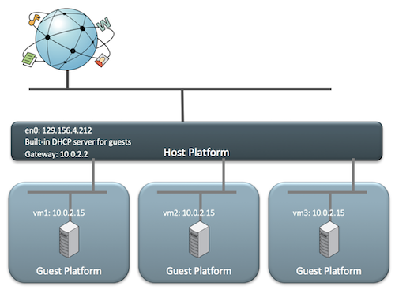
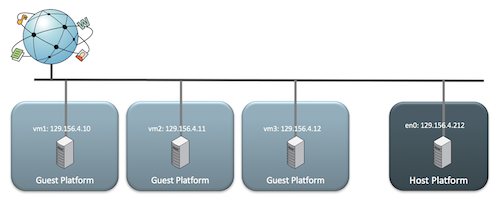
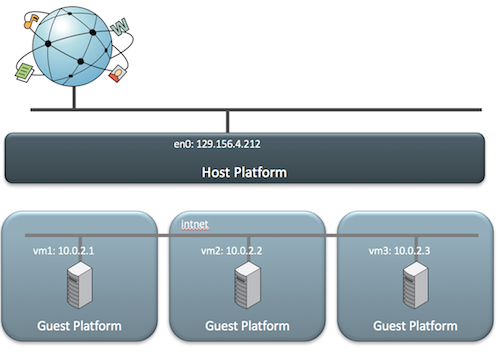
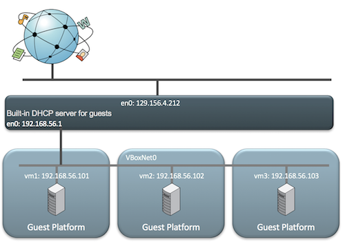
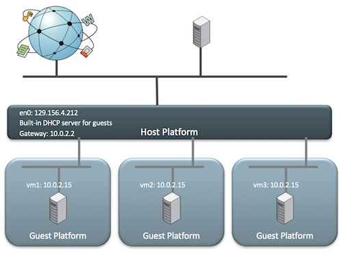

## 6.1 Network Address Translation (NAT)

在NAT模式下，当一个VM操作系统启动时，它通常通过发送一个DHCP Request来获取一个IP地址。VirtualBox将会处理这个DHCP Request，然后返回一个DHCP Response给VM，这个DHCP Response包含了一个IP地址以及网关地址，其中网关地址用于路由Outbound connections

在这种模式下，每一个VM被分配到的都是一个相同的IP（10.0.2.15），因为每一个VM都认为他们处于一个隔离的网络中，也就是说不同的VM之间无法感知到对方的存在

当VM通过网关（10.0.2.2）发送流量时，VirtualBox会重写数据包，使其看起来好像来自主机，而不是来自VM（在主机内运行）

逻辑上，网络看起来像下面这样

总结一下，NAT包含如下特征

1. VM处于一个私有的局域网
2. VirtualBox扮演着DHCP服务器的角色
3. VirtualBox Engine起到转换地址的作用
4. 适用于当VM作为Client的场景，因此不是适用于VM作为Server的场景
5. VM可以访问外界网络，而外界网络无法访问VM

## 6.2 Bridged Networking

当您希望您的VM成为完整的网络公民，即与网络上的主机相同时，使用Bridged Networking；在此模式下，虚拟NIC“桥接”到主机上的物理网卡

这样做的结果是每个VM都可以像访问主机一样访问物理网络。它可以像访问主机一样访问网络上的任何服务，例如外部DHCP服务，名称查找服务和路由信息

此时，网桥会作为DHCP客户端，获取可访问外网的IP地址

逻辑上，网络看起来像下面这样

总结一下，Bridged Networking网络包含如下特征

1. VirtualBox桥接到主机网络
2. 会消耗IP地址
3. 适用于Client VM或Server VM

## 6.3 Internal Networking

Internal Networking网络（在本例中为“intnet”）是一个完全隔离的网络，因此非常“安静”。当您需要一个单独的，干净的网络时，这适用于测试，您可以使用VM创建复杂的内部网络，为内部网络提供自己的服务。（例如Active Directory，DHCP等）。**请注意，即使主机也不是内部网络的成员**，但即使主机未连接到网络（例如，在平面上），此模式也允许VM运行

逻辑上，网络看起来像下面这样

请注意，在此模式下，VirtualBox不提供DHCP等“便利”服务，因此必须静态配置您的计算机，或者VM需要提供DHCP/名称服务

总结一下，Internal Networking网络包含如下特征

1. 不同VM之间处于同一个私有网络
2. VM无法访问外部网络
3. 宿主机断网时，VM也能正常工作（本来就不需要外网）

## 6.4 Host-only Networking

坐在这个“vboxnet0”网络上的所有VM都会看到对方，此外，主机也可以看到这些VM。但是，其他外部计算机无法在此网络上看到VM，因此名称为“Host-only”

逻辑上，网络看起来像下面这样

这看起来非常类似于Internal Networking，但主机现在位于“vboxnet0”并且可以提供DHCP服务

总结一下，Host-only Networking网络包含如下特征

1. VirtualBox为VM以及宿主机创建了一个私有网络
2. VirtualBox提供DHCP服务
3. VM无法看到外部网络
4. 宿主机断网时，VM也能正常工作（本来就不需要外网）

## 6.5 Port-Forwarding with NAT Networking

如果您在笔记本电脑上购买移动演示或开发环境并且您有一台或多台VM需要其他机器连接，该怎么办？而且你不断地跳到不同的VM网络上。在这样的场景下

1. NAT：无法满足，因为外部机器无法连接到VM上
2. Bridged：可以满足，但是会消耗IP资源，且VM网络环境随着外部网络环境的改变而改变
3. Internal：无法满足，因为外部机器无法连接到VM上
4. Host-only：无法满足，因为外部机器无法连接到VM上

当外部机器连接到宿主机的“host:port”时，VirtualBox会将连接forward到VM的“guest:port”上

逻辑上，网络看起来像下面这样（forward并没有在这张图体现出来，所以这幅图与NAT很像）

## 6.6 参考

- [Oracle VM VirtualBox: Networking options and how-to manage them](https://blogs.oracle.com/scoter/networking-in-virtualbox-v2)
- [Chapter 6. Virtual networking](https://www.virtualbox.org/manual/ch06.html#network_bridged)
- [VMware虚拟机三种网络模式详解](https://www.linuxidc.com/Linux/2016-09/135521.htm)
